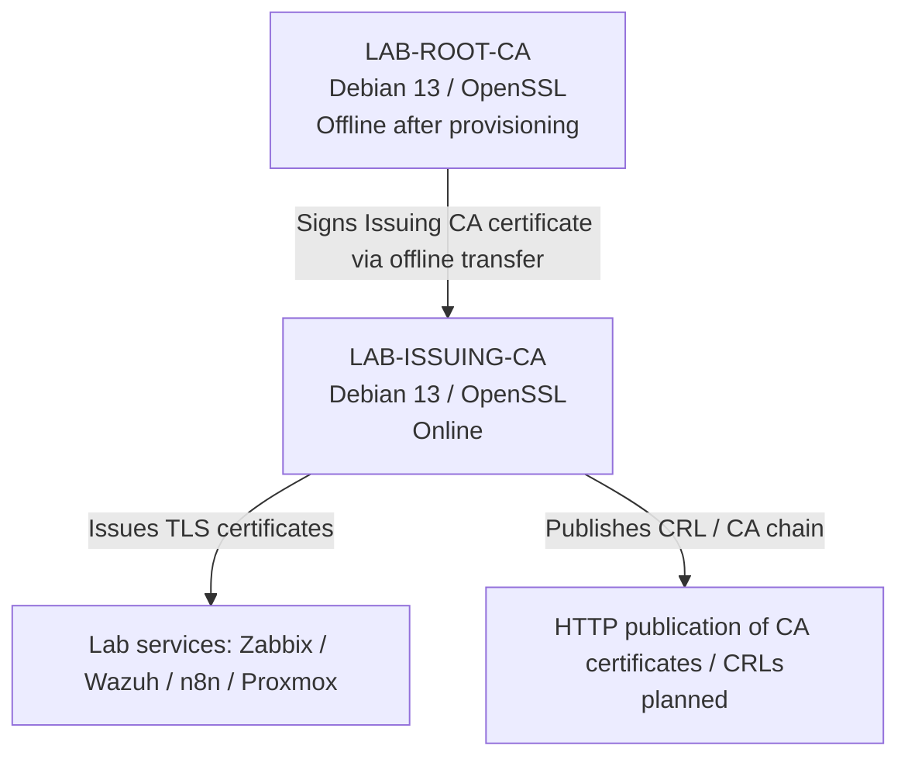

# Two-Tier PKI Deployment — Debian 13 (Home IT Lab)

> **Status:** Infrastructure preparation and hardening completed; CA deployment pending.

A documented Home IT Lab project to build a two-tier Public Key Infrastructure (PKI) with an **offline Root CA** and an **online Issuing CA**, using Debian 13 and OpenSSL. The project focuses on isolation of cryptographic keys, certificate lifecycle, CRL/AIA publication, auditing and verification.

## Architecture



| Role | Hostname | Lab IP | Target state |
| --- | --- | --- | --- |
| Root CA | `lab-root-ca` | `10.1.201.232/24` (provisioning only) | Offline, NIC disconnected |
| Issuing CA | `lab-issuing-ca` | `10.1.201.231/24` | Online |

**Note:** The addresses are LAB examples, not production PKI. Root CA must not remain network-connected once its private key is present.

## Current progress (2026-11-12)

- [x] Two Debian 13 virtual machines created in Hyper-V
- [x] Static IPs and DNS configured during provisioning
- [x] OpenSSH on port `2352`; root SSH login disabled
- [x] Separate Ed25519 SSH keys; password-based SSH authentication disabled and tested
- [x] UFW enabled and SSH access controlled
- [x] `umask 077` for the administration account
- [x] Kernel hardening settings applied
- [x] Lynis security audits performed (Issuing CA: **77/100**)
- [x] `auditd` audit rules prepared; Wazuh agent visible in Issuing CA audit
- [x] NTP time synchronization verified
- [x] ClamAV command-line scanner installed on Issuing CA; signature updater enabled
- [ ] Freeze architecture and publication hostnames
- [ ] Secure, offline Root CA key generation and OpenSSL CA setup
- [ ] Issuing CA key generation, CSR and offline signing
- [ ] CA distribution, CRL/AIA publication and validation
- [ ] Issue and validate first lab TLS certificate
- [ ] Encrypted backups and recovery test

The Lynis hardening index is a benchmark metric, **not a percentage of security**. No CA private keys have been generated as part of this repository.

## Documentation

- [Architecture and security assumptions](docs/01-architecture.md)
- [Debian preparation and hardening](docs/02-hardening.md)
- [CA deployment plan](docs/03-deployment-plan.md)
- [Verification checklist](docs/04-verification.md)

## Repository layout

```text
01-Two-Tier-PKI-Deployment/
├── README.md
├── docs/
├── configs/
│   ├── root-ca/
│   └── issuing-ca/
├── scripts/
└── screenshots/
    ├── root-ca/
    └── issuing-ca/
```

## Important security rules

**Never commit** CA private keys, unencrypted backups, real passwords, token files, secrets, production CA databases or sensitive logs. Keep Root CA network-isolated after provisioning. Treat all examples as documentation, not copy-paste production configuration.

## Scope

Independent lab PKI is recommended; do not copy live production CA keys from CreoConcept into a lab. If migrating a real CA, treat it as a separate, formally planned task with secure transport and controls.
