# Two-Tier PKI na Debianie 13 — Home IT Lab

> **Status: wdrożenie w toku** · **Aktualizacja: 16 listopada 2026 r.**  
> ✅ Root CA offline — utworzony • ✅ Certyfikat Issuing CA — podpisany i zweryfikowany • ⏳ Dystrybucja certyfikatów, CRL/AIA i testy HTTPS — w przygotowaniu.

Projekt dokumentuje **rzeczywistą, etapową budowę własnej dwupoziomowej infrastruktury klucza publicznego (PKI)** na dwóch VM z Debianem 13 w Hyper-V. Dokumentacja jest po polsku; zawiera wykorzystane polecenia, wyniki testów, zrzuty ekranu oraz celowo niewdrożone zalecenia. Jest to **środowisko laboratoryjne niezależne od produkcyjnego PKI**.

## Architektura

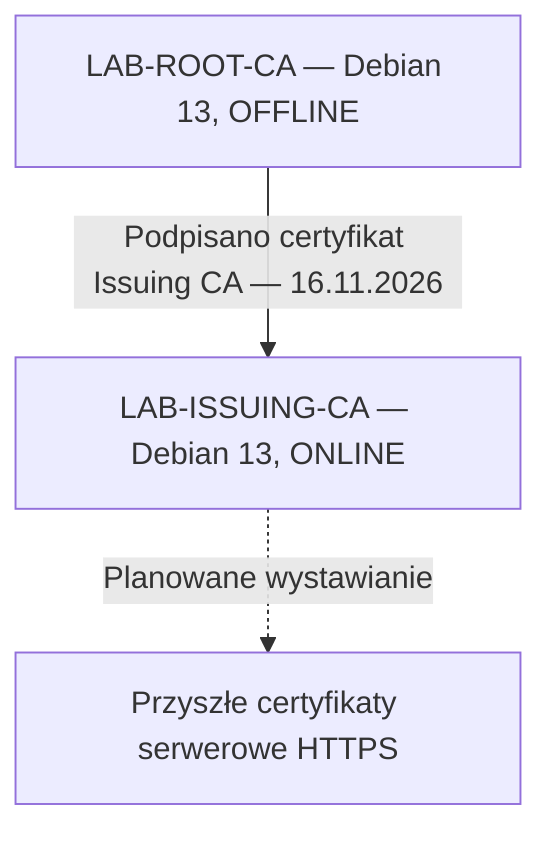

| Parametr | Root CA | Issuing CA |
|---|---|---|
| Host | `lab-root-ca` | `lab-issuing-ca` |
| Adres podczas przygotowania | `10.1.201.232/24` | `10.1.201.231/24` |
| Dostęp | Konsola Hyper-V, sieć odłączona | SSH 2352 + Ed25519 |
| System / OpenSSL | Debian 13 / 3.5.7 | Debian 13 / 3.5.7 |
| Rola | Podpisuje certyfikaty podrzędnych CA | Docelowo wystawia certyfikaty TLS |
| Klucz CA | RSA 4096, szyfrowany AES-256 | RSA 4096, szyfrowany AES-256 |

## Historia postępów

### 12.11.2026 — instalacja i hardening dwóch serwerów

Zainstalowałem Debiana 13 bez GUI na dwóch VM, przygotowałem statyczne IP i DNS (`10.1.201.1`, `8.8.8.8`), repozytoria, `sudo` oraz SSH z osobnymi kluczami Ed25519 na porcie 2352. Wyłączyłem uwierzytelnianie hasłem i zdalne logowanie `root`; negatywny test logowania bez klucza został odrzucony.

Wdrożyłem UFW, podstawowy hardening `sysctl`, `umask 0077`, audyt systemowy i monitoring Wazuh. Na Issuing CA dodałem ClamAV oraz aktualizację sygnatur. Pierwszy audyt Lynis miał **71/100**, później wynik wzrósł do **77/100** na Issuing CA. Hardening Index **nie jest procentem bezpieczeństwa systemu**.

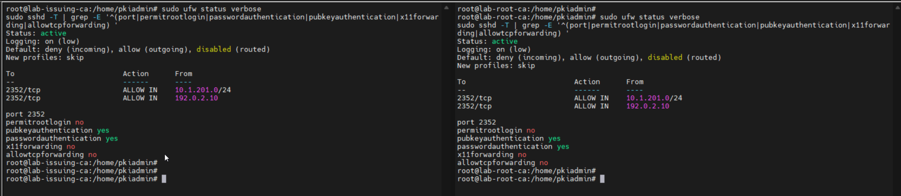

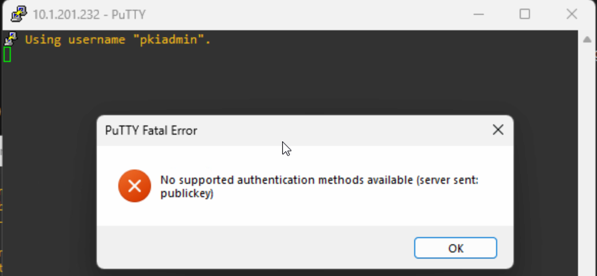


Następnie odłączyłem `LAB-ROOT-CA` od vSwitch w Hyper-V i wyłączyłem usługę SSH. Test wykazał `eth0 DOWN`, brak połączenia z bramą oraz nieaktywny SSH. W ten sposób **Root CA działa bez połączenia sieciowego**, ale wciąż zależy od bezpieczeństwa hosta Hyper-V.

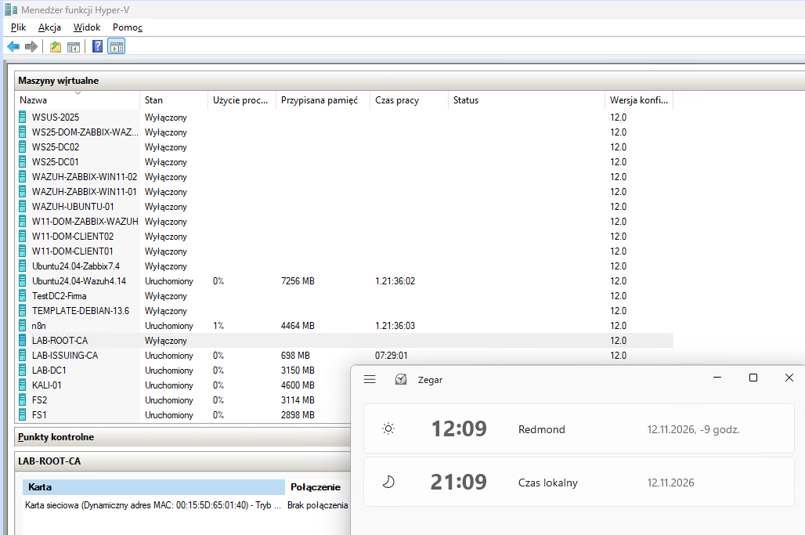

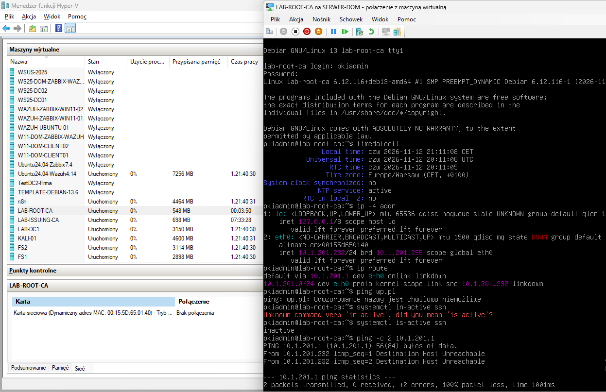

### 16.11.2026 — klucz i certyfikat Root CA

Na offline `LAB-ROOT-CA` przygotowałem `/opt/pki/root`, bazę CA (`index.txt`, `serial`, `crlnumber`) i konfigurację OpenSSL. Wygenerowałem zaszyfrowany klucz RSA 4096, następnie samopodpisany certyfikat **Home IT Lab Root CA** z rozszerzeniami `CA:TRUE, pathlen:1` i `keyCertSign, cRLSign`.

- **Wystawca i podmiot:** `C=PL, O=Home IT Lab, OU=PKI, CN=Home IT Lab Root CA`.
- **Ważność:** od 16.11.2026 13:03:19 UTC do 13.11.2036 13:03:19 UTC.
- **Weryfikacja:** `openssl verify` z certyfikatem Root CA jako punktem zaufania zakończyło się `OK`.


### 16.11.2026 — przygotowanie Issuing CA i CSR

Na `LAB-ISSUING-CA` przygotowałem bazę CA i katalogi pod `/opt/pki/intermediate`, konfigurację `openssl.cnf` oraz osobny szyfrowany klucz RSA 4096. Wygenerowałem żądanie podpisania certyfikatu (`CSR`) dla **Home IT Lab Issuing CA 01**. Wynik weryfikacji: `Certificate request self-signature verify OK`.

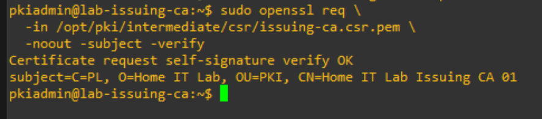

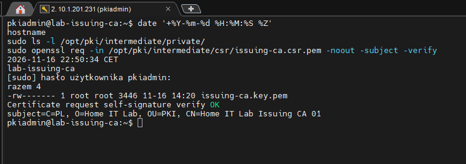

### 16.11.2026 — transfer CSR bez włączania sieci Root CA

Ze względu na problemy z funkcją **„Wpisz tekst ze schowka”** w konsoli VMConnect, przygotowywałem pliki konfiguracyjne na Windowsie, następnie tworzyłem z nich obrazy **ISO w AnyBurn**. Pliki ISO montowałem na offline Debianie jako nośniki wyłącznie do odczytu. Tą samą drogą trafił na Root CA publiczny CSR z Issuing CA — **bez przenoszenia prywatnego klucza** i bez uruchamiania SSH na Root CA.

Początkowo myliłem `/dev/sr0` i `/dev/sr1`, dlatego przed montowaniem sprawdzałem `lsblk -f` oraz `blkid`; prawidłowy nośnik pojawił się jako `iso9660` na `/dev/sr0`. Przeniesiony CSR zweryfikowałem ponownie.

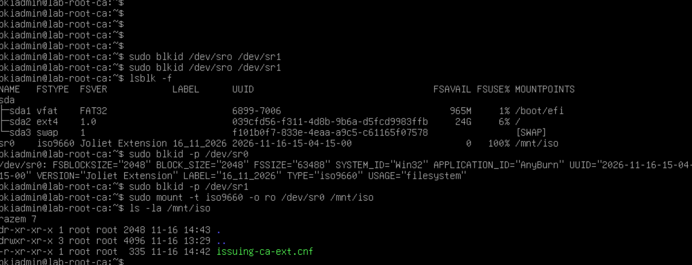


### 16.11.2026 — podpisanie Issuing CA przez Root CA

Na offline Root CA podpisałem istniejący CSR poleceniem `openssl ca`, z osobnym plikiem rozszerzeń X.509 dla CA podrzędnego. Przed podpisaniem zmieniłem adresy publikacji z roboczego `pki.cyber.local` na **`pki.tworzewski.pl`**. W UniFi dodałem odpowiadającą nazwę DNS Host (A); faktyczna dostępność usług HTTP i poprawność odpowiedzi DNS są jeszcze do przetestowania.

**Parametry wystawionego certyfikatu Issuing CA:**

| Parametr | Potwierdzona wartość |
|---|---|
| Subject | `Home IT Lab Issuing CA 01` |
| Issuer | `Home IT Lab Root CA` |
| Ważność | 16.11.2026 14:29:38 UTC – 15.11.2031 14:29:38 UTC |
| Basic Constraints | `CA:TRUE, pathlen:0` (critical) |
| Key Usage | `Certificate Sign, CRL Sign` (critical) |
| AIA | `http://pki.tworzewski.pl/ca/root-ca.cert.pem` |
| CRL Distribution Point | `http://pki.tworzewski.pl/crl/root-ca.crl` |
| Podpis | SHA-256 z RSA |

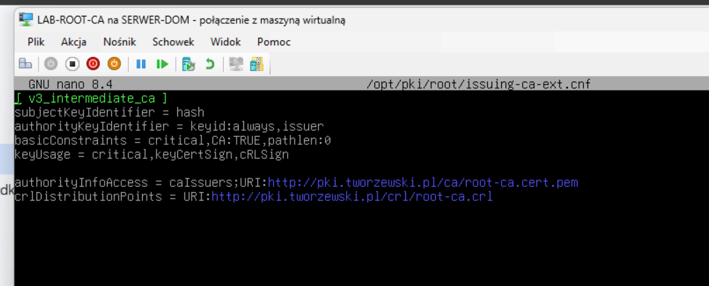

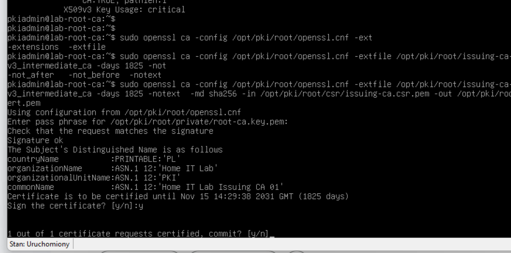


### 16.11.2026 wieczorem — powtórna weryfikacja

Po podpisaniu wykonałem ponowny test offline na Root CA:

```bash
sudo openssl verify -CAfile /opt/pki/root/certs/root-ca.cert.pem /opt/pki/root/certs/issuing-ca.cert.pem
# /opt/pki/root/certs/issuing-ca.cert.pem: OK
```

Wynik `OK` potwierdza poprawność podpisu i łańcucha względem wskazanego zaufanego Root CA. **Nie jest to jeszcze potwierdzenie dostępności CRL ani skuteczności sprawdzania unieważnień.**

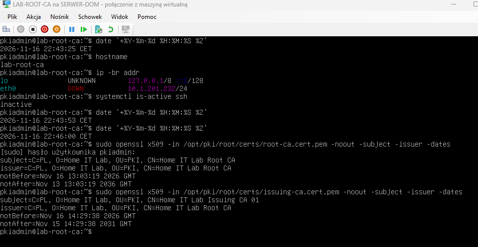


W chwili weryfikacji: `eth0 DOWN`, SSH `inactive`, `System clock synchronized: no` — oczekiwane przy pracy offline. Czas przed operacjami podpisywania należy sprawdzać niezależnie. Na Issuing CA wynik Lynis nadal wynosił **77/100** (zgłoszony po ponownym audycie).

## Aktualny stan i kolejne kroki

- [x] Dwie maszyny Debian 13 i hardening dostępu SSH.
- [x] Root CA odłączony od sieci w Hyper-V.
- [x] Zaszyfrowany klucz i samopodpisany certyfikat Root CA.
- [x] Klucz Issuing CA i CSR — weryfikacja OK.
- [x] CSR przeniesiony nośnikiem ISO na offline Root CA.
- [x] Certyfikat Issuing CA podpisany, AIA/CRL wskazują na `pki.tworzewski.pl`.
- [x] Podpis i łańcuch certyfikatów zweryfikowane lokalnie (`openssl verify`: OK).
- [ ] Przenieść **publiczne** certyfikaty Root/Issuing CA z offline VM na Issuing CA (np. kontrolowanym VHDX).
- [ ] Skonfigurować DNS i Nginx, opublikować certyfikaty CA oraz listy CRL w formacie DER.
- [ ] Przygotować pierwsze CRL i procedurę odnawiania CRL Root CA offline.
- [ ] Sprawdzić HTTP AIA/CRL z hostów klienckich i poprawność sprawdzania unieważnień.
- [ ] Wystawić pierwszy certyfikat TLS z SAN i zweryfikować HTTPS na kliencie.
- [ ] Sprawdzić Wazuh/auditd i uruchomić testy odtwarzania CA.

**Uwaga:** adresy publikacji w certyfikacie nie oznaczają, że wymienione pliki są już udostępniane. Projekt nie jest jeszcze gotową produkcyjną usługą PKI.

## Dodatkowe zabezpieczenia Root CA — zalecane, ale niewdrożone w tym labie

W tej iteracji **nie wdrożyłem** poniższych zaleceń. Opisuję je, ponieważ izolacja sieciowa VM **nie chroni przed administratorem hosta Hyper-V, dostępem do VHDX ani utratą dysku**.

| Zalecenie | Dlaczego ma znaczenie |
|---|---|
| Ograniczenie checkpointów Hyper-V | Zmniejsza liczbę dodatkowych kopii stanu VM, mogących zawierać materiał kryptograficzny; checkpoint nie jest backupem. |
| Ochrona hosta i VHDX (ACL, kontrola dostępu, szyfrowanie woluminu) | Ogranicza ryzyko dostępu do plików CA przez osoby z uprawnieniami do hosta. |
| Niezależny, zaszyfrowany backup Root CA i bazy CA | Umożliwia odzyskanie hierarchii po uszkodzeniu VM, bez ujawnienia klucza. |
| Próbne odtwarzanie backupu w odizolowanym środowisku | Weryfikuje, czy kopia rzeczywiście pozwala odzyskać CA. |
| Kontrolowana wymiana danych z offline CA | Ogranicza ryzyko podmiany CSR lub niepożądanych plików na nośniku. |

**Ryzyko świadomie zaakceptowane w laboratorium:** brak kopii bezpieczeństwa może oznaczać utratę klucza CA i konieczność zbudowania hierarchii od początku. Nie należy kopiować tego podejścia do środowiska produkcyjnego.

## Ochrona sekretów i publikacja

Do repozytorium nie trafiają: klucze prywatne, hasła, pliki `.ppk`, pliki bazy wystawionych certyfikatów czy backupy. Zrzuty ekranu zostały dołączone jako rzeczywista dokumentacja; **przed publikacją trzeba świadomie zaakceptować widoczne w nich nazwy hostów, domeny, adresy IP i daty**. Publiczne certyfikaty i CSR nie są sekretami, ale w tej paczce celowo nie dołączam samych plików kryptograficznych.

**Materiały szczegółowe:** [Dziennik wdrożenia](docs/06-etap-2-pki-2026-11-16.md) · [Etapy i zadania](docs/04-plan-pki.md) · [Zrzuty](docs/05-zrzuty-ekranu.md).
