# Two-Tier PKI na Debianie 13 — Home IT Lab

> **Status: zakończony w ustalonym zakresie** · **Aktualizacja: 17 listopada 2026 r.**  
> ✅ Offline Root CA i online Issuing CA • ✅ Publikacja AIA/CRL • ✅ Certyfikat TLS Wazuh i zaufanie Windows/Chrome • ✅ Weryfikacja certyfikatu z `-crl_check_all`  
> **Poza zakresem zakończonej iteracji:** test faktycznego unieważnienia certyfikatu, automatyzacja odnowień oraz odtworzenie z backupu.

Projekt dokumentuje **rzeczywistą, etapową budowę własnej dwupoziomowej infrastruktury klucza publicznego (PKI)** na dwóch VM z Debianem 13 w Hyper-V. Dokumentacja jest po polsku; zawiera wykorzystane polecenia, wyniki testów, zrzuty ekranu oraz celowo niewdrożone zalecenia. Jest to **środowisko laboratoryjne niezależne od produkcyjnego PKI**.

## Architektura

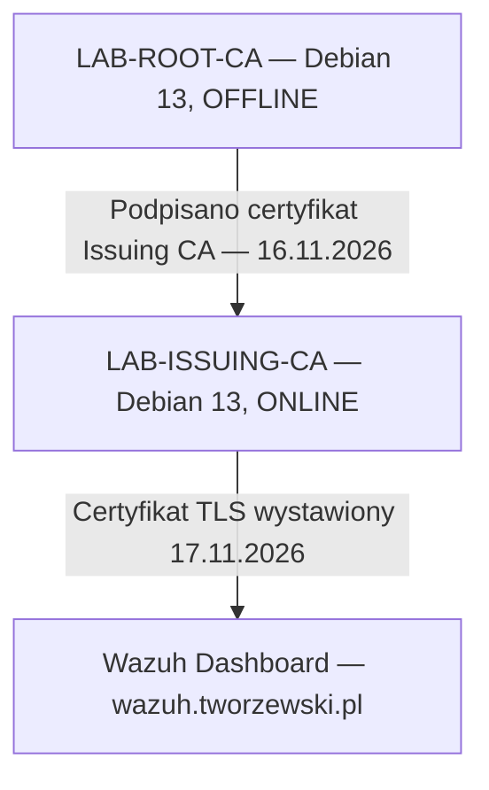

| Parametr | Root CA | Issuing CA |
|---|---|---|
| Host | `lab-root-ca` | `lab-issuing-ca` |
| Adres podczas przygotowania | `10.1.201.232/24` | `10.1.201.231/24` |
| Dostęp | Konsola Hyper-V, sieć odłączona | SSH 2352 + Ed25519 |
| System / OpenSSL | Debian 13 / 3.5.7 | Debian 13 / 3.5.7 |
| Rola | Podpisuje certyfikaty podrzędnych CA | Wystawia certyfikaty TLS |
| Klucz CA | RSA 4096, szyfrowany AES-256 | RSA 4096, szyfrowany AES-256 |

## Historia postępów

### 12.11.2026 — instalacja i hardening dwóch serwerów

Zainstalowałem Debiana 13 bez GUI na dwóch VM, przygotowałem statyczne IP i DNS (`10.1.201.1`, `8.8.8.8`), repozytoria, `sudo` oraz SSH z osobnymi kluczami Ed25519 na porcie 2352. Wyłączyłem uwierzytelnianie hasłem i zdalne logowanie `root`; negatywny test logowania bez klucza został odrzucony.

Wdrożyłem UFW, podstawowy hardening `sysctl`, `umask 0077`, audyt systemowy i monitoring Wazuh. Na Issuing CA dodałem ClamAV oraz aktualizację sygnatur. Pierwszy audyt Lynis miał **71/100**, później wynik wzrósł do **77/100** na Issuing CA. Hardening Index **nie jest procentem bezpieczeństwa systemu**.


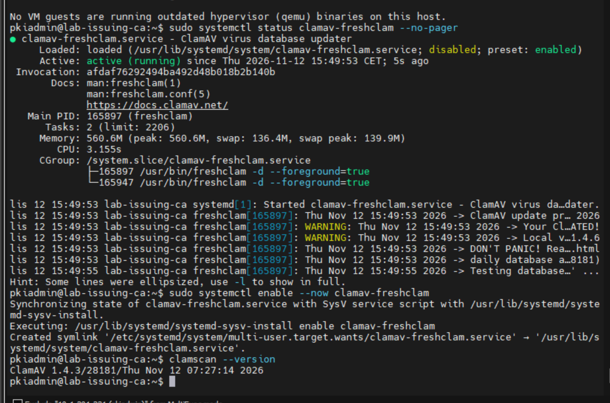

Następnie odłączyłem `LAB-ROOT-CA` od vSwitch w Hyper-V i wyłączyłem usługę SSH. Test wykazał `eth0 DOWN`, brak połączenia z bramą oraz nieaktywny SSH. W ten sposób **Root CA działa bez połączenia sieciowego**, ale wciąż zależy od bezpieczeństwa hosta Hyper-V.


### 16.11.2026 — klucz i certyfikat Root CA

Na offline `LAB-ROOT-CA` przygotowałem `/opt/pki/root`, bazę CA (`index.txt`, `serial`, `crlnumber`) i konfigurację OpenSSL. Wygenerowałem zaszyfrowany klucz RSA 4096, następnie samopodpisany certyfikat **Home IT Lab Root CA** z rozszerzeniami `CA:TRUE, pathlen:1` i `keyCertSign, cRLSign`.

- **Wystawca i podmiot:** `C=PL, O=Home IT Lab, OU=PKI, CN=Home IT Lab Root CA`.
- **Ważność:** od 16.11.2026 13:03:19 UTC do 13.11.2036 13:03:19 UTC.
- **Weryfikacja:** `openssl verify` z certyfikatem Root CA jako punktem zaufania zakończyło się `OK`.

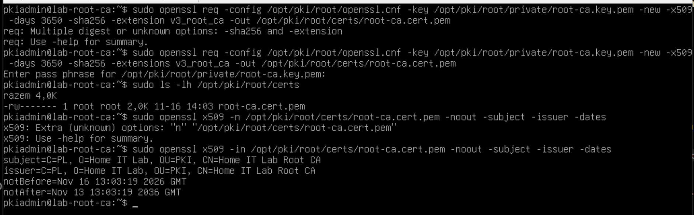

### 16.11.2026 — przygotowanie Issuing CA i CSR

Na `LAB-ISSUING-CA` przygotowałem bazę CA i katalogi pod `/opt/pki/intermediate`, konfigurację `openssl.cnf` oraz osobny szyfrowany klucz RSA 4096. Wygenerowałem żądanie podpisania certyfikatu (`CSR`) dla **Home IT Lab Issuing CA 01**. Wynik weryfikacji: `Certificate request self-signature verify OK`.


### 16.11.2026 — transfer CSR bez włączania sieci Root CA

Ze względu na problemy z funkcją **„Wpisz tekst ze schowka”** w konsoli VMConnect, przygotowywałem pliki konfiguracyjne na Windowsie, następnie tworzyłem z nich obrazy **ISO w AnyBurn**. Pliki ISO montowałem na offline Debianie jako nośniki wyłącznie do odczytu. Tą samą drogą trafił na Root CA publiczny CSR z Issuing CA — **bez przenoszenia prywatnego klucza** i bez uruchamiania SSH na Root CA.

Początkowo myliłem `/dev/sr0` i `/dev/sr1`, dlatego przed montowaniem sprawdzałem `lsblk -f` oraz `blkid`; prawidłowy nośnik pojawił się jako `iso9660` na `/dev/sr0`. Przeniesiony CSR zweryfikowałem ponownie.


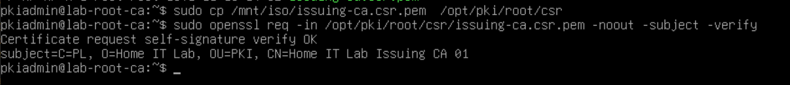

### 16.11.2026 — podpisanie Issuing CA przez Root CA

Na offline Root CA podpisałem istniejący CSR poleceniem `openssl ca`, z osobnym plikiem rozszerzeń X.509 dla CA podrzędnego. Przed podpisaniem zmieniłem adresy publikacji z roboczego `pki.cyber.local` na **`pki.tworzewski.pl`**. W UniFi dodałem rekord DNS Host (A), który następnie rozwiązywał się jako `10.1.201.231`. Dostępność plików HTTP została potwierdzona w kolejnym etapie.

**Parametry wystawionego certyfikatu Issuing CA:**

| Parametr | Potwierdzona wartość |
|---|---|
| Subject | `Home IT Lab Issuing CA 01` |
| Issuer | `Home IT Lab Root CA` |
| Ważność | 16.11.2026 14:29:38 UTC – 15.11.2031 14:29:38 UTC |
| Basic Constraints | `CA:TRUE, pathlen:0` (critical) |
| Key Usage | `Certificate Sign, CRL Sign` (critical) |
| AIA | `http://pki.tworzewski.pl/ca/root-ca.cert.pem` |
| CRL Distribution Point | `http://pki.tworzewski.pl/crl/root-ca.crl` |
| Podpis | SHA-256 z RSA |


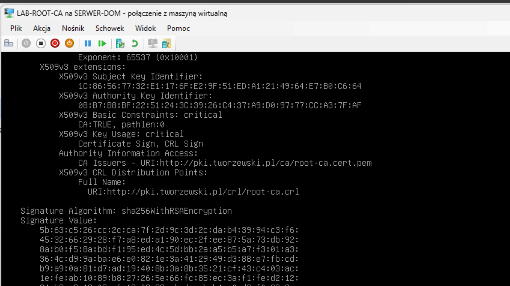

### 16.11.2026 wieczorem — powtórna weryfikacja

Po podpisaniu wykonałem ponowny test offline na Root CA:

```bash
sudo openssl verify -CAfile /opt/pki/root/certs/root-ca.cert.pem /opt/pki/root/certs/issuing-ca.cert.pem
# /opt/pki/root/certs/issuing-ca.cert.pem: OK
```

Wynik `OK` potwierdza poprawność podpisu i łańcucha względem wskazanego zaufanego Root CA. **Nie jest to jeszcze potwierdzenie dostępności CRL ani skuteczności sprawdzania unieważnień.**


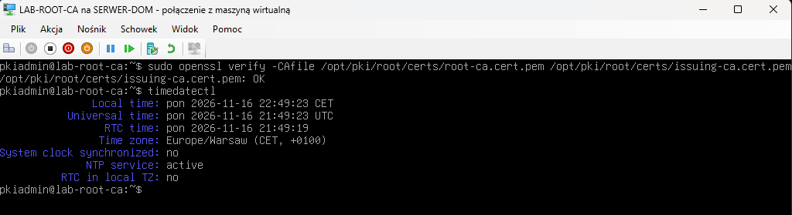

W chwili weryfikacji: `eth0 DOWN`, SSH `inactive`, `System clock synchronized: no` — oczekiwane przy pracy offline. Czas przed operacjami podpisywania należy sprawdzać niezależnie. Na Issuing CA wynik Lynis nadal wynosił **77/100** (zgłoszony po ponownym audycie).

## 16/17.11.2026 — transfer publicznych certyfikatów z offline Root CA

Po podpisaniu Issuing CA przeniosłem dwa **publiczne** certyfikaty (`root-ca.cert.pem` i `issuing-ca.cert.pem`) z `LAB-ROOT-CA` na `LAB-ISSUING-CA`, bez włączania sieci Root CA. Wykorzystałem odłączany VHDX w Hyper-V. Pierwsze podejście z FAT32 było nieudane: pliki były widoczne przed odmontowaniem, ale znikały przy kolejnych podłączeniach (potwierdzone także testowym plikiem). Nie ustalono jednoznacznie, co powodowało problem — w dokumentacji nie przypisuję go z pewnością samemu FAT32.

Następnie na **wydzielonym dysku transferowym 1 GB** utworzyłem ext4, skopiowałem certyfikaty i sprawdziłem, że pozostały po odmontowaniu i ponownym zamontowaniu. Po odłączeniu dysku od Root CA i podłączeniu go do Issuing CA odczytałem pliki w trybie `ro,noload` i umieściłem w `/opt/pki/intermediate/certs/`. Wynik:

```text
/opt/pki/intermediate/certs/issuing-ca.cert.pem: OK
```

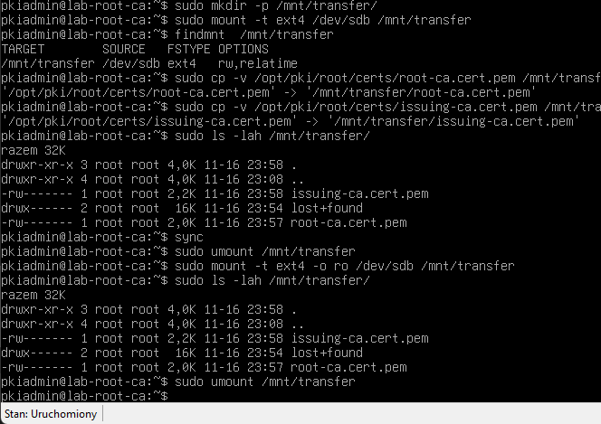

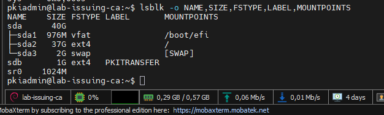

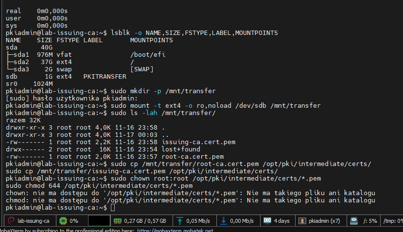

## 17.11.2026 — Nginx, DNS oraz publikacja certyfikatów CA

Na online `LAB-ISSUING-CA` zainstalowałem Nginx 1.26.3, utworzyłem `/var/www/pki/ca` i `/var/www/pki/crl`, skonfigurowałem wirtualny host `pki.tworzewski.pl` i port HTTP 80 dostępny z `10.1.201.0/24` w UFW. Test `nginx -t` zakończył się powodzeniem, `getent ahostsv4 pki.tworzewski.pl` wskazał `10.1.201.231`. Serwer udostępnia pliki bez katalogowego `autoindex`.

Dla obu certyfikatów HTTP zwrócił **200 OK**, a pobrana treść została prawidłowo rozpoznana przez `openssl x509 -noout -subject -issuer`:

- `http://pki.tworzewski.pl/ca/root-ca.cert.pem` — subject/issuer: `Home IT Lab Root CA`;
- `http://pki.tworzewski.pl/ca/issuing-ca.cert.pem` — subject: `Home IT Lab Issuing CA 01`, issuer: `Home IT Lab Root CA`.

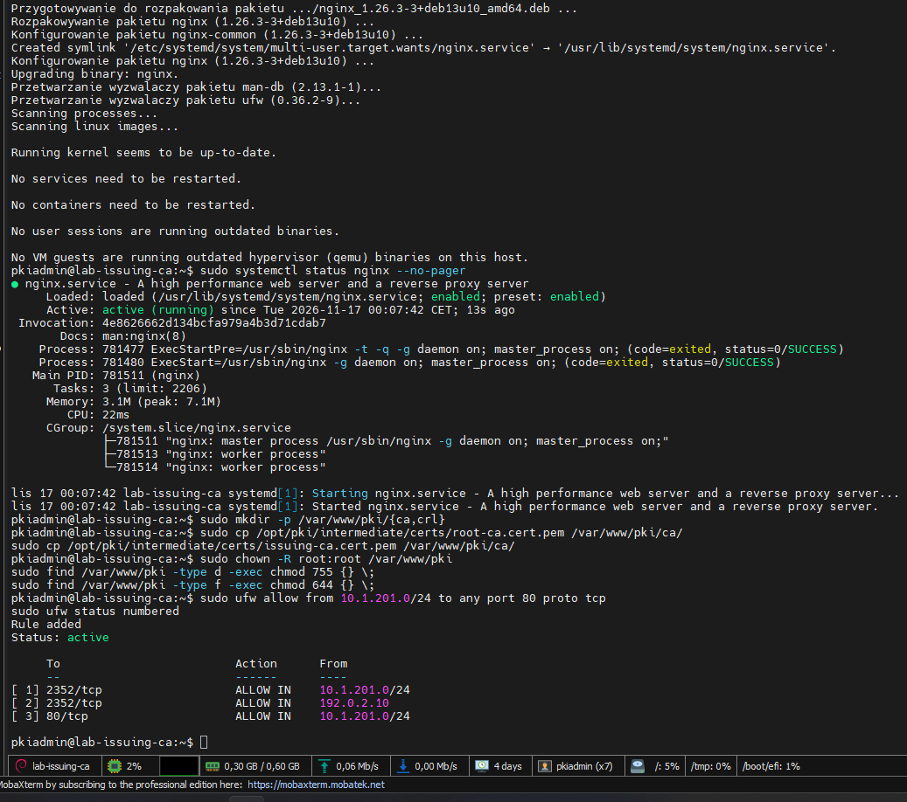

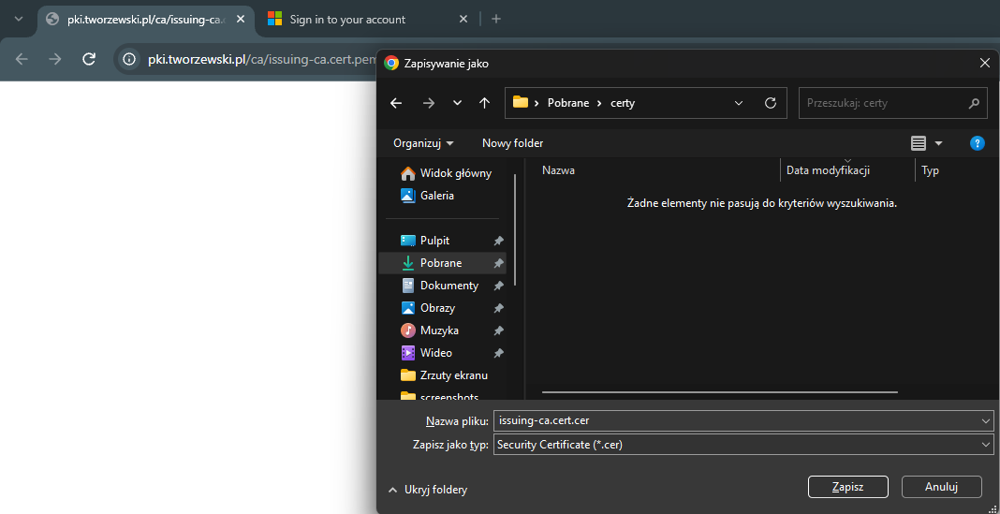

**Dlaczego HTTP?** Pliki CA i listy CRL są weryfikowane kryptograficznie; HTTP pozwala uniknąć zależności cyklicznej przy weryfikacji certyfikatów serwera publikacji. Nie jest to panel administracyjny. Obecna konfiguracja UFW pozwala na port 80 z podsieci `10.1.201.0/24`; dostęp z innych sieci wymaga dodatkowych testów i reguł.

## 17.11.2026 — pierwsze CRL i ręczne odnawianie

Na **LAB-ISSUING-CA** wygenerowałem listę CRL podpisaną kluczem Issuing CA, sprawdziłem ją, skonwertowałem do DER i udostępniłem przez Nginx. Następnie ponowiłem ręczną operację, uzyskując poprawną weryfikację podpisu `verify OK` i zgodność dat między lokalnym a opublikowanym plikiem.

Na **LAB-ROOT-CA** (offline) wygenerowałem i zweryfikowałem CRL Root CA (`verify OK`), przekonwertowałem do DER, przeniosłem przez ext4 VHDX i opublikowałem na Issuing CA. Odczyt obu URL przez `curl | openssl crl -inform DER` działał prawidłowo.

| Udostępniony zasób | Wynik testu | Ostatnio potwierdzone `nextUpdate` (UTC) |
|---|---|---|
| `/crl/root-ca.crl` | HTTP 200, podpis zweryfikowany | 15.05.2027, 23:20:11 |
| `/crl/issuing-ca.crl` | HTTP 200, odczyt i podpis poprawne | 23.11.2026, 23:34:58 |

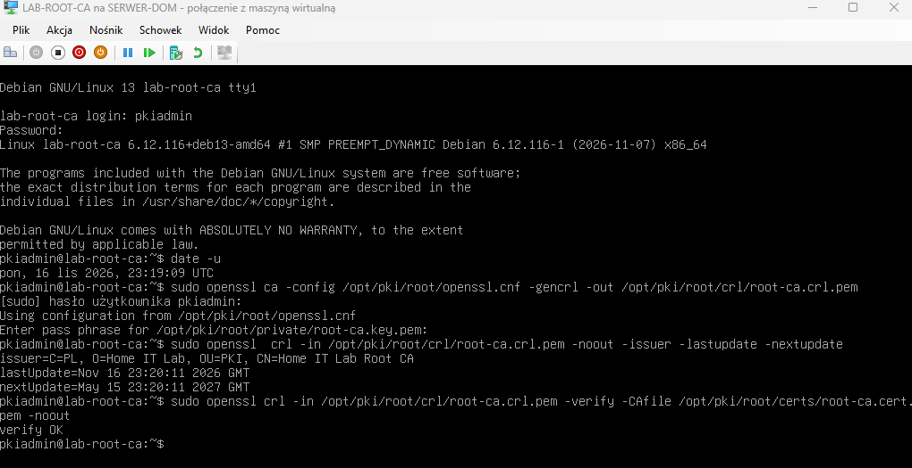

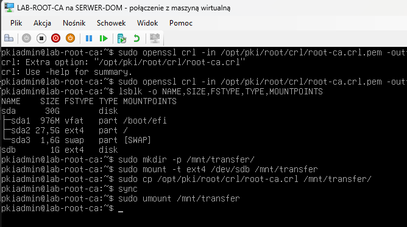

**Odnawianie CRL Issuing CA jest ręczne.** Klucz `issuing-ca.key.pem` pozostaje zaszyfrowany i przy `openssl ca -gencrl` trzeba podać hasło interaktywnie. Na serwerze przygotowano plik `/usr/local/sbin/renew-issuing-crl.sh`, ale **nie potwierdzono wykonania całego skryptu**; nie włączono timera systemd ani automatycznego podawania hasła. Operacja potwierdzona w logach to ręczna generacja, weryfikacja podpisu, konwersja do DER i atomowa podmiana opublikowanej CRL.

Root CA CRL trzeba odnawiać osobno przez offline VM, z zachowaniem procedury transferu. Daty `nextUpdate` są terminami ważności konkretnych opublikowanych list, a nie deklaracją stałego harmonogramu.

## 17.11.2026 — pierwszy certyfikat HTTPS: Wazuh Dashboard

Migrację wykonano dla `wazuh.tworzewski.pl` (`10.1.201.201`). Dotychczasowa usługa Wazuh Dashboard działała bezpośrednio na HTTPS 443, z plikami `/etc/wazuh-dashboard/certs/wazuh-dashboard.pem` i `wazuh-dashboard-key.pem`. Poprzedni certyfikat pochodził od `Tworzewski LAB Root CA`; nie był to nowy urząd `Home IT Lab Root CA`.

**Wydanie i uruchomienie:**

1. Na serwerze Wazuh wykonano kopię dotychczasowych plików i przygotowano osobny klucz RSA 4096 oraz CSR (bez przesyłania klucza prywatnego do Issuing CA).
2. CSR przeniesiono przez Windows/MobaXterm. `openssl req -verify` potwierdził podpis CSR i SAN: `DNS:wazuh.tworzewski.pl`, `IP:10.1.201.201`.
3. W pliku `openssl.cnf` Issuing CA poprawiono pozostałe stare punkty `pki.cyber.local` na `pki.tworzewski.pl`. Pozostawiono `copy_extensions = none`, a SAN i profil TLS podano jawnie w `wazuh-server-ext.cnf` (`CA:FALSE`, `serverAuth`, odpowiednie Key Usage, AIA i CDP).
4. Pierwszą próbę wystawienia przerwano przed potwierdzeniem, a przy kolejnej wpisano niepoprawne hasło klucza CA (`bad decrypt`). Test `openssl pkey -check -noout` zakończył się `Key is valid`; podpisanie powtórzono i zatwierdzono. OpenSSL zwrócił `Database updated`.
5. Certyfikat wystawiono na **365 dni**: `notBefore=Nov 16 23:57:05 2026 GMT`, `notAfter=Nov 16 23:57:05 2027 GMT`, z wystawcą `Home IT Lab Issuing CA 01`.
6. Na serwer Wazuh przeniesiono publiczny *fullchain* (certyfikat serwera + certyfikat Issuing CA), zachowując klucz prywatny wyłącznie na Wazuh. Zmieniono dwie ścieżki `server.ssl.key` i `server.ssl.certificate`, po czym uruchomiono ponownie `wazuh-dashboard`.
7. Po restarcie usługa miała status `active (running)`, `curl -k -I https://127.0.0.1/` zwrócił `302 Found` do `/app/login?`, a `openssl s_client` pokazał nowy certyfikat i jego wystawcę.
8. Początkowo Chrome oznaczał stronę jako niezabezpieczoną. Po pobraniu publicznego certyfikatu Root CA i dodaniu go do magazynu zaufanych urzędów Windows ostrzeżenie zniknęło. Dla bezpieczeństwa odcisk Root CA należy porównać ze źródłem zaufanym przed importem.

**Testy końcowe:**

```bash
# LAB-ISSUING-CA — poprawny łańcuch i nazwa DNS
sudo openssl verify \
  -CAfile /opt/pki/intermediate/certs/root-ca.cert.pem \
  -untrusted /opt/pki/intermediate/certs/issuing-ca.cert.pem \
  -purpose sslserver -verify_hostname wazuh.tworzewski.pl \
  /opt/pki/intermediate/certs/wazuh.cert.pem
# /opt/pki/intermediate/certs/wazuh.cert.pem: OK
```

Po przygotowaniu zestawu PEM zawierającego **Root CA CRL i Issuing CA CRL** wykonano także:

```bash
sudo openssl verify \
  -CAfile /opt/pki/intermediate/certs/root-ca.cert.pem \
  -untrusted /opt/pki/intermediate/certs/issuing-ca.cert.pem \
  -CRLfile /tmp/pki-crls.pem \
  -crl_check_all -purpose sslserver \
  -verify_hostname wazuh.tworzewski.pl \
  /opt/pki/intermediate/certs/wazuh.cert.pem
# /opt/pki/intermediate/certs/wazuh.cert.pem: OK
```

To potwierdza, że w chwili testu certyfikat Wazuh przeszedł kontrolę ścieżki zaufania i dostarczonych list CRL. **Nie testowano rzeczywistego cofnięcia certyfikatu ani automatycznej kontroli CRL przez Chrome.**


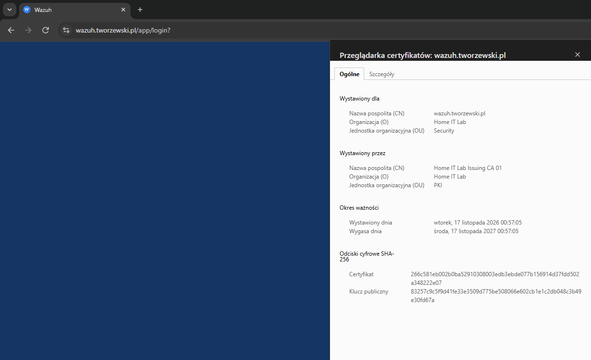


Pełny opis i procedura ręcznego odnawiania: **[Wazuh: CSR, podpis, wdrożenie, walidacja](docs/08-wazuh-dashboard-https-2026-11-17.md)**.

## Stan końcowy i ograniczenia

- [x] Dwa serwery Debian 13, hardening SSH/UFW, monitoring/audyt.
- [x] Root CA offline, szyfrowany klucz RSA 4096 i certyfikat Root CA.
- [x] Osobny klucz Issuing CA, CSR, podpis CA i weryfikacja łańcucha.
- [x] Transfer plików konfiguracyjnych i CSR przez ISO.
- [x] Transfer dwóch publicznych certyfikatów przez VHDX z ext4.
- [x] Nginx, lokalny DNS `pki.tworzewski.pl`, testy HTTP 200 i odczyt certyfikatów.
- [x] Dwie listy CRL w formacie DER, publikowane w HTTP; ręczne odnowienie Issuing CRL.
- [ ] Test dostępności HTTP AIA/CRL z innych VLAN-ów i końcowych klientów.
- [x] Wystawić certyfikat serwerowy z SAN i uruchomić HTTPS dla `wazuh.tworzewski.pl`.
- [x] Zainstalować publiczny Root CA w magazynie Windows i potwierdzić brak ostrzeżenia w Chrome.
- [x] Zweryfikować certyfikat Wazuh przez OpenSSL z obydwiema listami CRL (`-crl_check_all`).
- [ ] Przetestować faktyczne **unieważnienie testowego** certyfikatu i wykrycie `certificate revoked` (poza zakresem tej iteracji).
- [ ] Ustalić procedurę regularnego ręcznego odnawiania CRL przed `nextUpdate`.
- [ ] Przetestować odtwarzanie PKI z kopii (backup Root CA nie został wdrożony).

**Zakres potwierdzenia:** Windows/Chrome przestał zgłaszać ostrzeżenie po dodaniu zaufanego Root CA; OpenSSL zweryfikował certyfikat Wazuh wraz z dwoma podanymi CRL. Nie potwierdza to sprawdzania unieważnień przez wszystkich klientów ani dostępności AIA/CRL z każdego VLAN-u.

## Dodatkowe zabezpieczenia Root CA — zalecane, ale niewdrożone w tym labie

W tej iteracji **nie wdrożyłem** poniższych zaleceń. Opisuję je, ponieważ izolacja sieciowa VM **nie chroni przed administratorem hosta Hyper-V, dostępem do VHDX ani utratą dysku**.

| Zalecenie | Dlaczego ma znaczenie |
|---|---|
| Ograniczenie checkpointów Hyper-V | Zmniejsza liczbę dodatkowych kopii stanu VM, mogących zawierać materiał kryptograficzny; checkpoint nie jest backupem. |
| Ochrona hosta i VHDX (ACL, kontrola dostępu, szyfrowanie woluminu) | Ogranicza ryzyko dostępu do plików CA przez osoby z uprawnieniami do hosta. |
| Niezależny, zaszyfrowany backup Root CA i bazy CA | Umożliwia odzyskanie hierarchii po uszkodzeniu VM, bez ujawnienia klucza. |
| Próbne odtwarzanie backupu w odizolowanym środowisku | Weryfikuje, czy kopia rzeczywiście pozwala odzyskać CA. |
| Kontrolowana wymiana danych z offline CA | Ogranicza ryzyko podmiany CSR lub niepożądanych plików na nośniku. |

**Ryzyko świadomie zaakceptowane w laboratorium:** brak kopii bezpieczeństwa może oznaczać utratę klucza CA i konieczność zbudowania hierarchii od początku. Nie należy kopiować tego podejścia do środowiska produkcyjnego.

## Ochrona sekretów i publikacja

Do repozytorium nie trafiają: klucze prywatne, hasła, pliki `.ppk`, pliki bazy wystawionych certyfikatów czy backupy. Zrzuty ekranu zostały dołączone jako rzeczywista dokumentacja; **przed publikacją trzeba świadomie zaakceptować widoczne w nich nazwy hostów, domeny, adresy IP i daty**. Publiczne certyfikaty i CSR nie są sekretami, ale w tej paczce celowo nie dołączam samych plików kryptograficznych.

**Materiały szczegółowe:** [Dziennik utworzenia CA](docs/06-etap-2-pki-2026-11-16.md) · [Transfer i publikacja AIA/CRL](docs/07-transfer-publikacja-crl-2026-11-17.md) · [Certyfikat HTTPS Wazuh](docs/08-wazuh-dashboard-https-2026-11-17.md) · [Zrzuty](docs/05-zrzuty-ekranu.md).
