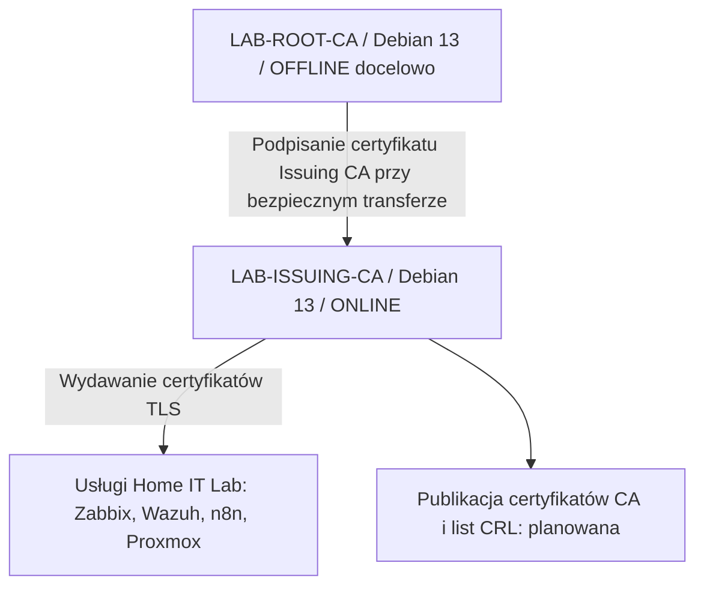
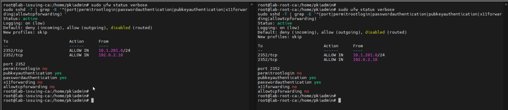
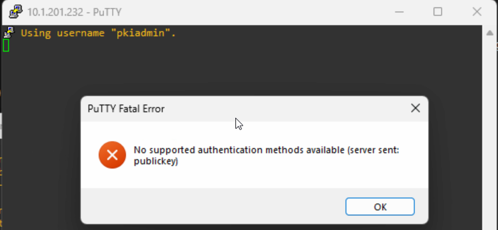
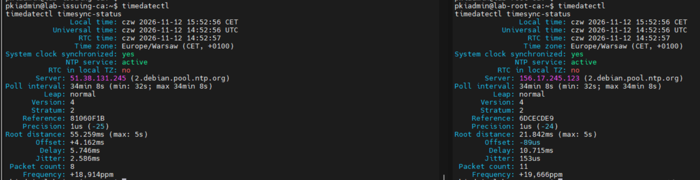

# Two-Tier PKI — Debian 13 | Home IT Lab

> **Status projektu: W TRAKCIE REALIZACJI**  
> **Etap 1 (10–12 listopada 2026): instalacja dwóch VM i hardening systemów — wykonany.**  
> **Etap 2: konfiguracja Root CA offline i Issuing CA online — planowany.**

Projekt dokumentuje budowę **dwupoziomowej infrastruktury klucza publicznego (PKI)** na dwóch maszynach wirtualnych Debian 13 w Home IT Lab. Docelowo Root CA ma być izolowany od sieci, a Issuing CA ma wystawiać certyfikaty dla usług laboratoryjnych. Nie jest to ukończone wdrożenie urzędu certyfikacji: obecny stan obejmuje przygotowanie i zabezpieczenie systemów.

## Architektura docelowa

| Element | LAB-ROOT-CA | LAB-ISSUING-CA |
|---|---|---|
| Hostname | `lab-root-ca` | `lab-issuing-ca` |
| Adres w fazie przygotowania | `10.1.201.232/24` | `10.1.201.231/24` |
| System | Debian 13 bez GUI | Debian 13 bez GUI |
| SSH | TCP `2352`, tylko klucz Ed25519 | TCP `2352`, tylko klucz Ed25519 |
| Tryb docelowy | OFFLINE, karta sieciowa odłączona | ONLINE |

## Co faktycznie wykonano

- [x] Dwie maszyny Hyper-V z Debianem 13, użytkownik `pkiadmin` z `sudo`.
- [x] Stałe IP, brama `10.1.201.1`, DNS `10.1.201.1` i `8.8.8.8`, kontrola `apt update`.
- [x] SSH na porcie `2352`; `PermitRootLogin no`, `PasswordAuthentication no`, `KbdInteractiveAuthentication no`.
- [x] Osobne klucze Ed25519; test logowania z kluczem i odmowy bez klucza.
- [x] UFW aktywny; dostęp SSH ograniczony regułami (do dalszego zawężenia).
- [x] Parametry `sysctl`, `umask 0077`, uprawnienia `/etc/sudoers.d`.
- [x] Uruchomiony `auditd`; w raporcie Lynis widoczne reguły audytu.
- [x] Integracja z Wazuh na Issuing CA wykryta przez Lynis.
- [x] ClamAV i `clamav-freshclam` na Issuing CA.
- [x] Kontrola synchronizacji NTP na obu VM.
- [x] Audyt Lynis; **Issuing CA: 71 → 76 → 77/100**, 258 testów, 0 ostrzeżeń w ostatnim raporcie.

## Dokumentacja z wykonanych prac

1. [Instalacja i sieć](docs/01-instalacja-i-siec.md)
2. [Hardening systemów](docs/02-hardening.md)
3. [Wyniki weryfikacji i Lynis](docs/03-audyt-i-testy.md)
4. [Plan dalszego wdrożenia PKI](docs/04-plan-pki.md)
5. [Galeria zrzutów z komentarzami](docs/05-zrzuty-ekranu.md)

### Wybrane zrzuty

**Firewall i SSH na obu maszynach:**

**Test negatywny: bez klucza nie da się zalogować:**

**Synchronizacja czasu NTP:**

## Co jest dopiero planowane

- [ ] Rozstrzygnięcie: nowa, niezależna hierarchia laboratoryjna (zalecana), nie kopiowanie produkcyjnych kluczy CA.
- [ ] Oddzielenie Root CA od sieci **przed** wygenerowaniem/przeniesieniem klucza prywatnego.
- [ ] Konfiguracja OpenSSL dla obu CA i bezpieczny transfer CSR/certyfikatu.
- [ ] Podpisanie certyfikatu Issuing CA przez offline Root CA.
- [ ] Publikacja CA/CRL (AIA/CDP), obsługa odnowień i unieważnień.
- [ ] Wystawienie certyfikatu TLS dla usługi labowej; weryfikacja łańcucha zaufania.
- [ ] Szyfrowane backupy, test odtworzenia i procedura odnawiania CRL Root CA.

> **Bezpieczeństwo repozytorium:** nie publikować kluczy prywatnych, sekretów, plików baz CA, kopii zapasowych ani danych produkcyjnych. Zdjęcia pochodzą z rzeczywistych prac w labie; przed opublikowaniem należy samodzielnie przejrzeć każdy screen pod kątem danych wewnętrznych. `77/100` to indeks Lynis, **nie procent bezpieczeństwa**. ClamAV CLI nie oznacza ochrony antywirusowej w czasie rzeczywistym.
