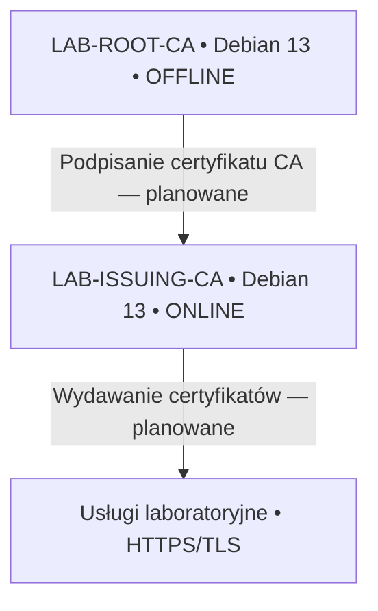
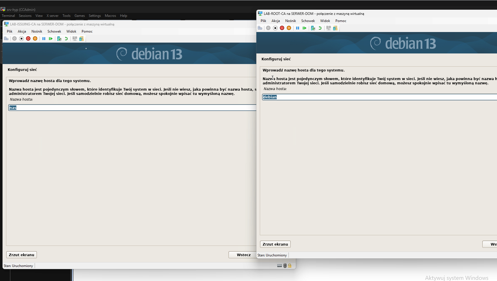
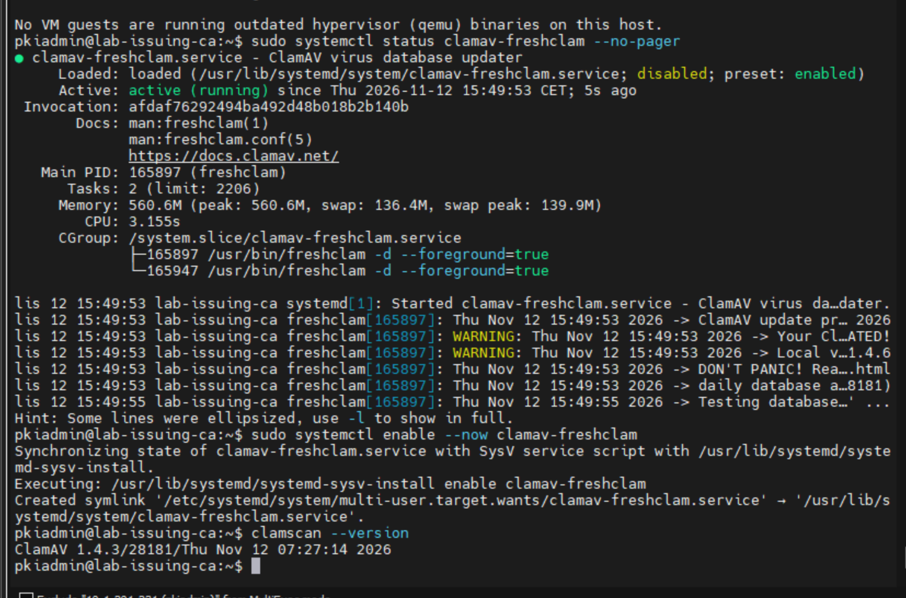
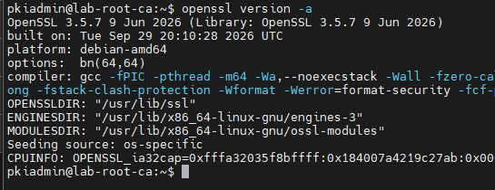
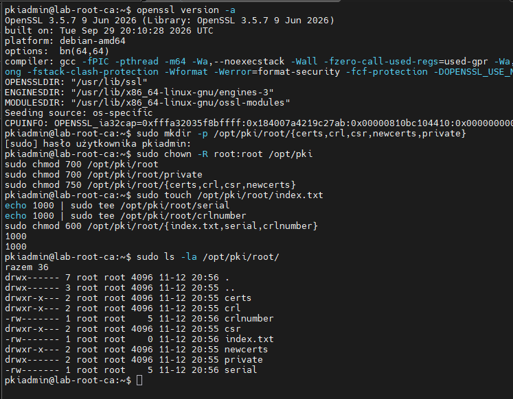
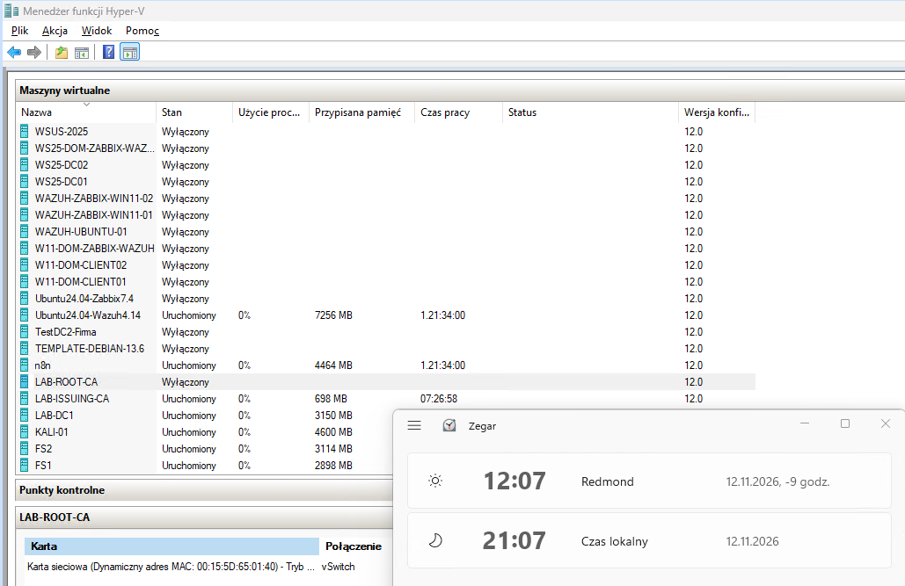
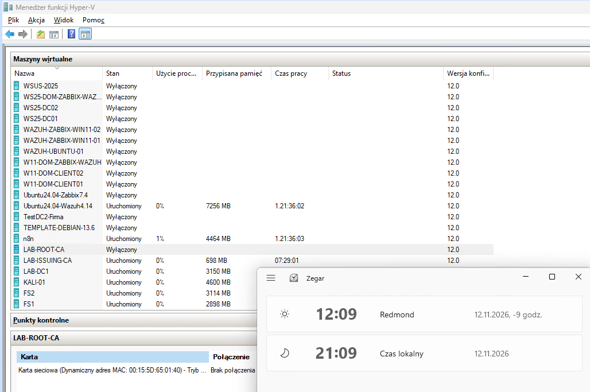
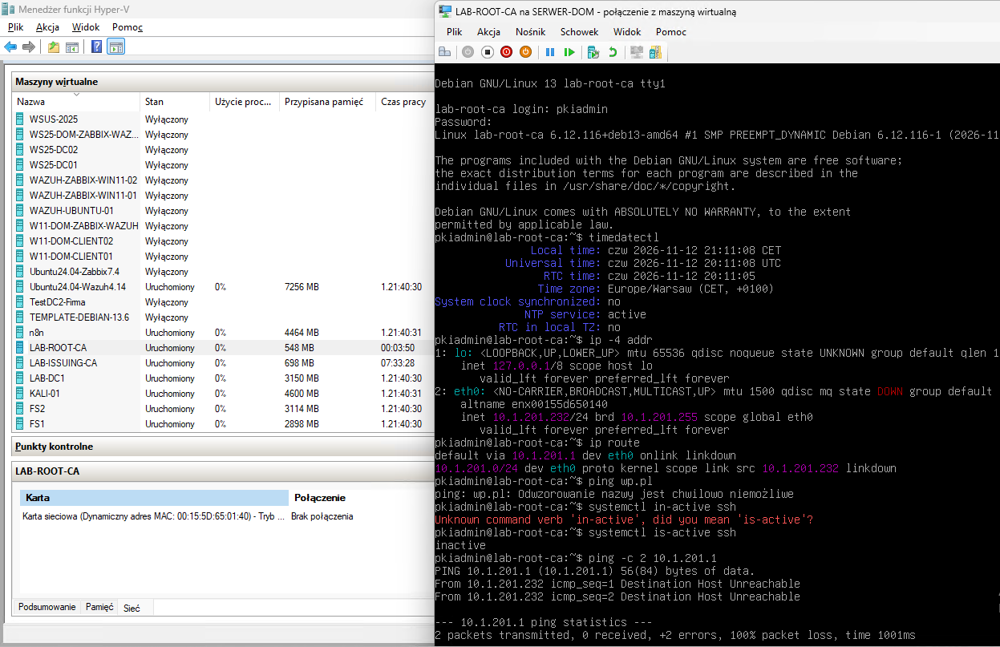

# Two-Tier PKI na Debianie 13 — Home IT Lab

> **Status: projekt w trakcie realizacji** · Ostatnia aktualizacja: **12 listopada 2026**  
> **Zrobione:** instalacja i hardening dwóch VM, izolacja Root CA, przygotowanie katalogów OpenSSL na Root CA.  
> **Jeszcze nie zrobione:** generowanie kluczy i certyfikatów CA, podpisanie Issuing CA, CRL/AIA, wystawienie certyfikatu TLS.

## Cel projektu

Projekt dokumentuje **budowę dwupoziomowej infrastruktury PKI** w środowisku Home IT Lab, z użyciem dwóch maszyn wirtualnych Debian 13 uruchomionych na Hyper-V. Docelowo **Root CA** będzie urzędem nadrzędnym, pracującym offline, a **Issuing CA** będzie wydawał certyfikaty usługom laboratoryjnym.

To dokumentacja kolejnych, rzeczywiście wykonanych czynności, a nie opis gotowego już wdrożenia. Hierarchia jest **nowym projektem laboratoryjnym**, niezależnym od produkcyjnej infrastruktury CreoConcept.

## Architektura i hosty

| Parametr | LAB-ROOT-CA | LAB-ISSUING-CA |
|---|---|---|
| Hostname | `lab-root-ca` | `lab-issuing-ca` |
| IP w fazie konfiguracji | `10.1.201.232/24` | `10.1.201.231/24` |
| System | Debian 13, bez GUI | Debian 13, bez GUI |
| Konto | `pkiadmin` | `pkiadmin` |
| SSH | Port `2352`, Ed25519; usługa obecnie wyłączona | Port `2352`, Ed25519 |
| Sieć (aktualnie) | **Karta odłączona od vSwitch** | Online |
| DNS (przed izolacją) | `10.1.201.1`, `8.8.8.8` | `10.1.201.1`, `8.8.8.8` |

> Uwaga: przed odłączeniem sieci oba serwery zostały skonfigurowane z bramą `10.1.201.1`. Obecność zapisanej konfiguracji IP na offline Root CA **nie oznacza aktywnej łączności**.

## Dziennik wykonanych prac

### Etap 1 — Instalacja i zabezpieczenie systemów (wykonany)

- [x] Utworzenie dwóch VM i instalacja Debian 13 bez GUI.
- [x] Konfiguracja sieci statycznej, repozytoriów APT i DNS; testy rozwiązywania nazw.
- [x] Utworzenie konta `pkiadmin` z `sudo`.
- [x] SSH na porcie `2352`, `PermitRootLogin no`, `PasswordAuthentication no`, `KbdInteractiveAuthentication no`.
- [x] Oddzielne klucze SSH Ed25519 i test odmowy logowania bez klucza.
- [x] UFW: domyślne blokowanie ruchu przychodzącego, dopuszczone wybrane źródła do SSH.
- [x] `umask 0077`, podstawowy hardening `sysctl`, uprawnienia `/etc/sudoers.d` (`750`).
- [x] `auditd` i raportowanie zdarzeń; integracja Wazuh wykryta w raporcie Issuing CA.
- [x] Instalacja ClamAV na Issuing CA; wykrywanie przez Lynis.
- [x] Weryfikacja NTP na obu serwerach przed izolacją Root CA.
- [x] Lynis na Issuing CA: **71 → 76 → 77/100** (ostatni audyt: 258 testów, **0 ostrzeżeń**, 36 sugestii).

**Instalacja dwóch serwerów:**

**UFW i skuteczne ustawienia SSH:**

**Test negatywny SSH: logowanie bez klucza odrzucone:**

**ClamAV i aktualizator sygnatur:**

**Synchronizacja czasu przed izolacją:**

### Etap 2 — Odłączenie Root CA i przygotowanie OpenSSL (częściowo wykonany)

- [x] Zweryfikowano OpenSSL **3.5.7** na LAB-ROOT-CA.
- [x] Utworzono `/opt/pki/root/{certs,crl,csr,newcerts,private}`.
- [x] Utworzono puste `index.txt` oraz inicjalizacyjne `serial` i `crlnumber` o wartości `1000`.
- [x] Nadano katalogowi kluczy `private` uprawnienia `700`, plikom bazy `600` i właściciela `root:root`.
- [x] Wyłączono SSH na Root CA (`systemctl disable --now ssh`).
- [x] Wyłączono VM, odłączono jej kartę od vSwitch Hyper-V i ponownie uruchomiono przez konsolę.
- [x] Potwierdzono `NO-CARRIER`, brak łączności z `10.1.201.1`, SSH `inactive`.
- [ ] Przygotować `/opt/pki/root/openssl.cnf`.
- [ ] Wygenerować zaszyfrowany klucz prywatny i certyfikat Root CA.

**OpenSSL na Root CA:**

**Struktura katalogów Root CA:**

**Hyper-V — przed odłączeniem:**

**Hyper-V — po odłączeniu (Brak połączenia):**

**Weryfikacja na konsoli offline VM:**

**Ważne:** po odłączeniu od sieci Root CA nie ma aktywnej synchronizacji NTP. Przed podpisywaniem certyfikatów należy zweryfikować czas z wiarygodnym źródłem. Zegar Hyper-V i lokalna konsola nie zastępują izolowanego źródła zaufanego czasu.

## Co dalej (nie wykonano)

1. Przygotowanie konfiguracji OpenSSL dla Root CA i określenie okresów ważności, AIA/CDP i polityki CA.
2. Wygenerowanie klucza oraz samopodpisanego certyfikatu Root CA na odłączonej maszynie.
3. Przygotowanie Issuing CA i utworzenie CSR.
4. Kontrolowane przeniesienie CSR do offline Root CA i podpisanie certyfikatu Issuing CA.
5. Publikacja certyfikatów urzędów i list CRL; zaplanowanie odnawiania CRL Root CA.
6. Wystawienie testowego certyfikatu TLS z SAN i sprawdzenie łańcucha zaufania.

## Dodatkowe zabezpieczenia Root CA — zalecane, ale **niewdrożone w tym labie**

W tym etapie zastosowano izolację sieciową i wyłączenie SSH. Poniższe działania pozostają **świadomie niewdrożone** i nie są przedstawiane jako wykonane:

| Zalecenie | Dlaczego warto je rozważyć? |
|---|---|
| Wyłączyć checkpointy Hyper-V oraz przejrzeć już istniejące | Punkty kontrolne mogą przechowywać dodatkowe kopie stanu VM, także materiału kluczowego; checkpoint nie zastępuje backupu. |
| Ograniczyć uprawnienia do VHDX i hosta Hyper-V | Administrator hosta lub osoba, która przejmie host, może uzyskać dostęp do danych VM mimo odłączonej sieci. |
| Szyfrować wolumin magazynujący VHDX | Ogranicza ryzyko odczytu danych z nośnika po jego utracie; nie chroni przed przejętym, uruchomionym hostem. |
| Utrzymywać osobne, szyfrowane backupy CA i okresowo testować odtworzenie | Awaria lub utrata offline Root CA może uniemożliwić utrzymanie hierarchii PKI. Backup powinien objąć klucz, certyfikat, bazę, numerację, konfigurację i CRL. |
| Ograniczyć użycie klucza i zabezpieczyć hasło | Klucz prywatny Root CA jest najważniejszym sekretem całej hierarchii. |

> **Ryzyko zaakceptowane w labie:** odłączona karta sieciowa nie chroni przed dostępem administratora Hyper-V do plików maszyny. Brak niezależnego backupu stanowi ryzyko utraty CA. W środowisku produkcyjnym takie ryzyka wymagają osobnej oceny.

## Dokumentacja szczegółowa

- [01 — Instalacja i sieć](docs/01-instalacja-i-siec.md)
- [02 — Hardening](docs/02-hardening.md)
- [03 — Audyt i testy](docs/03-audyt-i-testy.md)
- [04 — Plan PKI](docs/04-plan-pki.md)
- [05 — Galeria zrzutów](docs/05-zrzuty-ekranu.md)

## Bezpieczeństwo publikacji

**Nie umieszczaj w GitHubie:** kluczy prywatnych (`*.key`, `*.pem`, `*.ppk`), haseł, kopii baz certyfikatów CA, backupów VM, sekretów ani nieprzejrzanych logów. Plik `.gitignore` ogranicza ryzyko przypadkowego dodania części takich danych, ale **nie zastępuje ręcznej kontroli `git diff --cached`**. Zrzuty pokazują rzeczywiste środowisko laboratoryjne, w tym nazwy hostów i adresy prywatne — przed publikacją sprawdź każdy obraz.

> **Hardening Index Lynis nie jest procentowym wskaźnikiem bezpieczeństwa.** ClamAV w trybie CLI nie zapewnia skanowania w czasie rzeczywistym.
