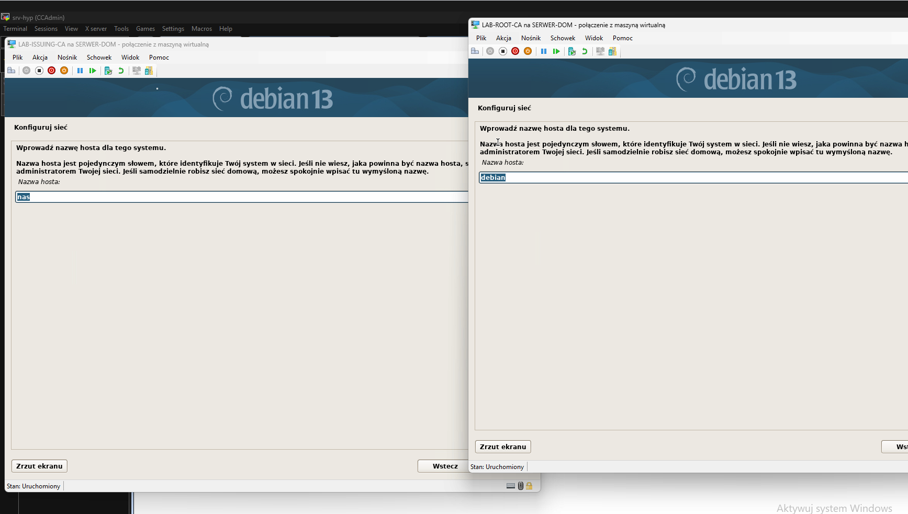
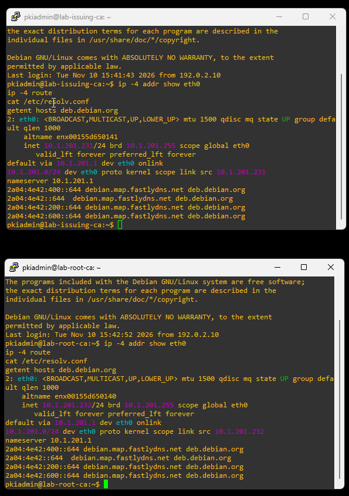
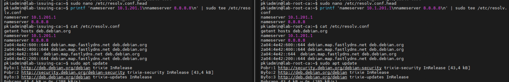

# 01 — Instalacja Debian 13 i konfiguracja sieci

**Zakres: wykonany, 10–12.11.2026.**

Powstały dwie osobne VM Hyper-V z Debianem 13 (bez GUI): `lab-root-ca` oraz `lab-issuing-ca`. Na obu skonfigurowano konto `pkiadmin`, pakiet `sudo` i aktualizacje APT. Początkowo repozytorium APT wskazywało nośnik DVD (`cdrom:`), co wymagało przełączenia na repozytoria sieciowe Debian Trixie.

| Parametr | Issuing CA | Root CA |
|---|---|---|
| IPv4 | `10.1.201.231/24` | `10.1.201.232/24` |
| Brama | `10.1.201.1` | `10.1.201.1` |
| DNS 1 | `10.1.201.1` | `10.1.201.1` |
| DNS 2 | `8.8.8.8` | `8.8.8.8` |

Sieć ustawiono w `/etc/network/interfaces`; podczas zmiany konfiguracji na statyczną pojawił się problem z pustym `/etc/resolv.conf` generowanym przez `dhcpcd`. Po uzupełnieniu resolvera sprawdzono `getent hosts deb.debian.org` i `apt update`. Trwałość adresacji i DNS sprawdzono po ponownym uruchomieniu systemu.

**Uwaga:** `8.8.8.8` nie rozwiązuje stref prywatnych labu, dlatego nie zastępuje drugiego wewnętrznego DNS. Docelowy Root CA nie będzie używał połączenia sieciowego.
