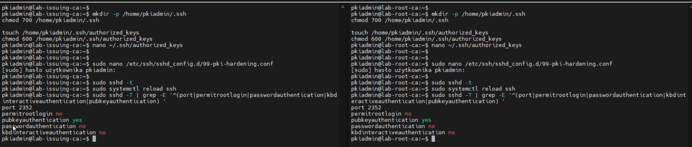
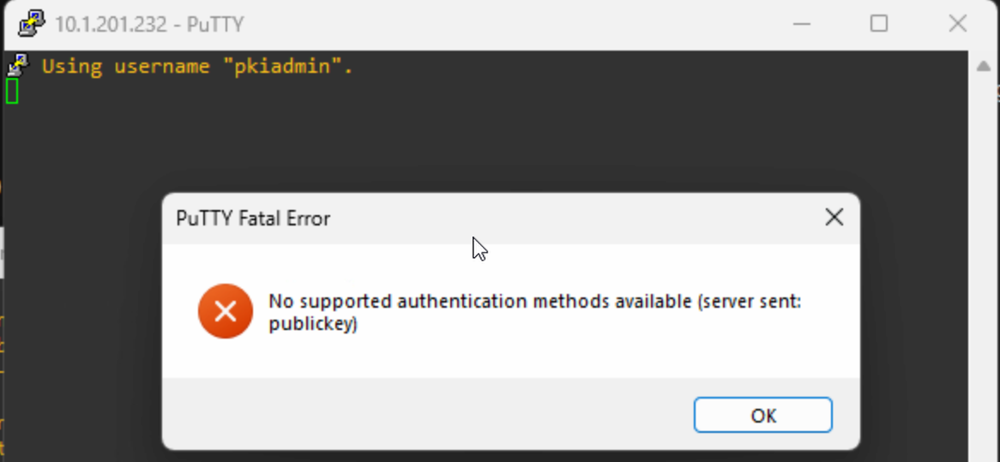
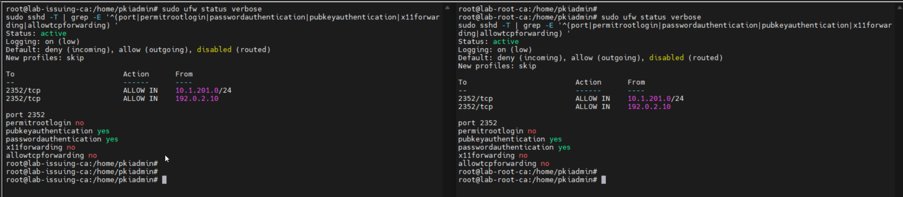
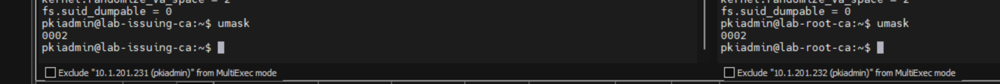
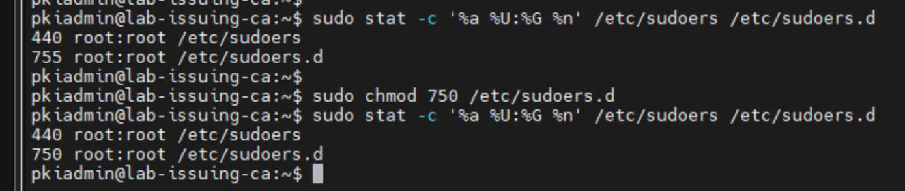
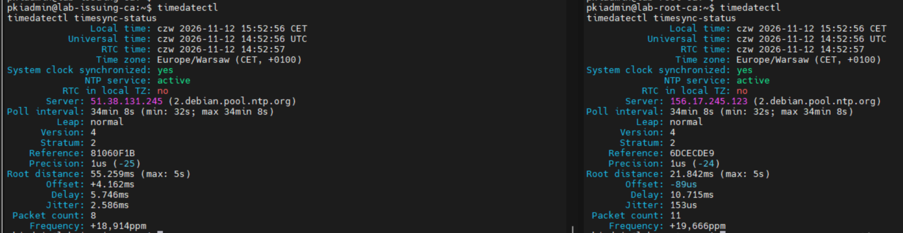

# 02 — Hardening Debian 13

**Zakres: wykonane czynności udokumentowane w rozmowie.**

## SSH

- Osobne pary kluczy Ed25519 (klucze prywatne pozostają na stacji administracyjnej).
- Port TCP `2352` na obu VM.
- `PermitRootLogin no`, `PubkeyAuthentication yes`, `PasswordAuthentication no`, `KbdInteractiveAuthentication no`.
- `X11Forwarding no`, `AllowTcpForwarding no`, `AllowAgentForwarding no`.
- Test poprawnego logowania kluczem oraz test negatywny bez klucza; PuTTY zwrócił `server sent: publickey`.

## Firewall UFW

UFW aktywny, domyślnie `deny incoming`, `allow outgoing`. Dostęp TCP `2352` dozwolony dla podsieci `10.1.201.0/24` oraz osobnego adresu źródłowego widocznego w konfiguracji podczas testów. Początkowo reguła tylko dla podsieci labowej odcięła SSH ze stacji administracyjnej; odzyskano dostęp przez konsolę Hyper-V i dopasowano reguły.

**Do poprawy przed uznaniem za docelowe:** zawęzić uprawnienie całej podsieci do wybranych stacji i potwierdzić realny adres źródłowy. Sama zmiana portu SSH nie zapewnia izolacji.

## Dodatkowe zabezpieczenia

- `umask 0077` dla konta `pkiadmin`.
- Parametry jądra, między innymi `net.ipv4.ip_forward=0`, `net.ipv4.conf.all.accept_redirects=0`, `kernel.randomize_va_space=2`, `fs.suid_dumpable=0`.
- Katalog `/etc/sudoers.d` zmieniony z `755` na `750` (uprawnienia pliku `/etc/sudoers`: `440`).
- `auditd` i reguły audytu; obecność reguł wykazana w raporcie Lynis.
- Synchronizacja czasu NTP potwierdzona na obu serwerach.
- Na Issuing CA zainstalowany ClamAV CLI i aktualizator baz sygnatur.

**Rozdzielenie ról:** Root CA docelowo offline, bez połączenia SSH i bez sieci. Nie przechowywać jego klucza prywatnego na maszynie online.
