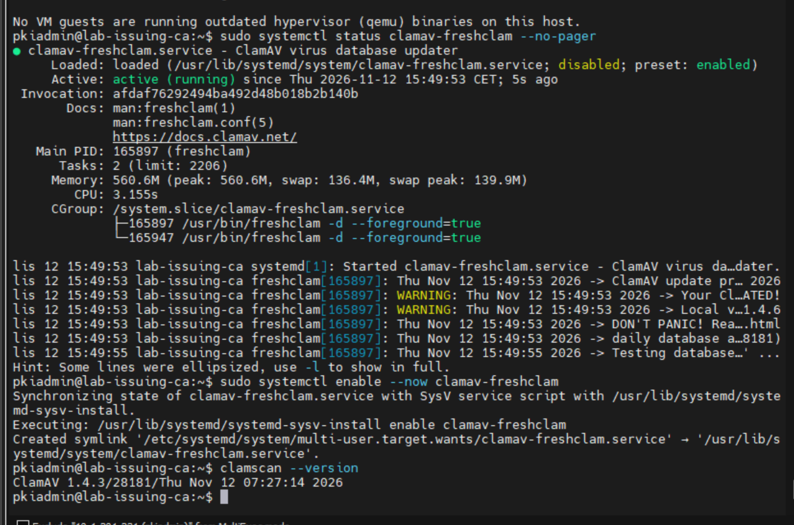
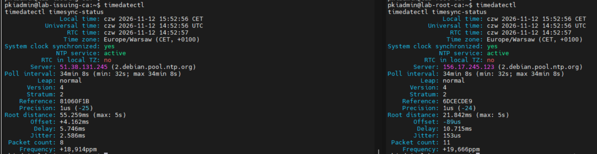

# 03 — Audyt i weryfikacja

## Audyt Lynis

Na `lab-issuing-ca` przeprowadzono ponowny audyt Lynis 3.1.4. W udostępnionym raporcie: **Hardening Index 77/100**, **258 testów**, **0 warnings**, **36 suggestions**. Wcześniejsze raportowane wyniki: 71 i 76. Wynik drugiej maszyny nie został udokumentowany w postaci analogicznego końcowego raportu — nie przypisujemy jej 77 punktów bez dowodu.

Potwierdzone w raporcie Issuing CA: firewall aktywny; wykryto skaner ClamAV; `auditd` włączony i reguły OK; narzędzie integralności Wazuh (syscheck) wykryte; AppArmor włączony; oba DNS-y odpowiadają. To raport testów konfiguracyjnych, nie test penetracyjny.

## ClamAV

Na Issuing CA: `clamav-freshclam.service` aktywny; `clamscan --version` zwraca ClamAV 1.4.3 z bazą sygnatur z 12.11.2026. Na screenie podczas pierwszego uruchomienia aktualizator zajmował około 560 MB RAM i używał swapu. Weryfikacja zużycia po aktualizacji pozostaje zalecana. W raporcie Lynis skaner wykryty, ale brak aktywnego agenta skanującego — planowany skan na żądanie.



## NTP

Na obu VM `System clock synchronized: yes`, `NTP service: active`, strefa `Europe/Warsaw`. Root CA offline wymaga sprawdzenia czasu przed podpisaniem CA lub wystawieniem CRL.



## Testy możliwe do powtórzenia

```bash
sudo sshd -T | grep -E '^(port|permitrootlogin|passwordauthentication|kbdinteractiveauthentication|pubkeyauthentication) '
sudo ufw status verbose
sudo auditctl -l
timedatectl
sudo lynis audit system --quick
sudo grep '^hardening_index=' /var/log/lynis-report.dat
```

> Raporty i screeny nie zawierają dowodu ukończenia konfiguracji samej hierarchii certyfikacji. To kolejny etap.
