# 05 — Galeria zrzutów z rzeczywistych prac

Poniższe obrazy pochodzą ze zrzutów udostępnionych podczas konfiguracji 10–12.11.2026. Każdy pokazuje konkretny, wykonany krok.

## 1. Dwie maszyny wirtualne podczas instalacji Debian 13

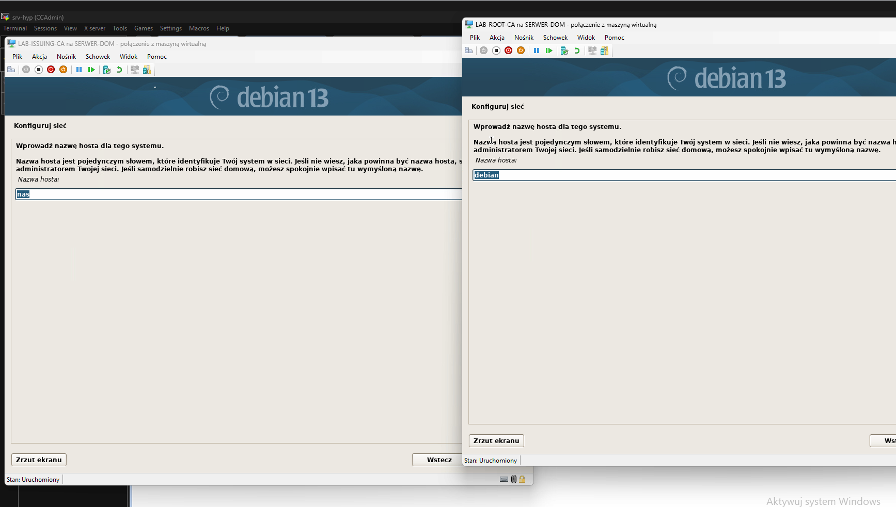

## 2. Sprawdzenie adresacji i DNS na obu serwerach

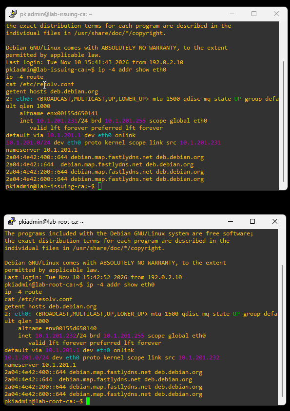

## 3. UFW aktywny i parametry SSH na obu maszynach

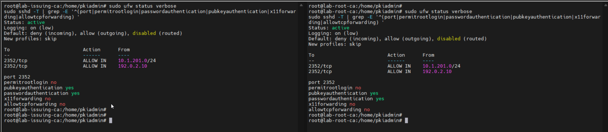

## 4. Efektywna konfiguracja SSH po wyłączeniu haseł

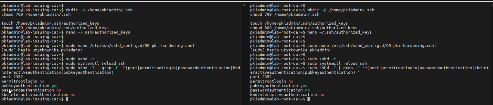

## 5. Odmowa logowania bez klucza w PuTTY

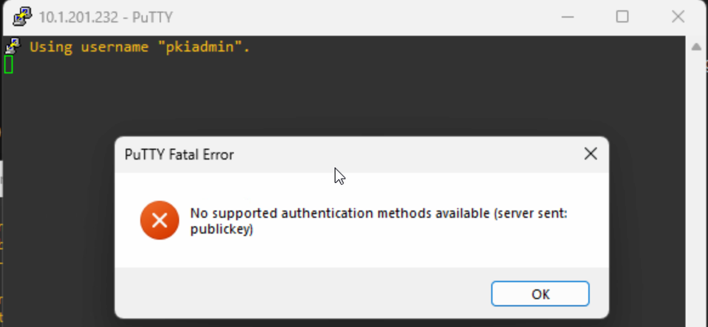

## 6. Umask 0077 na obu serwerach

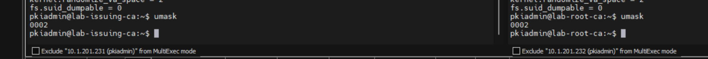

## 7. Dwa serwery DNS i aktualizacja APT

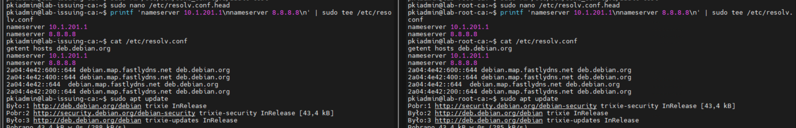

## 8. Zmiana uprawnień katalogu sudoers.d

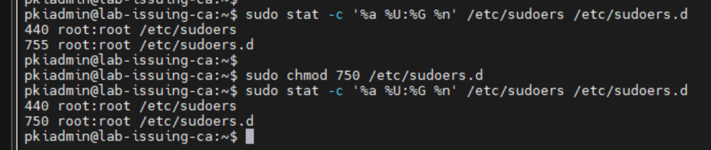

## 9. Status ClamAV i aktualizacji sygnatur na Issuing CA

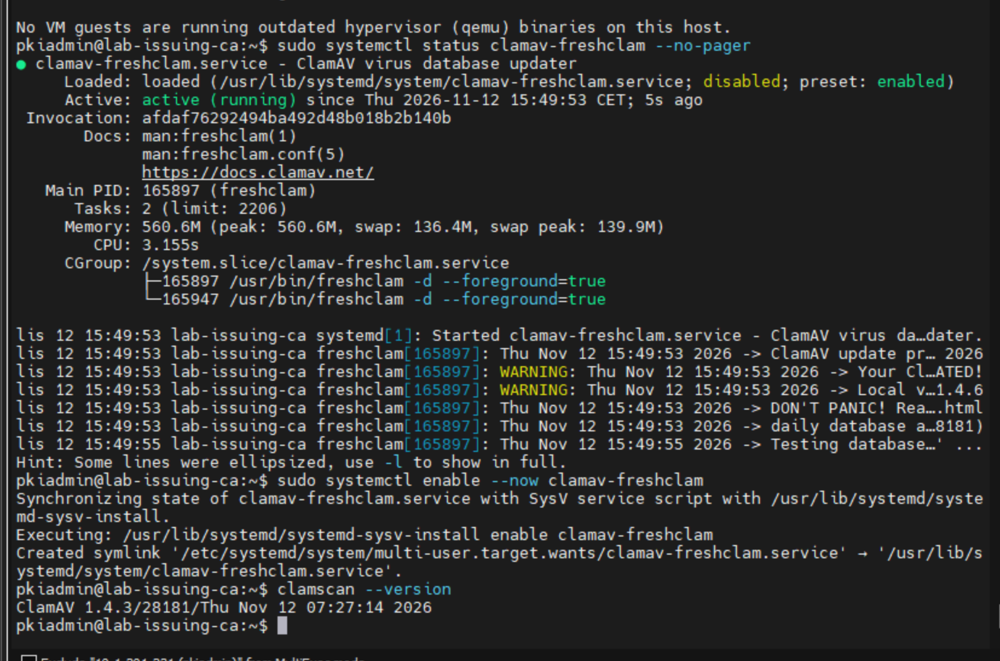

## 10. Synchronizacja NTP obu serwerów

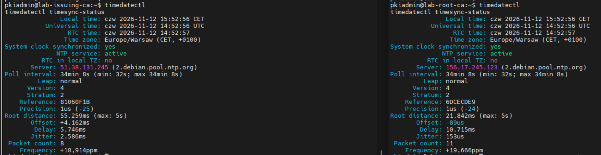

## Etap 2 — przejście Root CA offline i przygotowanie OpenSSL

- **Hyper-V przed izolacją:** 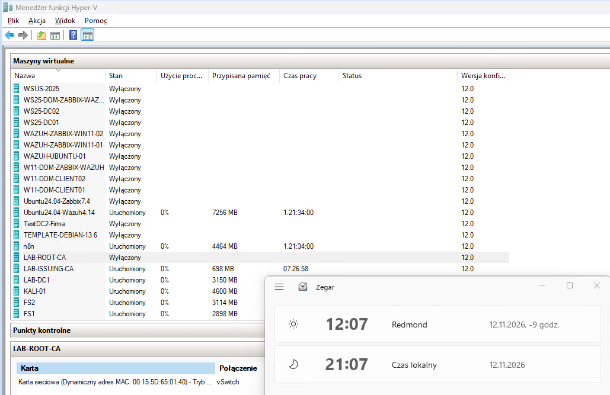
- **Hyper-V po izolacji:** 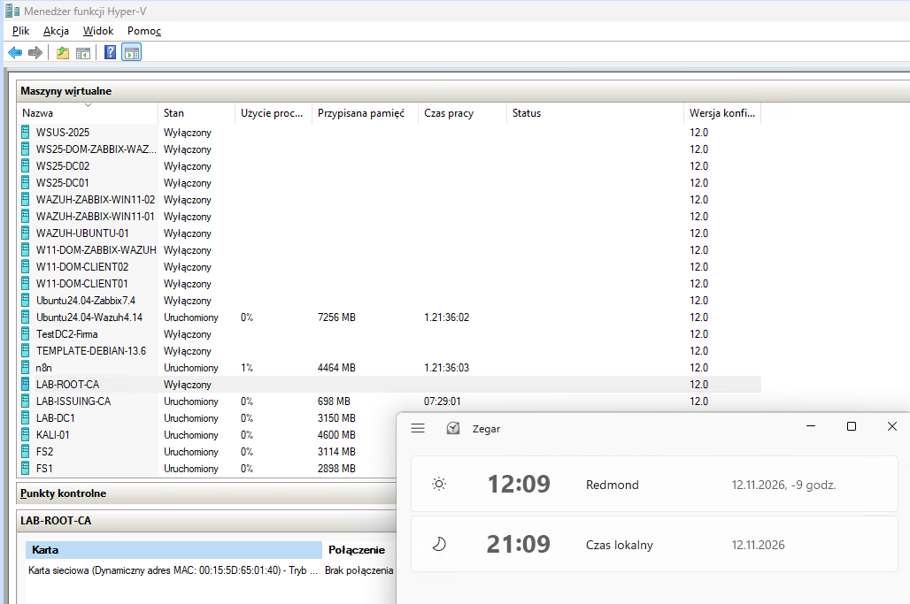
- **Konsola i test offline:** 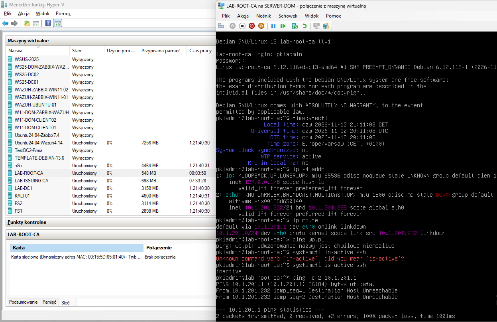
- **OpenSSL 3.5.7:** 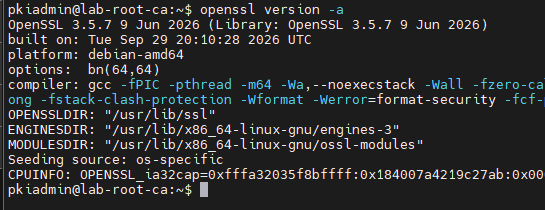
- **Katalogi bazy Root CA:** 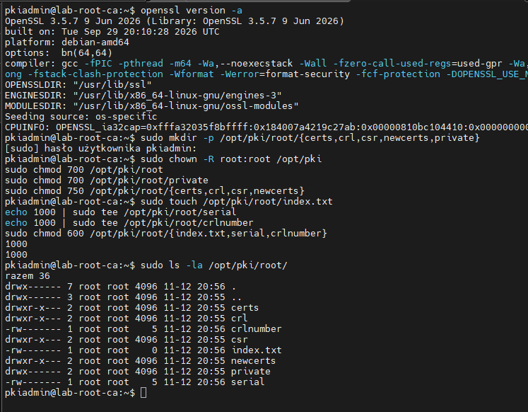

## 16 listopada 2026 — Root CA i Issuing CA

- [01-root-ca-offline-i-certyfikaty.png](../screenshots/2026-11-16/01-root-ca-offline-i-certyfikaty.png)
- [02-weryfikacja-lancucha-i-czas.png](../screenshots/2026-11-16/02-weryfikacja-lancucha-i-czas.png)
- [03-issuing-ca-klucz-i-csr.png](../screenshots/2026-11-16/03-issuing-ca-klucz-i-csr.png)
- [04-issuing-ca-x509-aia-crl.png](../screenshots/2026-11-16/04-issuing-ca-x509-aia-crl.png)
- [05-podpisanie-issuing-ca.png](../screenshots/2026-11-16/05-podpisanie-issuing-ca.png)
- [06-csr-przeniesiony-do-root-ca.png](../screenshots/2026-11-16/06-csr-przeniesiony-do-root-ca.png)
- [07-konfiguracja-rozszerzen-ca.png](../screenshots/2026-11-16/07-konfiguracja-rozszerzen-ca.png)
- [08-potwierdzenie-podpisu.png](../screenshots/2026-11-16/08-potwierdzenie-podpisu.png)
- [09-transfer-przez-iso.png](../screenshots/2026-11-16/09-transfer-przez-iso.png)
- [10-dns-unifi-pki.png](../screenshots/2026-11-16/10-dns-unifi-pki.png)
- [11-root-ca-generowanie-certyfikatu.png](../screenshots/2026-11-16/11-root-ca-generowanie-certyfikatu.png)
- [12-issuing-ca-csr-weryfikacja.png](../screenshots/2026-11-16/12-issuing-ca-csr-weryfikacja.png)

## 16–17.11.2026 — transfer VHDX, Nginx i CRL

- [01-transfer-ext4-root-ca.png](../screenshots/2026-11-16-17/01-transfer-ext4-root-ca.png)
- [02-transfer-ext4-issuing-ca.png](../screenshots/2026-11-16-17/02-transfer-ext4-issuing-ca.png)
- [03-weryfikacja-transferu-na-issuing.png](../screenshots/2026-11-16-17/03-weryfikacja-transferu-na-issuing.png)
- [04-nginx-ufw-na-issuing.png](../screenshots/2026-11-16-17/04-nginx-ufw-na-issuing.png)
- [05-pobieranie-certyfikatu-przegladarka.png](../screenshots/2026-11-16-17/05-pobieranie-certyfikatu-przegladarka.png)
- [06-root-ca-crl-openssl-verify.png](../screenshots/2026-11-16-17/06-root-ca-crl-openssl-verify.png)
- [07-konwersja-crl-transfer-vhdx.png](../screenshots/2026-11-16-17/07-konwersja-crl-transfer-vhdx.png)
- [08-test-zapisu-na-vhdx.png](../screenshots/2026-11-16-17/08-test-zapisu-na-vhdx.png)
- [09-dysk-transferowy-ext4.png](../screenshots/2026-11-16-17/09-dysk-transferowy-ext4.png)
- [10-problem-fat32-na-windows.png](../screenshots/2026-11-16-17/10-problem-fat32-na-windows.png)
- [11-weryfikacja-zawartosci-vhdx.png](../screenshots/2026-11-16-17/11-weryfikacja-zawartosci-vhdx.png)
- [12-transfer-certyfikatow-z-root-ca.png](../screenshots/2026-11-16-17/12-transfer-certyfikatow-z-root-ca.png)

## 17.11.2026 — wdrożenie HTTPS Wazuh

- [01-obecny-certyfikat-wazuh.png](../screenshots/2026-11-17-wazuh/01-obecny-certyfikat-wazuh.png)
- [02-poprawka-aia-crl-issuing.png](../screenshots/2026-11-17-wazuh/02-poprawka-aia-crl-issuing.png)
- [03-podpisywanie-i-test-hasla.png](../screenshots/2026-11-17-wazuh/03-podpisywanie-i-test-hasla.png)
- [04-podpis-i-weryfikacja-certyfikatu.png](../screenshots/2026-11-17-wazuh/04-podpis-i-weryfikacja-certyfikatu.png)
- [05-chrome-przed-zaufaniem-root-ca.png](../screenshots/2026-11-17-wazuh/05-chrome-przed-zaufaniem-root-ca.png)
- [06-pobranie-root-ca-windows.png](../screenshots/2026-11-17-wazuh/06-pobranie-root-ca-windows.png)
- [07-chrome-po-zaufaniu-root-ca.png](../screenshots/2026-11-17-wazuh/07-chrome-po-zaufaniu-root-ca.png)
- [08-pelny-test-crl-verify-ok.png](../screenshots/2026-11-17-wazuh/08-pelny-test-crl-verify-ok.png)
