# 05 — Galeria zrzutów z rzeczywistych prac

Poniższe obrazy pochodzą ze zrzutów udostępnionych podczas konfiguracji 10–12.11.2026. Każdy pokazuje konkretny, wykonany krok.

## 1. Dwie maszyny wirtualne podczas instalacji Debian 13

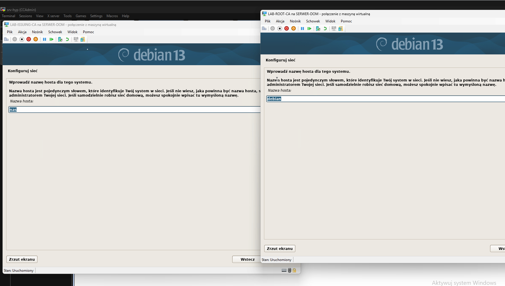

## 2. Sprawdzenie adresacji i DNS na obu serwerach

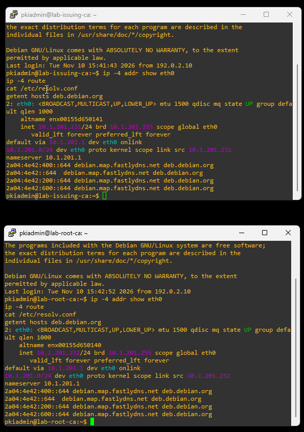

## 3. UFW aktywny i parametry SSH na obu maszynach

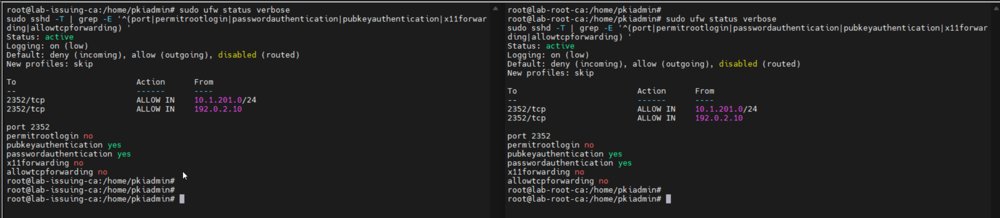

## 4. Efektywna konfiguracja SSH po wyłączeniu haseł

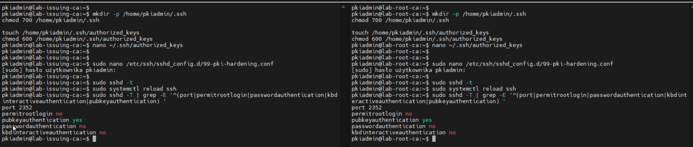

## 5. Odmowa logowania bez klucza w PuTTY

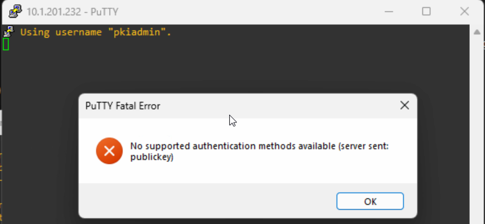

## 6. Umask 0077 na obu serwerach

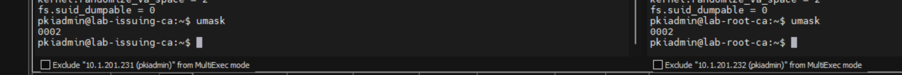

## 7. Dwa serwery DNS i aktualizacja APT

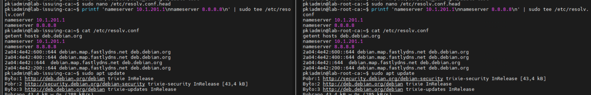

## 8. Zmiana uprawnień katalogu sudoers.d

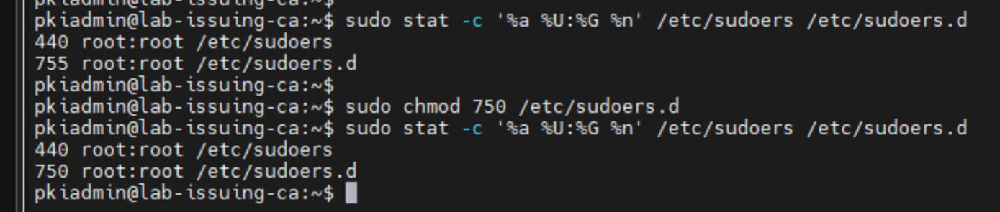

## 9. Status ClamAV i aktualizacji sygnatur na Issuing CA

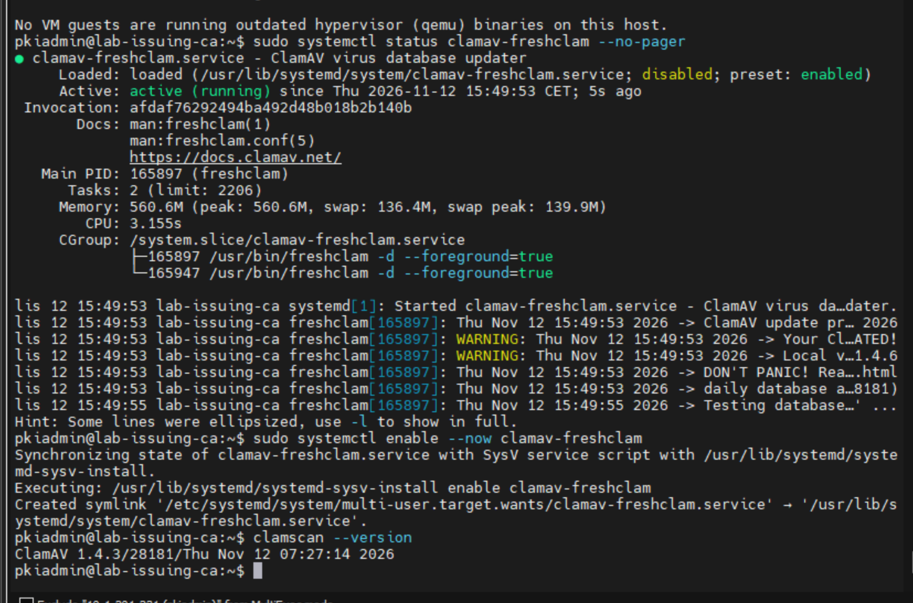

## 10. Synchronizacja NTP obu serwerów

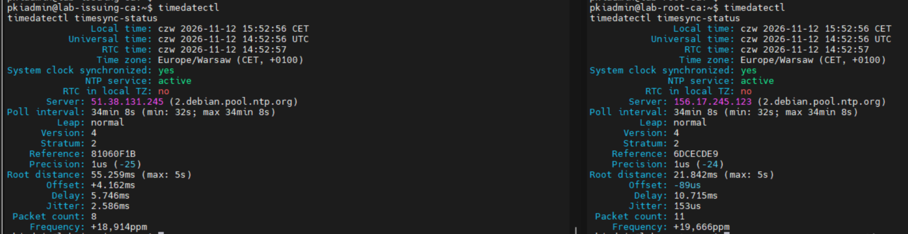

## Etap 2 — przejście Root CA offline i przygotowanie OpenSSL

- **Hyper-V przed izolacją:** 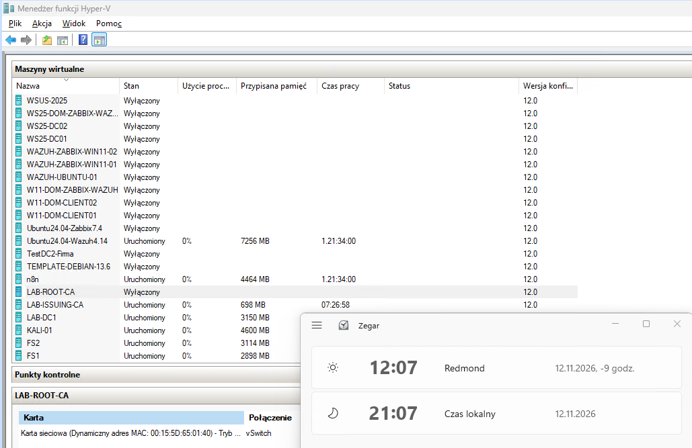
- **Hyper-V po izolacji:** 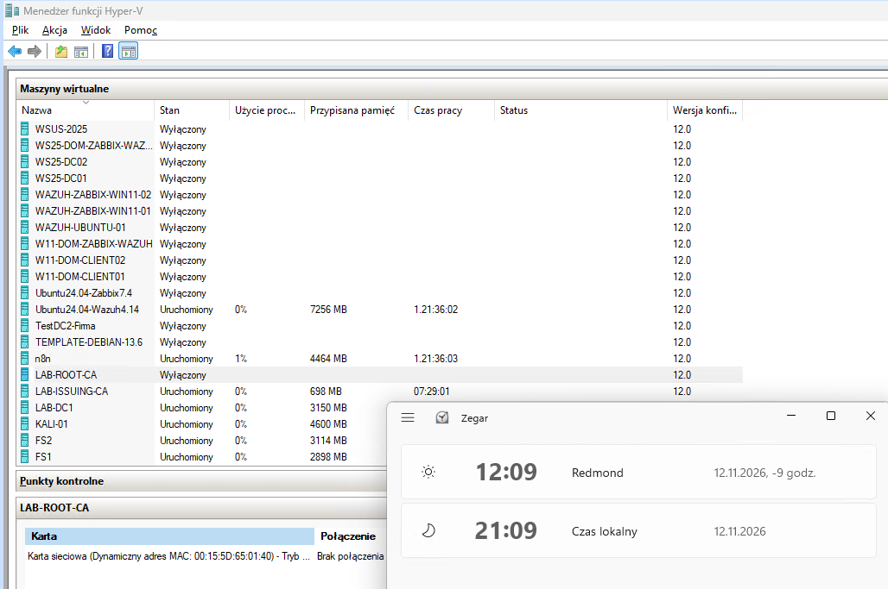
- **Konsola i test offline:** 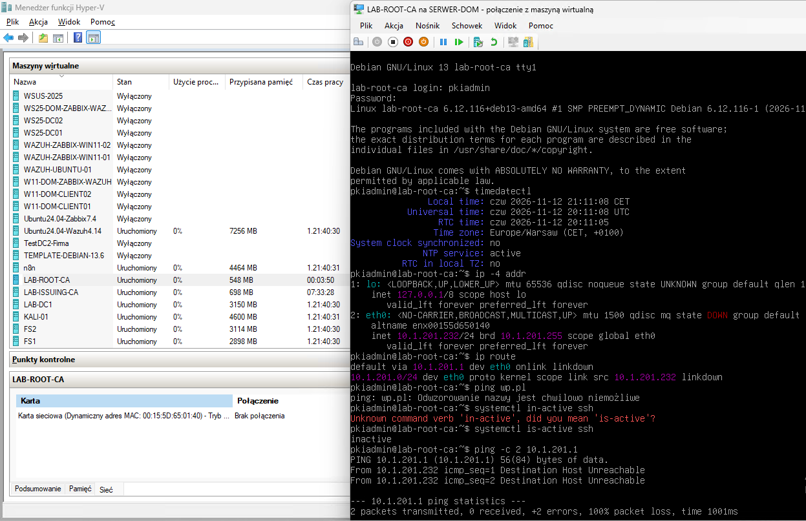
- **OpenSSL 3.5.7:** 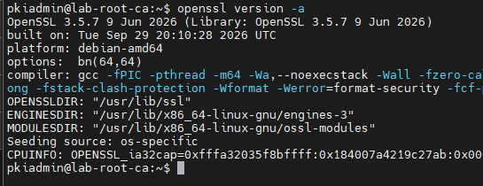
- **Katalogi bazy Root CA:** 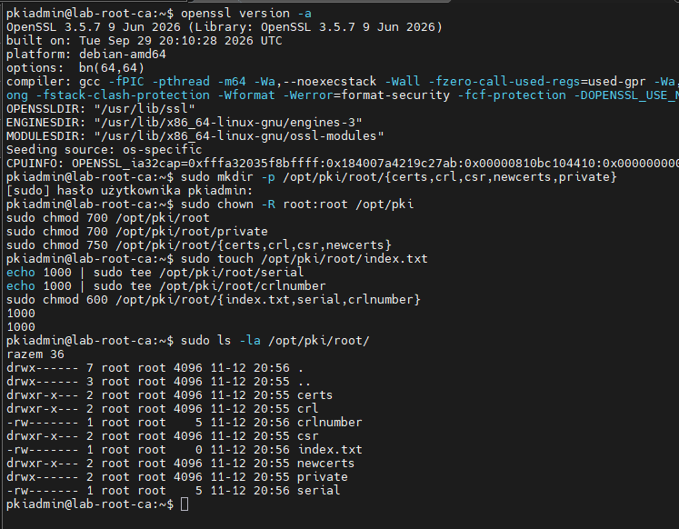
