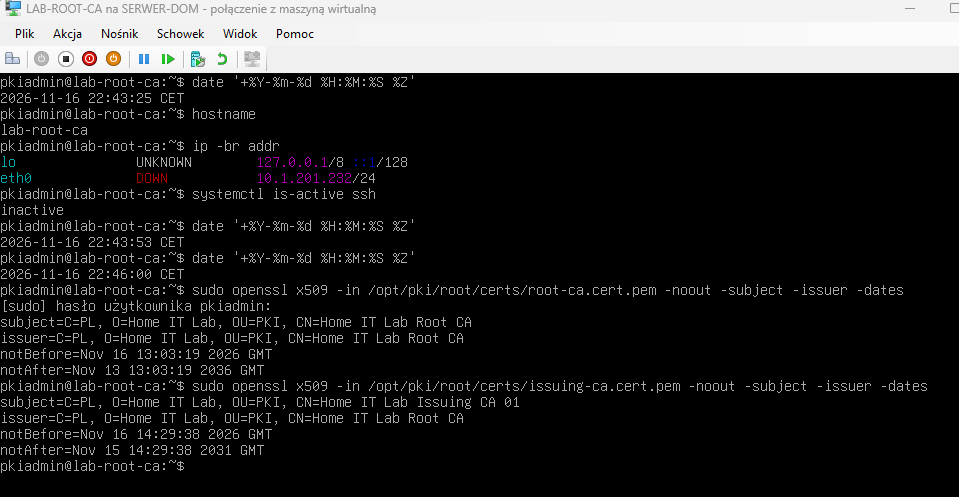
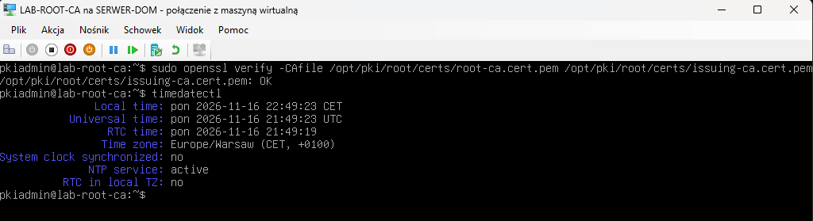
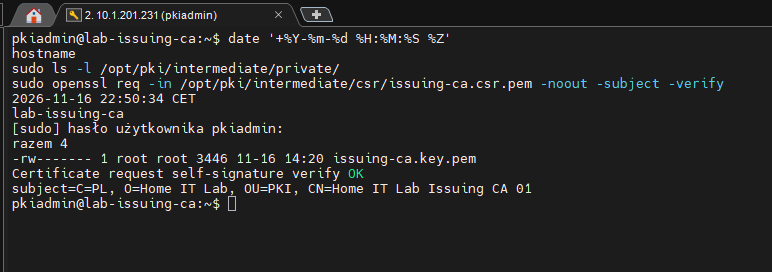

# Etap 2 — Hierarchia Root CA / Issuing CA (16.11.2026)

## Wykonane operacje

1. Utworzenie na offline Root CA zaszyfrowanego klucza RSA 4096 i samopodpisanego certyfikatu na ok. 10 lat.
2. Zweryfikowanie `subject=issuer`, `CA:TRUE,pathlen:1` i `keyCertSign,cRLSign` w certyfikacie Root CA.
3. Utworzenie na Issuing CA oddzielnego szyfrowanego klucza RSA 4096 oraz CSR.
4. Przeniesienie CSR na Root CA za pomocą ISO, ponowna weryfikacja self-signature CSR.
5. Przygotowanie rozszerzeń dla Issuing CA (`CA:TRUE,pathlen:0`, `keyCertSign,cRLSign`, HTTP AIA/CDP pod `pki.tworzewski.pl`).
6. Podpisanie CSR przez Root CA w OpenSSL `ca`, zatwierdzenie wpisu do bazy CA.
7. Zweryfikowanie certyfikatu i łańcucha zaufania. Wieczorem ponowiono testy ze wskazaniem daty i godziny.

## Wybrane polecenia kontrolne

> Polecenia służą do **odczytu i weryfikacji**, nie do ponownego wydawania certyfikatów.

```bash
sudo openssl x509 -in /opt/pki/root/certs/root-ca.cert.pem -noout -subject -issuer -dates
sudo openssl x509 -in /opt/pki/root/certs/issuing-ca.cert.pem -noout -subject -issuer -dates
sudo openssl x509 -in /opt/pki/root/certs/issuing-ca.cert.pem -noout -text
sudo openssl verify -CAfile /opt/pki/root/certs/root-ca.cert.pem /opt/pki/root/certs/issuing-ca.cert.pem
```

Ostatnie polecenie zwróciło `.../issuing-ca.cert.pem: OK`.

## Wnioski

Root CA pozostaje offline, co ogranicza jego ekspozycję na ataki sieciowe. Wystawiony certyfikat Issuing CA ma poprawne ograniczenie `pathlen:0`, a adresy publikacji zostały osadzone przed podpisaniem. Konfiguracja DNS w UniFi została dodana, ale publikacja HTTP certyfikatów i CRL oraz klientowska weryfikacja unieważnienia **nie zostały jeszcze wykonane**.

## Zdjęcia z dzisiejszych testów






