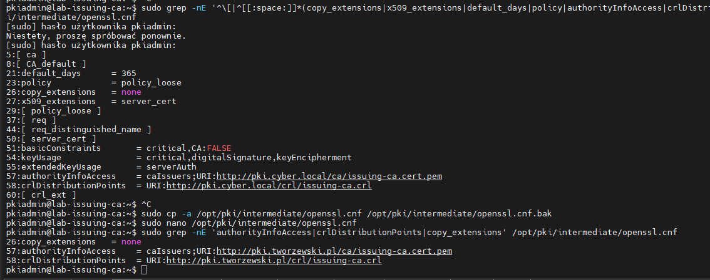
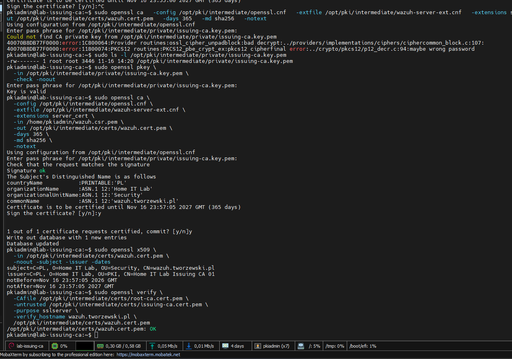
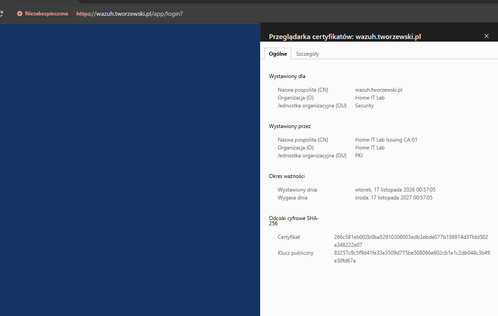
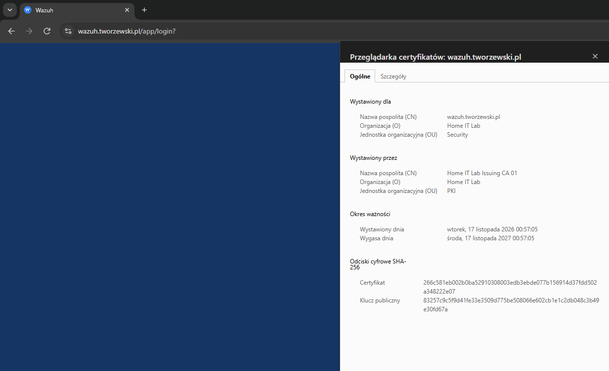
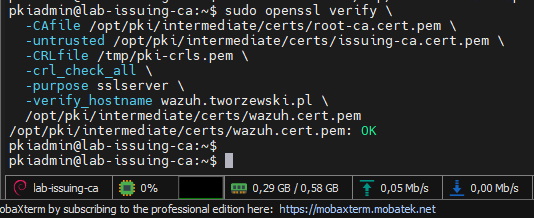

# 08 — Wazuh Dashboard: certyfikat HTTPS z Two-Tier PKI

**Data wykonania:** 17.11.2026 (część logów OpenSSL w UTC: 16.11.2026). **Status:** wdrożenie i testy certyfikatu zakończone.

## Cel i stan wejściowy

Wazuh Dashboard: `wazuh.tworzewski.pl`, `10.1.201.201`, port HTTPS `443`. Działająca usługa `wazuh-dashboard`; stary certyfikat wystawiony przez `Tworzewski LAB Root CA`. Nowe PKI: `Home IT Lab Root CA` (offline) → `Home IT Lab Issuing CA 01` (online). Wymiana dotyczyła tylko HTTPS Dashboardu, **bez ingerencji** w certyfikaty komunikacji Indexera, API czy agentów.

```yaml
# /etc/wazuh-dashboard/opensearch_dashboards.yml — wartości przed wymianą
server.host: 0.0.0.0
server.port: 443
server.ssl.enabled: true
server.ssl.key: "/etc/wazuh-dashboard/certs/wazuh-dashboard-key.pem"
server.ssl.certificate: "/etc/wazuh-dashboard/certs/wazuh-dashboard.pem"
```

## CSR i prywatny klucz — Wazuh

Utworzono kopię istniejących plików, następnie w `/etc/wazuh-dashboard/certs/home-pki/` wygenerowano nowy prywatny klucz RSA 4096. Plik klucza pozostaje na Wazuh; **nie znajduje się w repozytorium ani nie był przesyłany na CA**.

```bash
sudo openssl genpkey -algorithm RSA -pkeyopt rsa_keygen_bits:4096 \
  -out /etc/wazuh-dashboard/certs/home-pki/wazuh.key.pem
sudo chmod 600 /etc/wazuh-dashboard/certs/home-pki/wazuh.key.pem
```

Konfiguracja CSR (fragment):

```ini
[req]
default_md = sha256
prompt = no
distinguished_name = dn
req_extensions = req_ext
[dn]
C = PL
O = Home IT Lab
OU = Security
CN = wazuh.tworzewski.pl
[req_ext]
subjectAltName = @alt_names
[alt_names]
DNS.1 = wazuh.tworzewski.pl
IP.1 = 10.1.201.201
```

```bash
sudo openssl req -new \
  -key /etc/wazuh-dashboard/certs/home-pki/wazuh.key.pem \
  -out /etc/wazuh-dashboard/certs/home-pki/wazuh.csr.pem \
  -config /etc/wazuh-dashboard/certs/home-pki/wazuh-csr.cnf
```

CSR skopiowano przez Windows/MobaXterm do `/home/pkiadmin/wazuh.csr.pem` na `LAB-ISSUING-CA`. Wynik: `Certificate request self-signature verify OK` oraz SAN `DNS:wazuh.tworzewski.pl, IP Address:10.1.201.201`.

## Profil podpisu — Issuing CA

W `/opt/pki/intermediate/openssl.cnf` pozostawały stare punkty `pki.cyber.local`, które poprawiono na `pki.tworzewski.pl`; `copy_extensions = none` pozostało bez zmian. Zastosowano oddzielny plik rozszerzeń dla certyfikatu Wazuh:

```ini
[server_cert]
basicConstraints = critical,CA:FALSE
keyUsage = critical,digitalSignature,keyEncipherment
extendedKeyUsage = serverAuth
subjectKeyIdentifier = hash
authorityKeyIdentifier = keyid,issuer
subjectAltName = @alt_names
authorityInfoAccess = caIssuers;URI:http://pki.tworzewski.pl/ca/issuing-ca.cert.pem
crlDistributionPoints = URI:http://pki.tworzewski.pl/crl/issuing-ca.crl
[alt_names]
DNS.1 = wazuh.tworzewski.pl
IP.1 = 10.1.201.201
```

```bash
sudo openssl ca \
  -config /opt/pki/intermediate/openssl.cnf \
  -extfile /opt/pki/intermediate/wazuh-server-ext.cnf \
  -extensions server_cert \
  -in /home/pkiadmin/wazuh.csr.pem \
  -out /opt/pki/intermediate/certs/wazuh.cert.pem \
  -days 365 -md sha256 -notext
```

Podczas prób podpisania pierwszą operację przerwano przy pytaniu `Sign the certificate?`. Druga zakończyła się błędem `bad decrypt` z powodu niepoprawnego hasła. Następnie `openssl pkey -check -noout` potwierdził `Key is valid`; kolejna próba podpisania zakończyła się zatwierdzeniem i `Database updated`. Certyfikat nie został przypadkowo wydany w trakcie nieudanych prób.

**Potwierdzone parametry:**

| Parametr | Wynik |
|---|---|
| Subject | `C=PL, O=Home IT Lab, OU=Security, CN=wazuh.tworzewski.pl` |
| Issuer | `C=PL, O=Home IT Lab, OU=PKI, CN=Home IT Lab Issuing CA 01` |
| `notBefore` | `Nov 16 23:57:05 2026 GMT` |
| `notAfter` | `Nov 16 23:57:05 2027 GMT` |
| `openssl verify -verify_hostname` | `OK` |





## Wdrożenie HTTPS

Na `LAB-ISSUING-CA` przygotowano plik `wazuh-fullchain.pem` (certyfikat Wazuh jako pierwszy, następnie Issuing CA). Publiczny łańcuch przeniesiono przez Windows/MobaXterm na serwer Wazuh. Na Wazuh pozostawiono lokalny klucz prywatny i poprawiono ścieżki w konfiguracji:

```yaml
server.ssl.key: "/etc/wazuh-dashboard/certs/home-pki/wazuh.key.pem"
server.ssl.certificate: "/etc/wazuh-dashboard/certs/home-pki/wazuh-fullchain.pem"
```

Po restarcie:

```text
wazuh-dashboard.service: active (running)
curl -k -I https://127.0.0.1/  -> HTTP/1.1 302 Found, location: /app/login?
openssl s_client -> subject: wazuh.tworzewski.pl; issuer: Home IT Lab Issuing CA 01
```

Nie zmieniano ustawień certyfikatów połączenia z Wazuh Indexer.

## Zaufanie Windows i Chrome

Początkowo Chrome oznaczał HTTPS jako „Niezabezpieczona”, choć prezentowany certyfikat był już nowy. Publiczny certyfikat `root-ca.cert.pem` pobrano do `C:\SSL-PKI\`. Po weryfikacji odcisku SHA-256 z zaufaną kopią Root CA należy importować go do magazynu *Zaufane główne urzędy certyfikacji* komputera Windows:

```powershell
certutil -hashfile 'C:\SSL-PKI\root-ca.cert.pem' SHA256
# Porównaj fingerprint ze źródłem zaufanym przed importem
certutil -addstore Root 'C:\SSL-PKI\root-ca.cert.pem'
```

Po imporcie ostrzeżenie przestało być widoczne w Chrome. W rozmowie pokazano stan strony przed i po zmianie, ale **nie pokazano odrębnego protokołu porównania fingerprintu**; nie należy traktować go jako udokumentowanego testu.





## Walidacja certyfikatu i CRL

Na Issuing CA utworzono `/tmp/pki-crls.pem` zawierający dwie listy CRL w PEM: Root CA i Issuing CA. Następnie wykonano:

```bash
sudo openssl verify \
  -CAfile /opt/pki/intermediate/certs/root-ca.cert.pem \
  -untrusted /opt/pki/intermediate/certs/issuing-ca.cert.pem \
  -CRLfile /tmp/pki-crls.pem \
  -crl_check_all -purpose sslserver \
  -verify_hostname wazuh.tworzewski.pl \
  /opt/pki/intermediate/certs/wazuh.cert.pem
```

Otrzymano:

```text
/opt/pki/intermediate/certs/wazuh.cert.pem: OK
```

**Granice testu:** poprawnie zweryfikowano certyfikat przy użyciu przekazanych CRL, ale nie unieważniono osobnego certyfikatu testowego i nie sprawdzano, czy każdy klient automatycznie pobiera CRL z AIA/CDP.



## Eksploatacja po zakończeniu projektu

- **Issuing CA CRL:** odnawiać ręcznie przed datą `nextUpdate` (w tej iteracji: `23.11.2026 23:34:58 UTC`), sprawdzać podpis i publikację; preferowany zapas kilka dni. Chroniony hasłem klucz CA pozostaje zaszyfrowany.
- **Root CA CRL:** osobno odnawiać offline przed `15.05.2027 23:20:11 UTC`, przenosić publiczną CRL przez bezpieczny nośnik.
- **Certyfikat Wazuh:** planowo odnawiać przed `16.11.2027 23:57:05 UTC`.
- **Kopie i bezpieczeństwo:** backup klucza CA, ochronę VHDX, kontrolę checkpointów oraz test odtwarzania opisano jako zalecenia, lecz nie wdrożono. Nie publikować prywatnych kluczy, passphrase ani dysków VM.

**Wynik projektu:** dwupoziomowe PKI offline/online, publikacja certyfikatów CA i obu CRL, własny serwerowy certyfikat TLS dla Wazuh i test `-crl_check_all`: **zakończone w założonym zakresie**.
