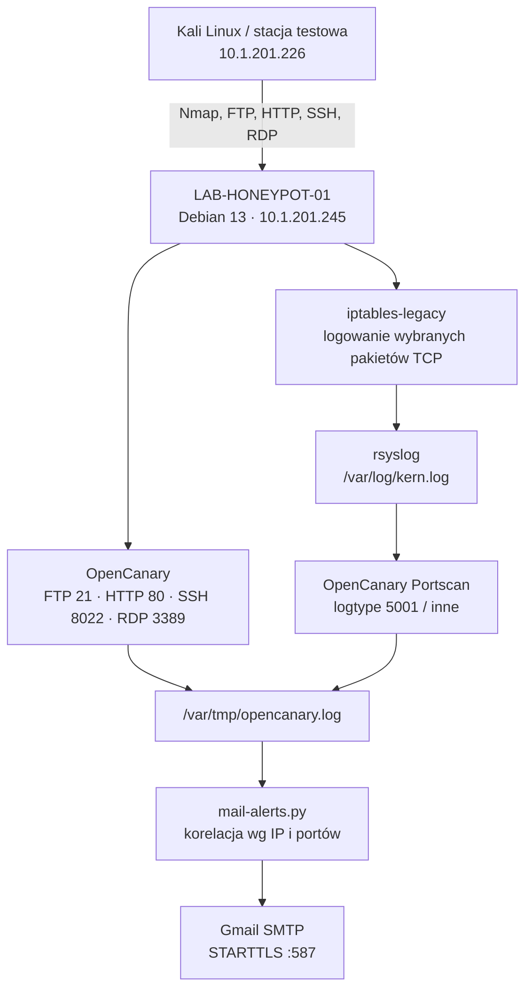
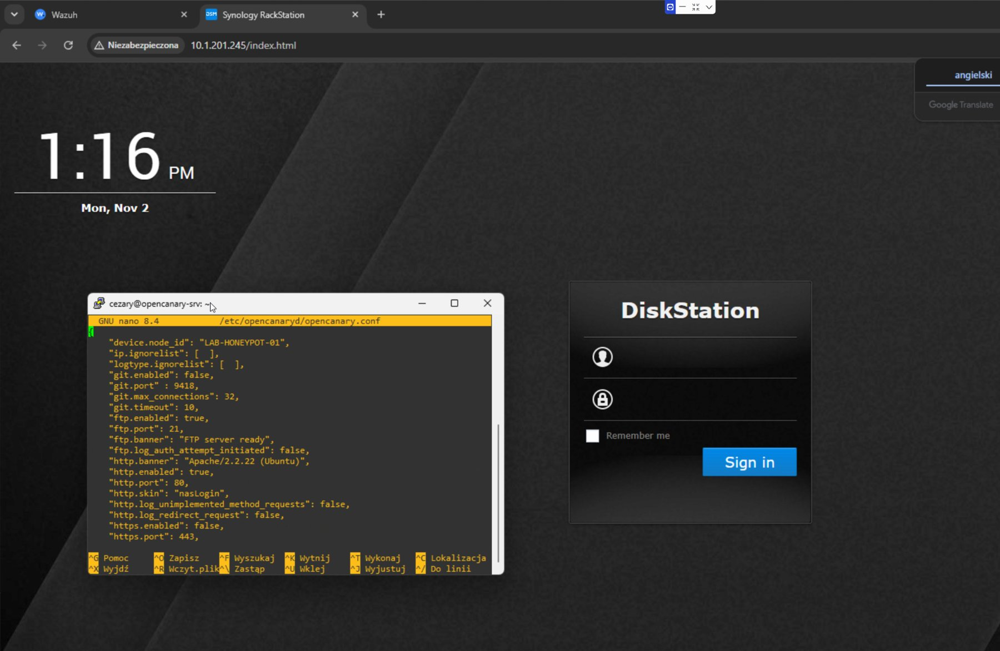
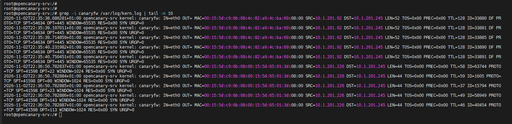
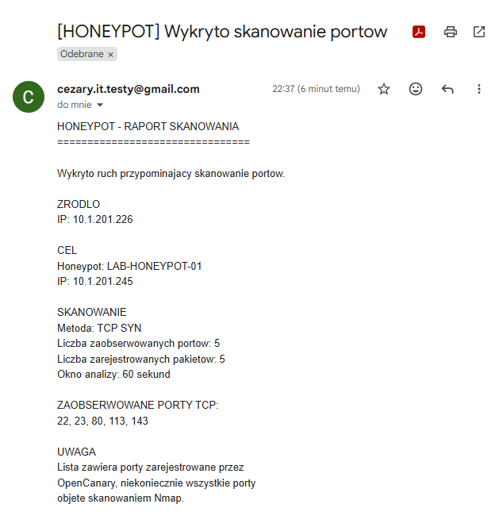
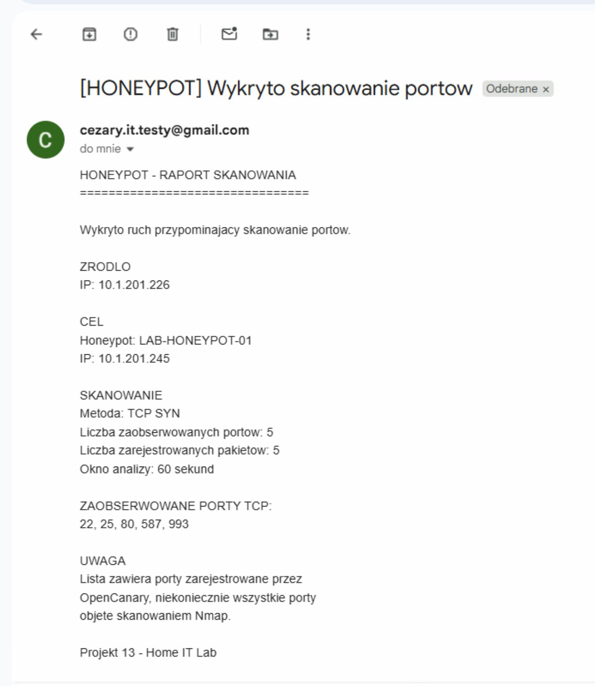
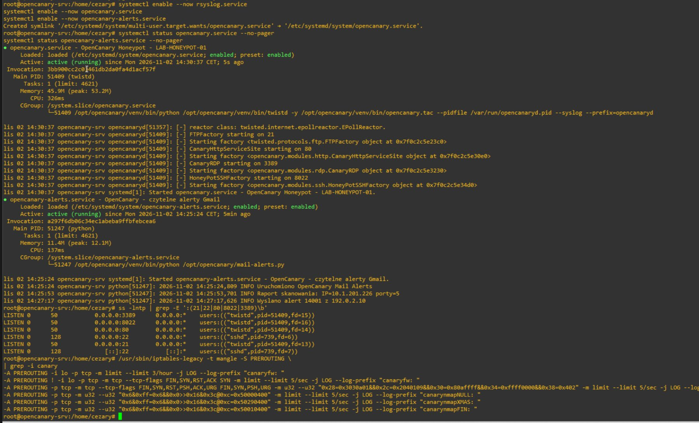
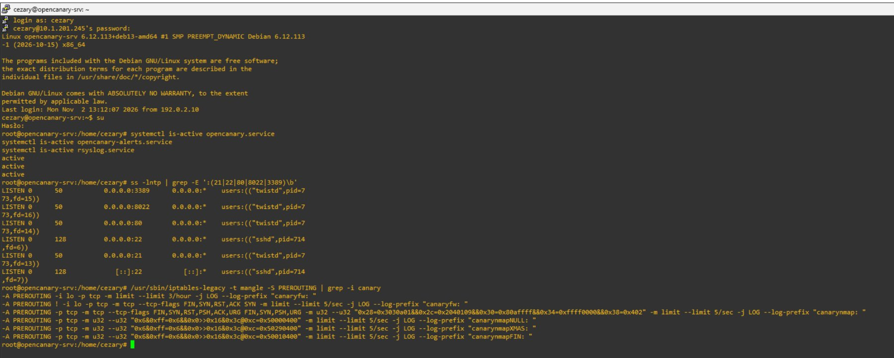
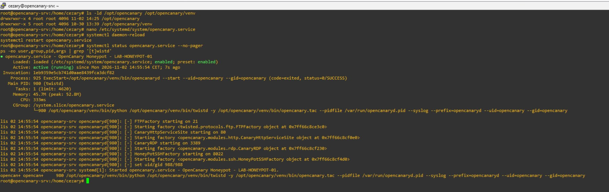

# Projekt 01 — OpenCanary Honeypot Deployment & Attack Detection

> **Home IT Lab · Debian 13 · OpenCanary 0.9.10 · Kali Linux · iptables-legacy · Gmail SMTP · systemd**  
> Stan dokumentacji: **2 listopada 2026 r.** | Status: **wdrożono i przetestowano w laboratorium**

## 1. Cel projektu

Celem było wdrożenie lekkiego honeypota, który udaje usługi sieciowe, rejestruje próby logowania i aktywność przypominającą skanowanie portów oraz wysyła **czytelne, zbiorcze alerty e-mail bez Wazuh i n8n**. Dodatkowym celem było przećwiczenie analizy ruchu TCP, obsługi usług Linux i podstaw hardeningu.

**Zakres potwierdzony testami:** usługi FTP, HTTP (fałszywy panel NAS), SSH honeypot, RDP, moduł portscan, odczyt logów jądra, korelacja obserwowanych portów, wysyłka Gmail, automatyczny start po restarcie oraz uruchomienie procesu `twistd` bez uprawnień root.

## 2. Architektura



| Element | Konfiguracja |
|---|---|
| Hypervisor | Hyper-V |
| System | Debian 13, bez GUI |
| Host | `opencanary-srv` / identyfikator `LAB-HONEYPOT-01` |
| IP honeypota | `10.1.201.245` — adres potwierdzony w logach testowych |
| Host testowy | Kali Linux `10.1.201.226` |
| OpenCanary | `0.9.10`, Python `venv` w `/opt/opencanary/venv` |
| Konfiguracja | `/etc/opencanaryd/opencanary.conf` |
| Dziennik OpenCanary | `/var/tmp/opencanary.log` |
| Dziennik pakietów | `/var/log/kern.log` |
| Skrypt alertów | `/opt/opencanary/mail-alerts.py` |
| Menedżer usług | `systemd` |

> **Uwaga o adresacji:** podczas instalacji rozważany był adres `10.1.201.240`, ale w późniejszych, rzeczywistych testach honeypot pracował pod `10.1.201.245`. W dokumentacji przyjęto adres z testów.

## 3. Fałszywe usługi

| Port | Rola | Wynik |
|---|---|---|
| `21/TCP` | OpenCanary FTP | Próba logowania zarejestrowana (`logtype: 2000`) |
| `80/TCP` | OpenCanary HTTP, `nasLogin` | Zarejestrowane interakcje i próby logowania (`3000`, `3001`) |
| `8022/TCP` | Fałszywe SSH | Nasłuch potwierdzony po restarcie |
| `3389/TCP` | Fałszywe RDP | Nasłuch oraz zdarzenie `14001` potwierdzone |
| `22/TCP` | **Prawdziwe SSH administracyjne Debiana** | Zachowane, nie jest pułapką |

Fragment konfiguracji — **nie jest pełnym plikiem JSON**:

```json
"device.node_id": "LAB-HONEYPOT-01",
"ftp.enabled": true,
"ftp.port": 21,
"http.enabled": true,
"http.port": 80,
"http.skin": "nasLogin",
"ssh.enabled": true,
"ssh.port": 8022,
"rdp.enabled": true,
"rdp.port": 3389,
"portscan.enabled": true,
"portscan.logfile": "/var/log/kern.log"
```



*Rys. 1. Widok fałszywego panelu NAS wygenerowanego przez OpenCanary.*

## 4. Wykrywanie skanowania Nmap

W Debianie 13 `iptables` było dostępne przez `/usr/sbin/iptables`, ale domyślny backend raportował `nf_tables`. W laboratorium uruchomiono reguły modułu Portscan oparte na **`iptables-legacy`**. Początkowo moduł nie konfigurował reguł z powodu braku `sudo`; po doinstalowaniu `sudo` reguły pojawiły się w tabeli `mangle/PREROUTING`.

```bash
# Weryfikacja wersji i reguł — bez modyfikowania firewalla
/usr/sbin/iptables-legacy --version
/usr/sbin/iptables-legacy -t mangle -S PREROUTING | grep -i canary

# Kontrola logów pakietów
grep -i canaryfw /var/log/kern.log | tail -n 10

# Kontrola zdarzeń OpenCanary
jq -c 'select(.logtype == 5001)' /var/tmp/opencanary.log | tail -n 10
```

Przykładowy **test w kontrolowanym labie**:

```bash
sudo nmap -sS -T3 -p 1-1000 10.1.201.245
```

**Wynik:** potwierdzono zdarzenia `logtype: 5001` ze źródła `10.1.201.226`, skierowane do `10.1.201.245`, oraz działanie reguł `canaryfw` / `canarynmap*`.



*Rys. 2. Pakiety z Kali zarejestrowane przez reguły i przekazane do OpenCanary.*

> **Interpretacja:** wykrycie SYN nie dowodzi samo w sobie użycia Nmap ani ataku. Mechanizm logowania posiada limit częstotliwości, więc raportowana lista portów jest **próbką zaobserwowanego ruchu**, a nie kompletnym wynikiem skanowania.

## 5. Czytelne i zbiorcze powiadomienia Gmail

Najpierw korzystano z wbudowanego `logging.handlers.SMTPHandler`, który wysyłał nieczytelny surowy JSON. Następnie zastąpiono go osobnym skryptem **`mail-alerts.py`**, odczytującym nowe linie `/var/tmp/opencanary.log` i wysyłającym sformatowane wiadomości.

**Logika korelacji potwierdzona w testach:**

1. Rejestracja pakietów TCP SYN (`logtype: 5001`) wraz z źródłowym IP i portem docelowym.
2. Grupowanie zdarzeń według źródła i celu w oknie **60 sekund**.
3. Próg **5 różnych portów** i **12 sekund bez nowych obserwacji**.
4. Jeden zbiorczy e-mail z liczbą i listą portów; ograniczenie kolejnych raportów dla tego samego źródła.
5. Osobne alerty o próbach logowania do obsługiwanych fałszywych usług.

Przykładowe wiadomości otrzymane w Gmailu:



*Rys. 3. Raport zawierający adres źródłowy, cel, liczbę pakietów i listę zaobserwowanych portów.*



*Rys. 4. Zbiorczy alert nadal dostarczany po uruchomieniu OpenCanary z ograniczonymi uprawnieniami.*

**Bezpieczeństwo Gmail:** wykorzystywane jest osobne hasło aplikacji Google przechowywane w pliku `/etc/opencanaryd/secrets/gmail-password` z uprawnieniami `600 root:root`. Skrypt odczytuje je lokalnie i uwierzytelnia się do `smtp.gmail.com:587` przez STARTTLS. Hasło aplikacji **nie jest publikowane w repozytorium**; alerty nie zawierają pól z hasłami podawanymi do honeypota.

> Nie publikuj rzeczywistej zawartości plików `gmail-password`, `opencanary.conf` z ewentualnymi sekretami ani pełnych logów zawierających dane prób logowania.

## 6. Automatyczny start przez systemd

Powstały dwie jednostki:

- `opencanary.service` — uruchamianie OpenCanary i inicjalizacja usług oraz reguł;
- `opencanary-alerts.service` — uruchamianie skryptu `mail-alerts.py` i wysyłka e-mail.

Kontrola:

```bash
systemctl is-active opencanary.service
systemctl is-active opencanary-alerts.service
systemctl is-active rsyslog.service
ss -lntp | grep -E ':(21|22|80|8022|3389)\b'
/usr/sbin/iptables-legacy -t mangle -S PREROUTING | grep -i canary
```

Po ponownym uruchomieniu Debiana potwierdzono status `active` dla trzech usług, nasłuch właściwych portów oraz obecność **sześciu reguł** wykrywania.



*Rys. 5. Usługi i reguły przed restartem.*



*Rys. 6. Weryfikacja usług, portów i reguł po restarcie Debiana.*

## 7. Hardening — wykonane prace

Utworzono konto systemowe `opencanary` (bez interaktywnego logowania), a uruchomienie OpenCanary zmieniono tak, aby **po inicjalizacji procesu nastąpiło zrzucenie uprawnień**:

```ini
ExecStart=/opt/opencanary/venv/bin/opencanaryd --start --uid=opencanary --gid=opencanary
```

Uruchomienie wymaga podwyższonych uprawnień na etapie otwierania portów uprzywilejowanych i konfiguracji portscan, ale po starcie proces `twistd` działa jako `opencanary` (UID/GID 988/988). Potwierdzono to komunikatem `set uid/gid 988/988` oraz listą procesów.

Uprawnienia istotnych plików podczas testu:

| Zasób | Uprawnienia |
|---|---|
| `/etc/opencanaryd/opencanary.conf` | `600 root:root` |
| `/etc/opencanaryd/secrets/gmail-password` | `600 root:root` |
| `/var/tmp/opencanary.log` | `660 root:opencanary-logs` |
| `/var/log/kern.log` | `640 root:adm` |

Użytkownik `opencanary` należał do grup `adm` i `opencanary-logs`. Testy `test -r` i `test -w` wykonane przez `runuser` potwierdziły odczyt logu jądra i zapis do dziennika OpenCanary. Po zmianie tożsamości procesu przeprowadzono test Nmap i ponownie otrzymano zbiorczy e-mail.



*Rys. 7. Proces `twistd` działa z ograniczonymi uprawnieniami.*

## 8. Świadome odstępstwa i ograniczenia

### SSH administracyjny — celowo bez ograniczenia do adresów IP

**Świadomie odstąpiono** w obecnym etapie od ograniczenia dostępu do prawdziwego SSH administracyjnego (TCP/22) tylko do określonych adresów. Decyzja dotyczy wygody zarządzania w kontrolowanym laboratorium, nie jest rekomendacją dla środowiska produkcyjnego. Ryzykiem jest szersza powierzchnia ataku. Przed ekspozycją poza zaufany lab należy ponownie ocenić dostęp do SSH, reguły firewalla i uwierzytelnianie kluczem.

### Zadania otwarte — nie oznaczono jako wykonane

- **Rotacja logów** (`logrotate`) wraz z zachowaniem praw dostępu i kompatybilnością z czytnikiem `mail-alerts.py` — do wdrożenia.
- **Izolacja sieciowa** honeypota od serwerów AD/FS/Wazuh — do zaprojektowania i przetestowania; sama wspólna podsieć nie daje takiej separacji.
- **Kolejka/persistencja e-maili:** obecny skrypt przechowuje stan korelacji w pamięci; po restarcie stan zanika i brak gwarantowanego ponowienia nieudanych wysyłek.
- **Prawdziwy fałszywy DC (LDAP/Kerberos/RPC):** wyłącznie rozważana rozbudowa. **Nie wdrożono** pełnej emulacji kontrolera domeny — OpenCanary sam z siebie nie jest Active Directory.

## 9. Wnioski

Projekt pokazał różnicę między pojedynczym zdarzeniem (`TCP SYN`, próba logowania) a korelacją wielu obserwacji w jeden czytelny alert. W praktyce połączono sieć TCP/IP, Linux, reguły firewalla, logowanie jądra, usługi systemd, Python i Gmail SMTP. Kluczowy rezultat: po zrzuceniu uprawnień procesu honeypot **nadal wykrywał skan i wysyłał alert**, co zostało potwierdzone testem z Kali.

## 10. Pliki projektu

- [`scripts/mail-alerts.py`](scripts/mail-alerts.py) — szablon skryptu korelującego zaobserwowane pakiety SYN i wysyłającego czytelne raporty Gmail. Adresy i hasło aplikacji pobierane są z konfiguracji lokalnej.
- [`config/mail-alerts.env.example`](config/mail-alerts.env.example) — przykład niepoufnych ustawień e-mail.
- [`config/opencanary.service.example`](config/opencanary.service.example) i [`config/opencanary-alerts.service.example`](config/opencanary-alerts.service.example) — wzory jednostek systemd (sprawdź ścieżki i uprawnienia przed wdrożeniem).
- [`screenshots/`](screenshots/) — siedem zrzutów z wykonanych testów.

**Uwaga:** są to szablony odtwarzające rozwiązanie laboratoryjne, a nie eksport plików bezpośrednio z serwera. Przed wdrożeniem należy porównać je z działającą konfiguracją.

## 11. Materiały

- [OpenCanary — repozytorium projektu](https://github.com/thinkst/opencanary)
- [OpenCanary — dokumentacja](https://opencanary.readthedocs.io/)
- [Debian — systemd](https://wiki.debian.org/systemd)
- [Google — hasła aplikacji](https://support.google.com/accounts/answer/185833)

---

**Zasada publikacji:** do repozytorium trafiają wyłącznie materiały laboratoryjne, bez kluczy SMTP, rzeczywistych haseł, pełnych logów i danych uwierzytelniających.
