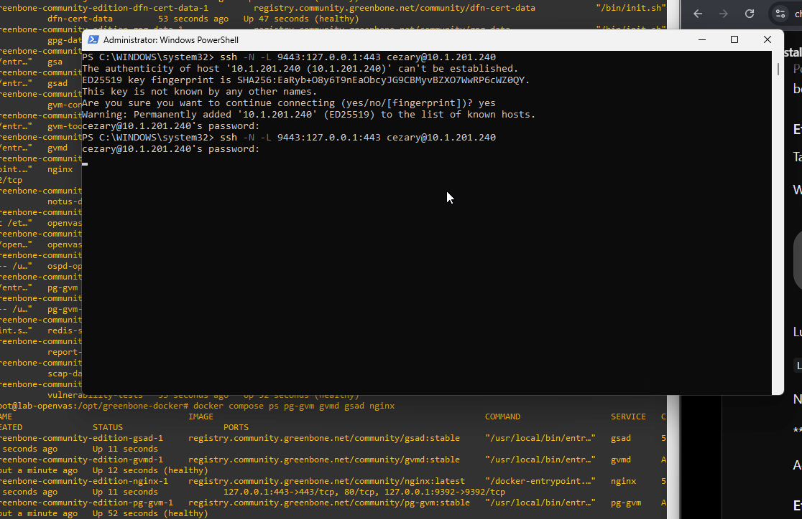
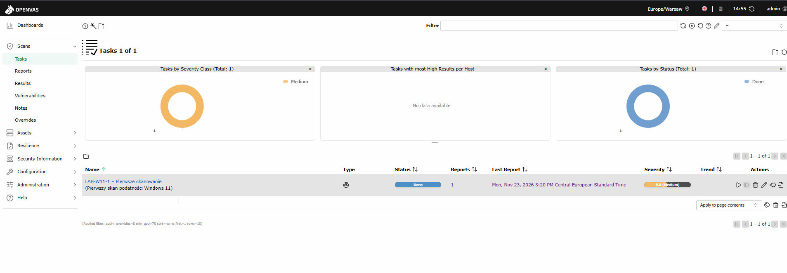
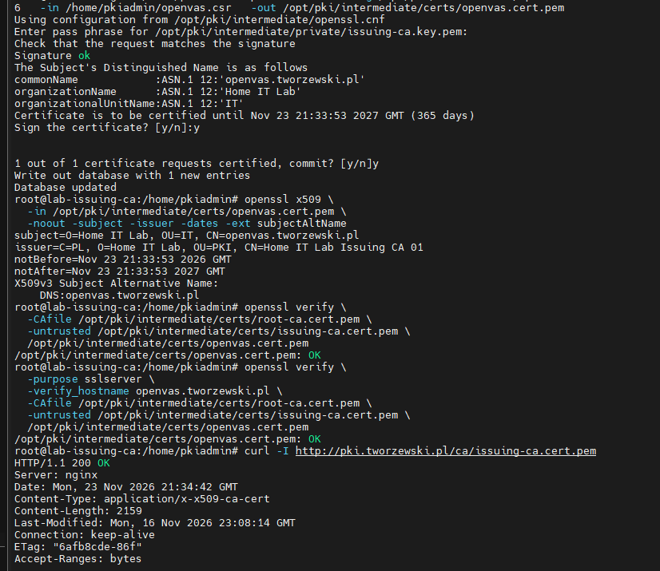

# OpenVAS / Greenbone Community Edition — Home IT Lab

W swoim Home Labie uruchomiłem **OpenVAS (Greenbone Community Edition)** na Debianie 13 z użyciem Docker Compose, aby skanować podatności urządzeń w sieci laboratoryjnej. Skonfigurowałem na routerze **wewnętrzny wpis DNS** dla `openvas.tworzewski.pl`, dzięki czemu panel jest dostępny po nazwie, bez tunelu SSH. Dostęp HTTPS zabezpieczyłem **własnym certyfikatem SSL/TLS**, wystawionym przez mój **LAB-ISSUING-CA** w dwupoziomowej infrastrukturze PKI z Root CA utrzymywanym offline. Przeprowadziłem pierwszy skan Windows 11 oraz przygotowałem zadanie dla laboratoryjnego kontrolera domeny Active Directory.
## Środowisko

- Debian 13 (bez GUI), Hyper-V, Docker Compose i Greenbone Community Edition.
- Na routerze dodałem wewnętrzny wpis DNS `openvas.tworzewski.pl` wskazujący serwer OpenVAS; dostęp do panelu pozostaje w LAN.
- Skanowane systemy: `LAB-W11-1` oraz `LAB-DC1` (laboratorium AD).
- Certyfikat TLS: własny **Home IT Lab Issuing CA 01**, ważny do 23.11.2027.

## Wdrożenie i weryfikacja

Oficjalny Greenbone uruchomiłem za pomocą Docker Compose:

```bash
mkdir -p /opt/greenbone-docker
cd /opt/greenbone-docker
curl -fL https://greenbone.github.io/docs/latest/_static/compose.yaml -o compose.yaml
docker compose config -q
docker compose pull
docker compose up -d
docker compose ps
```



Po pierwszym uruchomieniu zaczekałem na zakończenie synchronizacji **NVT, SCAP, CERT i GVMD_DATA**.


## Pierwsze skanowanie

Dodałem Windows 11 jako *Target* i uruchomiłem zadanie **Full and fast** bez uwierzytelnienia. Pierwszy skan wykazał m.in. wykrywalność usług RPC (135/TCP) oraz obsługę starszych wersji TLS na RDP (3389/TCP); najwyższa ocena w raporcie wynosiła **CVSS 5.0 (Medium)**. Utworzyłem także zadanie dla laboratoryjnego kontrolera domeny. Wyniki wymagają oceny w kontekście konfiguracji hosta — samo wykrycie usługi nie oznacza udanego ataku.




## DNS na routerze i HTTPS z własnego PKI

Po dodaniu wpisu DNS na routerze, na LAB-OPENVAS wygenerowałem klucz RSA 3072-bit oraz CSR z SAN `DNS:openvas.tworzewski.pl`. Żądanie podpisałem na własnym **LAB-ISSUING-CA**, używając profilu `serverAuth` i rozszerzeń AIA/CRL. Gotowy certyfikat z łańcuchem podłączyłem do Nginx wewnątrz Docker Compose; klucz prywatny OpenVAS pozostał na serwerze, a Root CA był offline.




**Efekt:** panel OpenVAS działa w LAN pod adresem **`https://openvas.tworzewski.pl`**, z certyfikatem wystawionym przez moje PKI, bez potrzeby uruchamiania tunelu SSH.

---

*Projekt laboratoryjny, wykonany 23 listopada 2026 r. Zrzuty pokazują wewnętrzne nazwy i adresację testową. W repozytorium nie publikuję kluczy prywatnych, haseł ani plików zawierających sekrety.*
