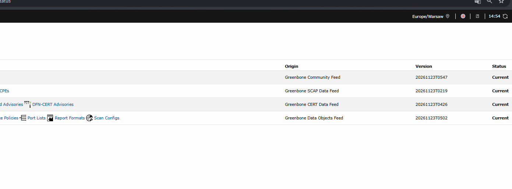
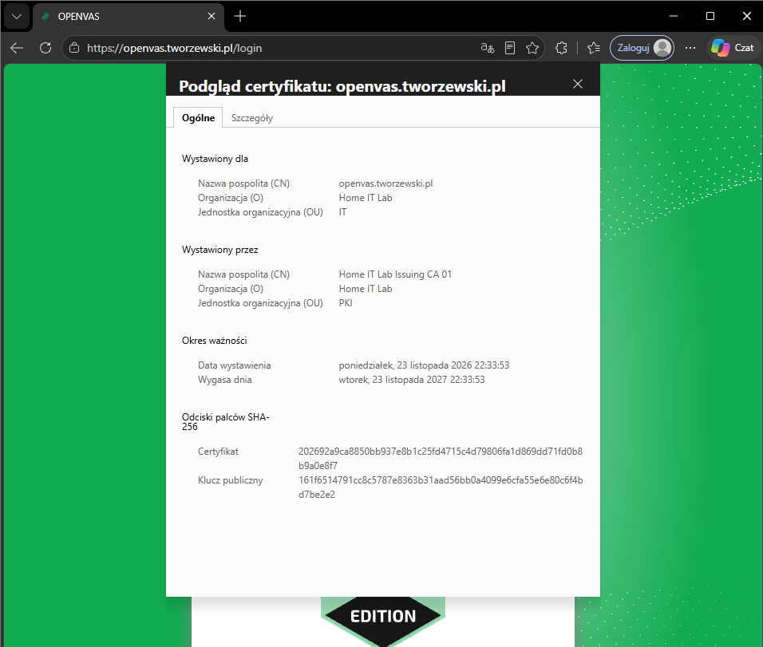

# OpenVAS / Greenbone Community Edition — Home IT Lab

W swoim Home Labie uruchomiłem **OpenVAS (Greenbone Community Edition)** na Debianie 13 z wykorzystaniem Docker Compose. Celem było sprawdzenie bezpieczeństwa maszyn laboratoryjnych, w tym Windows 11 i kontrolera domeny Active Directory. Po zakończeniu synchronizacji baz wykonałem pierwszy skan Windows 11 i przeanalizowałem wykryte usługi oraz słabsze ustawienia. Do zabezpieczenia dostępu HTTPS wykorzystałem **własną infrastrukturę Two-Tier PKI** — certyfikat dla `openvas.tworzewski.pl` wystawił mój LAB-ISSUING-CA, którego certyfikat został podpisany przez offline Root CA.

## Środowisko

- Debian 13 (bez GUI), Hyper-V, Docker Compose i Greenbone Community Edition.
- Wewnętrzna nazwa DNS: `openvas.tworzewski.pl` — dostęp tylko z sieci laboratoryjnej.
- Skanowane systemy: `LAB-W11-1` oraz `LAB-DC1` (laboratorium AD).
- Certyfikat TLS: własny **Home IT Lab Issuing CA 01**, ważny do 23.11.2027.

## Wdrożenie i weryfikacja

Oficjalny Greenbone uruchomiłem za pomocą Docker Compose:

```bash
mkdir -p /opt/greenbone-docker
cd /opt/greenbone-docker
curl -fL https://greenbone.github.io/docs/latest/_static/compose.yaml -o compose.yaml
docker compose config -q
docker compose pull
docker compose up -d
docker compose ps
```


Po pierwszym uruchomieniu zaczekałem na zakończenie synchronizacji **NVT, SCAP, CERT i GVMD_DATA**.



## Pierwsze skanowanie

Dodałem Windows 11 jako *Target* i uruchomiłem zadanie **Full and fast** bez uwierzytelnienia. Pierwszy skan wykazał m.in. wykrywalność usług RPC (135/TCP) oraz obsługę starszych wersji TLS na RDP (3389/TCP); najwyższa ocena w raporcie wynosiła **CVSS 5.0 (Medium)**. Utworzyłem także zadanie dla laboratoryjnego kontrolera domeny. Wyniki wymagają oceny w kontekście konfiguracji hosta — samo wykrycie usługi nie oznacza udanego ataku.


## HTTPS z własnego Two-Tier PKI

Na LAB-OPENVAS wygenerowałem klucz RSA 3072-bit oraz CSR z SAN `DNS:openvas.tworzewski.pl`. Żądanie podpisałem na własnym **LAB-ISSUING-CA**, używając profilu `serverAuth` i rozszerzeń AIA/CRL. Gotowy certyfikat z łańcuchem podłączyłem do Nginx wewnątrz Docker Compose; klucz prywatny OpenVAS pozostał na serwerze, a Root CA był offline.




**Efekt:** panel OpenVAS działa w LAN pod adresem **`https://openvas.tworzewski.pl`**, z certyfikatem wystawionym przez moje PKI, bez potrzeby uruchamiania tunelu SSH.

---

*Projekt laboratoryjny, wykonany 23 listopada 2026 r. Zrzuty pokazują wewnętrzne nazwy i adresację testową. W repozytorium nie publikuję kluczy prywatnych, haseł ani plików zawierających sekrety.*
