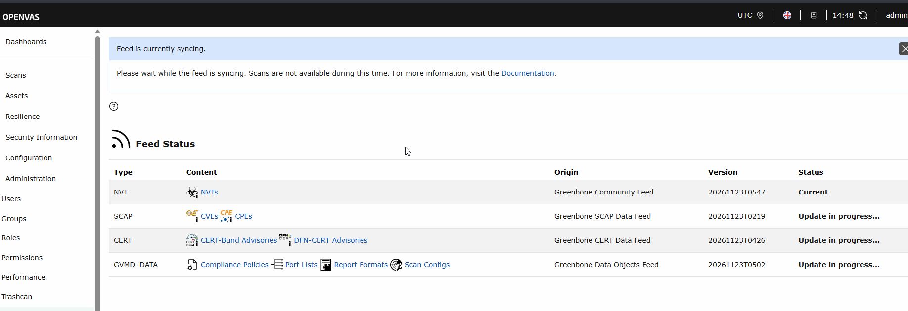
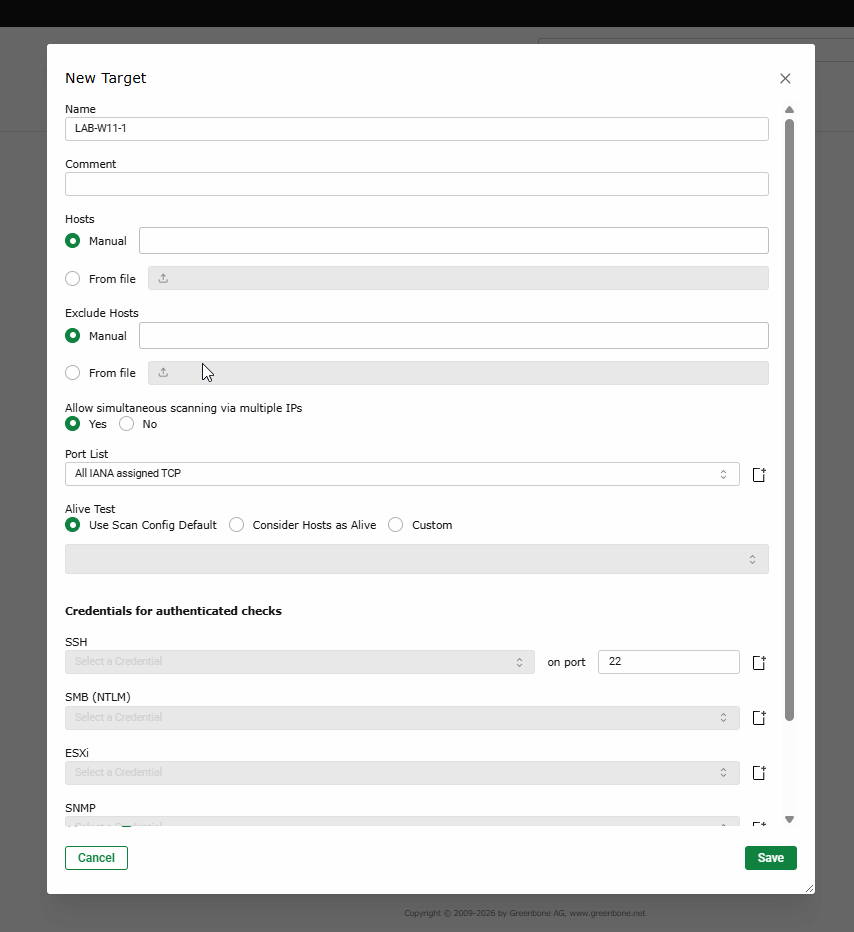
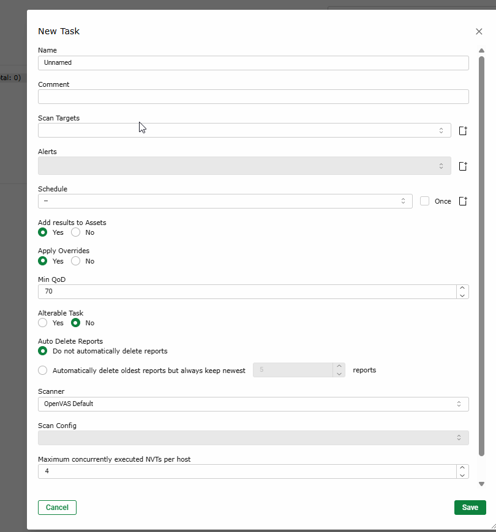
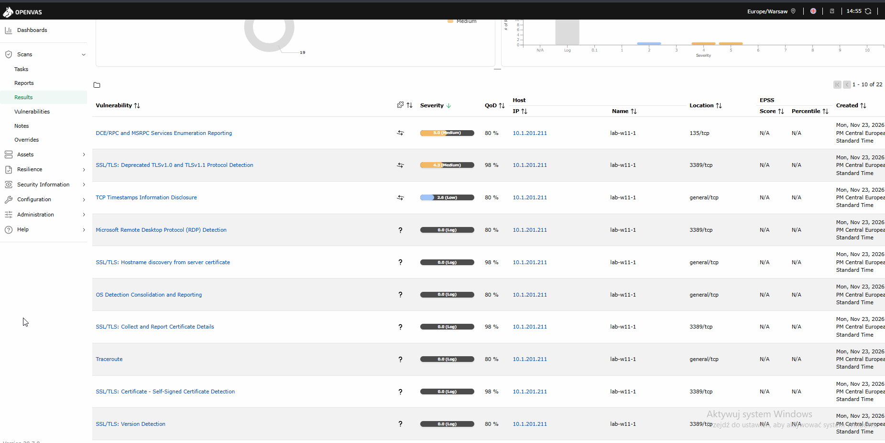

# OpenVAS / Greenbone Community Edition — wdrożenie w Home IT Lab


**Praktyczna dokumentacja drugiej, udanej instalacji** skanera podatności Greenbone Community Edition na Debianie 13 w Docker Compose, skanowania Windows 11 i laboratoryjnego kontrolera domeny oraz wdrożenia HTTPS z certyfikatem podpisanym przez własne **Two-Tier PKI**.

> **Zakres dokumentacji:** wdrożenie przeprowadzone 23 listopada 2026 r. Nie opisuję wcześniejszej próby instalacji ani historii problemów z dyskiem. Zrzuty pochodzą z faktycznej pracy w laboratorium. Występują na nich wewnętrzne nazwy hostów i adresy IP — sprawdź, czy chcesz je ujawniać w publicznym repozytorium.

## Spis treści

1. [Architektura i środowisko](#1-architektura-i-środowisko)
2. [Debian 13 i Docker](#2-debian-13-i-docker)
3. [Greenbone Community Edition](#3-greenbone-community-edition)
4. [Pierwsze uruchomienie i feedy](#4-pierwsze-uruchomienie-i-feedy)
5. [Dostęp z Windows przez SSH](#5-dostęp-z-windows-przez-ssh)
6. [Skan Windows 11](#6-skan-windows-11)
7. [Skan LAB-DC1](#7-skan-lab-dc1)
8. [Wewnętrzny DNS i HTTPS](#8-wewnętrzny-dns-i-https)
9. [Własny certyfikat Two-Tier PKI](#9-własny-certyfikat-two-tier-pki)
10. [Włączenie certyfikatu w kontenerze Nginx](#10-włączenie-certyfikatu-w-kontenerze-nginx)
11. [Weryfikacja i kolejne kroki](#11-weryfikacja-i-kolejne-kroki)

Pełna chronologia działań, obserwacji i zrzutów: **[Dziennik wdrożenia — 23.11.2026](docs/DZIENNIK-2026-11-23.md)**.

## 1. Architektura i środowisko

```text
Windows 11 w LAN ── HTTPS/TCP 443 ── openvas.tworzewski.pl
                                         │
                                         ▼
                         LAB-OPENVAS / Debian 13 / Docker
                         ├── nginx + GSA/GSAD (panel WWW)
                         ├── gvmd + pg-gvm (zarządzanie + PostgreSQL)
                         ├── ospd-openvas + Redis (skaner)
                         └── Greenbone Community Feed (NVT/SCAP/CERT/GVMD_DATA)

LAB-ROOT-CA (offline) → LAB-ISSUING-CA → certyfikat TLS dla OpenVAS
```

| Element | Konfiguracja |
|---|---|
| Hypervisor | Hyper-V na Windows 11 |
| VM | Debian 13 Trixie, bez środowiska graficznego |
| Hostname | `lab-openvas` |
| IP | `10.1.201.240` (sieć laboratoryjna) |
| FQDN | `openvas.tworzewski.pl` (wewnętrzny DNS) |
| Usługa | Greenbone Community Edition przez Docker Compose |
| HTTPS | TCP/443, certyfikat `Home IT Lab Issuing CA 01` |
| Testy | `LAB-W11-1` / `10.1.201.211`, `LAB-DC1` |

> OpenVAS jest skanerem podatności. Wazuh w tym samym laboratorium monitoruje zdarzenia i może wykrywać oznaki ataku, jeśli odpowiednie logi i reguły są skonfigurowane.

## 2. Debian 13 i Docker

Wybrano minimalnego Debiana 13, z SSH i narzędziami systemowymi. Sprawdzono sieć, pamięć, partycję `/` oraz repozytoria APT.

```bash
su -
apt update
apt full-upgrade -y
apt install -y ca-certificates curl nano
```

Repozytorium Docker dla **Debiana 13 (trixie)**:

```bash
install -m 0755 -d /etc/apt/keyrings
curl -fsSL https://download.docker.com/linux/debian/gpg -o /etc/apt/keyrings/docker.asc
chmod a+r /etc/apt/keyrings/docker.asc
cat > /etc/apt/sources.list.d/docker.sources <<'EOF'
Types: deb
URIs: https://download.docker.com/linux/debian
Suites: trixie
Components: stable
Signed-By: /etc/apt/keyrings/docker.asc
EOF
apt update
apt install -y docker-ce docker-ce-cli containerd.io docker-buildx-plugin docker-compose-plugin
systemctl enable --now docker
docker --version
docker compose version
docker run --rm hello-world
```

## 3. Greenbone Community Edition

Pobrano oficjalny plik Compose zamiast tworzyć ręcznie zestaw kontenerów:

```bash
mkdir -p /opt/greenbone-docker
cd /opt/greenbone-docker
curl -fL https://greenbone.github.io/docs/latest/_static/compose.yaml -o compose.yaml
docker compose config -q
docker compose pull
docker compose up -d
docker compose ps -a
```


Najważniejsze usługi: `nginx`, `gsad`, `gvmd`, `pg-gvm`, `ospd-openvas`, `redis-server` i kontenery dostarczające dane feedów. `Exited (0)` dla usług jednorazowych nie musi oznaczać awarii.

Hasło użytkownika panelu `admin` ustawiono w GVMD. **Nie zapisuj prawdziwego hasła w dokumentacji ani w terminalu widocznym na screenie.** Przykładowa składnia:

```bash
docker compose exec -u gvmd gvmd gvmd --user=admin --new-password='TUTAJ_HASLO'
```

Tak podane hasło może pozostać w historii powłoki — w praktyce warto użyć bezpiecznej procedury zarządzania sekretami.

## 4. Pierwsze uruchomienie i feedy

Pierwszy import danych obejmuje **NVT, SCAP, CERT i GVMD_DATA**. Do czasu pojawienia się profili skanowania nie można było utworzyć zadania. Komunikat o niedostępności `default Scan Config` ustąpił po synchronizacji danych.




Monitorowanie:

```bash
docker compose logs -f --tail=50 gvmd
docker compose ps gvmd pg-gvm ospd-openvas
docker stats
df -h /
```

## 5. Dostęp z Windows przez SSH

Początkowo oficjalny plik Compose wystawiał panel lokalnie na Debianie (`127.0.0.1:443`). Połączono się więc z innego komputera Windows przez tunel SSH:

```powershell
ssh -N -L 9443:127.0.0.1:443 cezary@10.1.201.240
```

Adres lokalny w przeglądarce: `https://localhost:9443`. Parametr `-N` powoduje, że sesja SSH utrzymuje tunel bez interaktywnej powłoki. Na screenie potwierdzono nasłuchiwanie na porcie 9443.


## 6. Skan Windows 11

W **Configuration → Targets** dodano `LAB-W11-1` (`10.1.201.211`): lista portów `All IANA assigned TCP`, bez danych logowania, `Alive Test` domyślny. Po synchronizacji feedów utworzono zadanie w **Scans → Tasks** z profilem `Full and fast`.





W pierwszym, **nieuwierzytelnionym** skanie uzyskano m.in.:

| Wynik | CVSS | Port |
|---|---:|---|
| DCE/RPC and MSRPC Services Enumeration Reporting | 5.0 (Medium) | 135/TCP |
| SSL/TLS: Deprecated TLSv1.0 and TLSv1.1 Protocol Detection | 4.3 (Medium) | 3389/TCP |
| TCP Timestamps Information Disclosure | 2.6 (Low) | ogólny TCP |
| RDP Detection / szczegóły certyfikatu | informacyjne | 3389/TCP |



Wyniki nie stanowią dowodu wykorzystania podatności; wymagają analizy podatnego komponentu, QoD i konfiguracji sieci. Osobno można wykonać skan uwierzytelniony i porównać rezultaty.

## 7. Skan LAB-DC1

Utworzono również zadanie dla laboratoryjnego kontrolera domeny Active Directory `LAB-DC1`. Zrzut potwierdza **uruchomienie zadania**, nie kompletną analizę podatności kontrolera.


Skan kontrolera domeny należy przeprowadzać z uwzględnieniem obciążenia i wpływu na DNS, LDAP, Kerberos oraz pozostałe usługi.

## 8. Wewnętrzny DNS i HTTPS

Celem było odejście od tunelu na rzecz dostępu z zaufanej sieci LAN pod nazwą:

**`https://openvas.tworzewski.pl`**

W wewnętrznym DNS skonfigurowano rekord `A`: `openvas.tworzewski.pl → 10.1.201.240`. Port 443 udostępniono na adresie interfejsu VM, a nie na wszystkich interfejsach. Nie skonfigurowano publicznego dostępu do panelu.

Sama nazwa DNS nie stanowi mechanizmu kontroli dostępu — należy ograniczać ruch do TCP/443 regułami zapory lub segmentacją sieci.

## 9. Własny certyfikat Two-Tier PKI

**Schemat:** `LAB-ROOT-CA (offline)` → `LAB-ISSUING-CA (online)` → `openvas.tworzewski.pl`.

Na OpenVAS wygenerowano klucz prywatny RSA 3072-bit i żądanie CSR:

```bash
mkdir -p /opt/greenbone-docker/certs
cd /opt/greenbone-docker/certs
umask 077
openssl genpkey -algorithm RSA -pkeyopt rsa_keygen_bits:3072 -out openvas.key
```

Plik `openvas.cnf`:

```ini
[req]
default_md = sha256
prompt = no
distinguished_name = dn
req_extensions = req_ext
[dn]
CN = openvas.tworzewski.pl
O = Home IT Lab
OU = IT
[req_ext]
subjectAltName = @alt_names
keyUsage = critical, digitalSignature, keyEncipherment
extendedKeyUsage = serverAuth
[alt_names]
DNS.1 = openvas.tworzewski.pl
```

```bash
openssl req -new -key openvas.key -out openvas.csr -config openvas.cnf
openssl req -in openvas.csr -noout -verify -text
```

Na `LAB-ISSUING-CA` skopiowano **wyłącznie CSR**, nie klucz prywatny. Potwierdzono poprawność podpisu CSR, SAN `DNS:openvas.tworzewski.pl`, a następnie przygotowano osobny profil rozszerzeń z `serverAuth`, AIA i CRL.


Przykładowe rozszerzenia podpisywanego certyfikatu:

```ini
[server_cert]
basicConstraints = critical,CA:FALSE
keyUsage = critical,digitalSignature,keyEncipherment
extendedKeyUsage = serverAuth
subjectKeyIdentifier = hash
authorityKeyIdentifier = keyid,issuer
subjectAltName = @alt_names
authorityInfoAccess = caIssuers;URI:http://pki.tworzewski.pl/ca/issuing-ca.cert.pem
crlDistributionPoints = URI:http://pki.tworzewski.pl/crl/issuing-ca.crl
[alt_names]
DNS.1 = openvas.tworzewski.pl
```

Podpisano CSR przy użyciu istniejącej konfiguracji CA, bez wyłączania Root CA z trybu offline:

```bash
openssl ca   -config /opt/pki/intermediate/openssl.cnf   -extfile /opt/pki/intermediate/openvas-server-ext.cnf   -extensions server_cert   -days 365 -notext -md sha256   -in /home/pkiadmin/openvas.csr   -out /opt/pki/intermediate/certs/openvas.cert.pem
```

Weryfikacja:

```bash
openssl verify   -purpose sslserver -verify_hostname openvas.tworzewski.pl   -CAfile /opt/pki/intermediate/certs/root-ca.cert.pem   -untrusted /opt/pki/intermediate/certs/issuing-ca.cert.pem   /opt/pki/intermediate/certs/openvas.cert.pem
```

Wynik `OK` oraz poprawną nazwę DNS potwierdzono w terminalu. Certyfikat wystawiono na okres **23.11.2026–23.11.2027**. AIA (plik CA) zwróciło HTTP 200; pełnej walidacji CRL na Windows nie potwierdzono.


Połączono certyfikat serwera i Issuing CA w `openvas-fullchain.pem` (certyfikat serwera **pierwszy**). Klucz prywatny pozostał na LAB-OPENVAS.

## 10. Włączenie certyfikatu w kontenerze Nginx

W `compose.yaml` zmodyfikowano wyłącznie odpowiednie części usług `gvm-config` i `nginx`:

```yaml
  gvm-config:
    image: registry.community.greenbone.net/community/gvm-config:latest
    environment:
      ENABLE_NGINX_CONFIG: true
      ENABLE_TLS_GENERATION: false
      NGINX_HOST: "openvas.tworzewski.pl"
      NGINX_HTTPS_PORT: 443
    volumes:
      - nginx_config_vol:/mnt/nginx/configs
      - nginx_certificates_vol:/mnt/nginx/certs

  nginx:
    image: registry.community.greenbone.net/community/nginx:latest
    ports:
      - "10.1.201.240:443:443"
      - "127.0.0.1:9392:9392"
    volumes:
      - nginx_config_vol:/etc/nginx/conf.d:ro
      - ./certs/openvas-fullchain.pem:/etc/nginx/certs/server.cert.pem:ro
      - ./certs/openvas.key:/etc/nginx/certs/server.key:ro
      - gsa_data_vol:/usr/share/nginx/html:ro
    deploy:
      restart_policy:
        condition: any
    depends_on:
      gvm-config:
        condition: service_completed_successfully
      gsa:
        condition: service_healthy
      gsad:
        condition: service_started
```


> Zrzut dokumentuje etap edycji; ostatecznie poprawiono wcięcia i sprawdzono poprawność pliku komendą `docker compose config -q`. Repozytorium nie zawiera rzeczywistych plików certyfikatów ani kluczy.

```bash
cd /opt/greenbone-docker
docker compose config -q
docker compose up -d --force-recreate gvm-config nginx
docker compose ps nginx
docker compose exec nginx nginx -t
```

Wynik testu `nginx -t` potwierdził poprawną składnię konfiguracji. Sprawdzono certyfikat prezentowany przez serwer:

```bash
echo | openssl s_client   -connect 10.1.201.240:443   -servername openvas.tworzewski.pl 2>/dev/null   | openssl x509 -noout -subject -issuer -dates
```

Serwer przedstawił certyfikat **CN=openvas.tworzewski.pl**, wystawiony przez **Home IT Lab Issuing CA 01**.


## 11. Weryfikacja i kolejne kroki

- [x] Uruchomienie Greenbone przez Docker Compose
- [x] Panel dostępny z Windows przez tunel SSH
- [x] Synchronizacja wszystkich czterech feedów do `Current`
- [x] Pierwszy skan Windows 11 i przegląd wyników
- [x] Utworzenie i uruchomienie skanu LAB-DC1
- [x] Wewnętrzny DNS `openvas.tworzewski.pl`
- [x] Certyfikat HTTPS podpisany przez LAB-ISSUING-CA
- [x] Weryfikacja certyfikatu prezentowanego przez Nginx
- [ ] Pełna weryfikacja pobierania i ważności CRL z Windows
- [ ] Przegląd zasad dostępu do panelu na firewallu
- [ ] Skan uwierzytelniony i porównanie wyników po naprawie

**Zasady bezpieczeństwa:** nie publikować kluczy prywatnych (`*.key`, `*.key.pem`), haseł, tokenów, pełnych plików konfiguracyjnych CA ani raportów ujawniających wrażliwe szczegóły środowiska. Należy też okresowo aktualizować obrazy i dane podatności.

## Dokumentacja źródłowa

- [Greenbone Community Containers](https://greenbone.github.io/docs/latest/22.4/container/index.html)
- [Oficjalny plik Compose](https://greenbone.github.io/docs/latest/_static/compose.yaml)
- [Docker Engine na Debianie](https://docs.docker.com/engine/install/debian/)
- [OpenSSL CA](https://docs.openssl.org/master/man1/openssl-ca/)
