# Dziennik wdrożenia OpenVAS — 23 listopada 2026

> Zakres: **druga instalacja**, jej konfiguracja i prace wieczorne związane z PKI i HTTPS. Bez opisu pierwszej instalacji i bez historii problemów z dyskiem. Chronologia bazuje na zapisach terminala i udostępnionych zrzutach; znaczniki czasu na zrzutach nie zawsze odpowiadają rzeczywistej godzinie wykonania operacji.

## I. Przygotowanie serwera i kontenerów

1. Przygotowano minimalną VM Debian 13 (Trixie) na Hyper-V, bez środowiska graficznego.
2. Zainstalowano Docker Engine i Compose Plugin z repozytorium Dockera dla `trixie`.
3. Pobrano oficjalny `compose.yaml` Greenbone do `/opt/greenbone-docker`.
4. Pobrano obrazy i uruchomiono zestaw kontenerów `docker compose up -d`.
5. Potwierdzono status głównych usług: `gvmd`, `pg-gvm`, `gsad`, `nginx`, `ospd-openvas`.

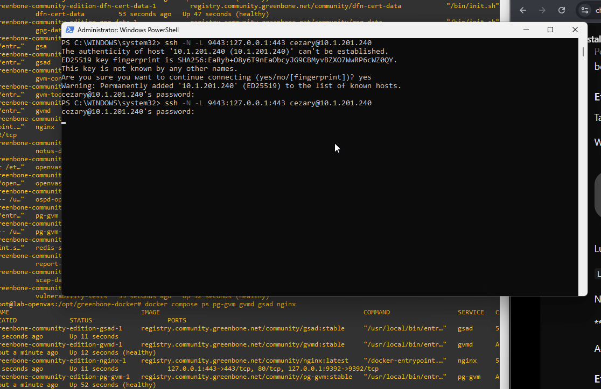

## II. Pierwszy dostęp z Windows i aktualizacja feedów

6. Panel był początkowo dostępny na `127.0.0.1:443` wewnątrz Debiana. Użyto tunelu SSH `9443 → 443`:

   ```powershell
   ssh -N -L 9443:127.0.0.1:443 cezary@10.1.201.240
   ```

7. Potwierdzono `Local forwarding listening on 127.0.0.1 port 9443` i otwarto panel pod `https://localhost:9443`.
8. Obserwowano import NVT, SCAP, CERT, GVMD_DATA. W trakcie importu pole `Scan Config` nie było dostępne.
9. Po zakończeniu synchronizacji wszystkie cztery feedy pokazywały `Current`.

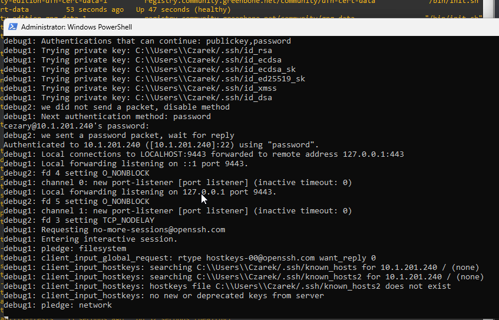
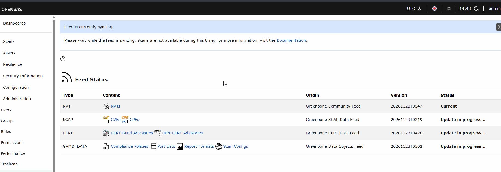
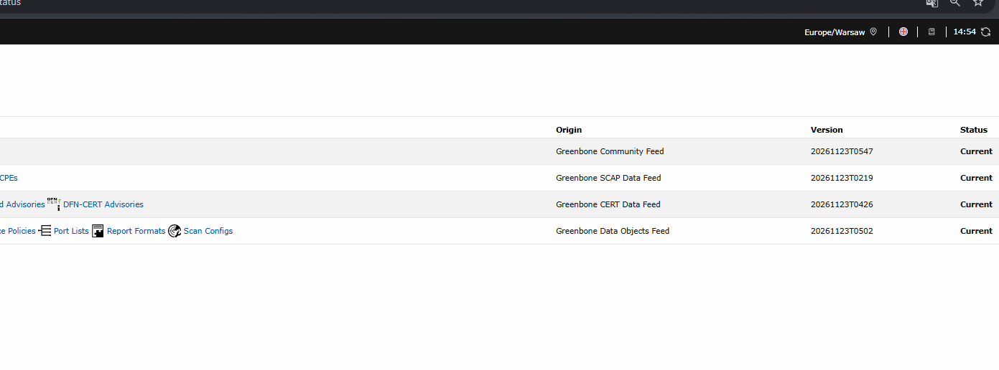

## III. Pierwszy skan Windows 11

10. Utworzono cel `LAB-W11-1` o adresie `10.1.201.211` bez uwierzytelnienia.
11. Utworzono zadanie `LAB-W11-1 – Pierwsze skanowanie` z `Full and fast`.
12. Po uruchomieniu zaobserwowano postęp do 98%, a następnie status `Done`.
13. Raport wskazywał najwyższy wynik **CVSS 5.0 (Medium)**. W widocznej części raportu znajdowały się wykrycia DCE/RPC (135/TCP), TLS 1.0/1.1 na RDP (3389/TCP), TCP timestamps oraz wpisy informacyjne o RDP/certyfikacie.
14. Omówiono różnicę między OpenVAS (ocena podatności) a Wazuh (monitorowanie zdarzeń i detekcja określonych zachowań).

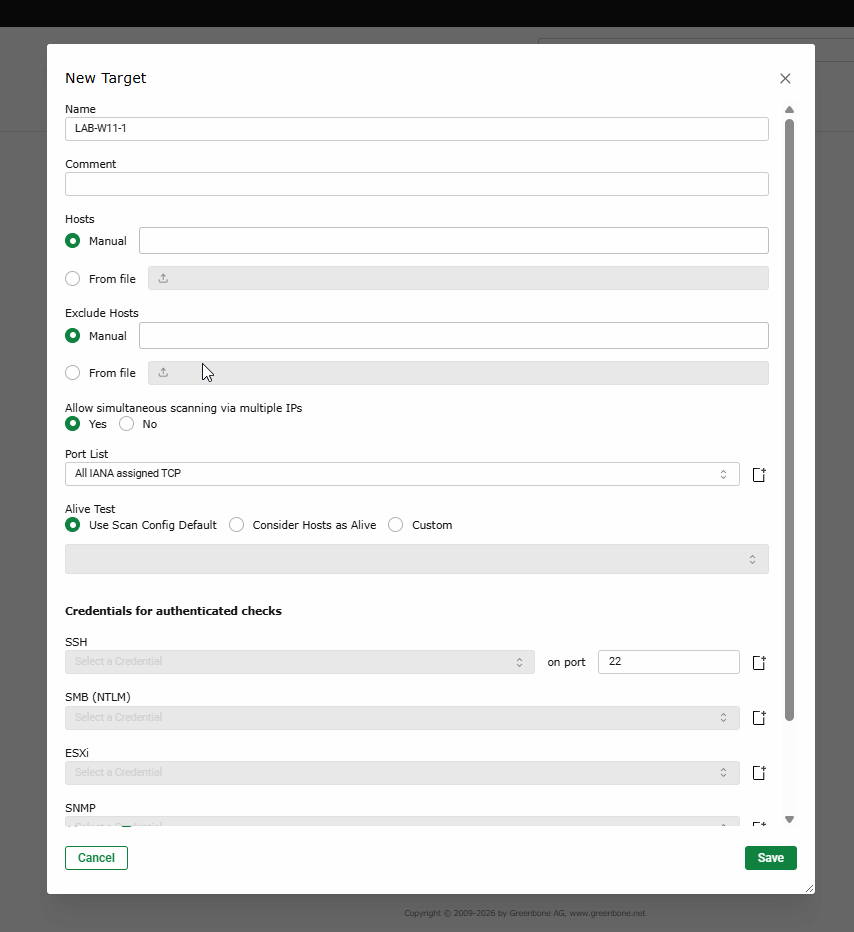
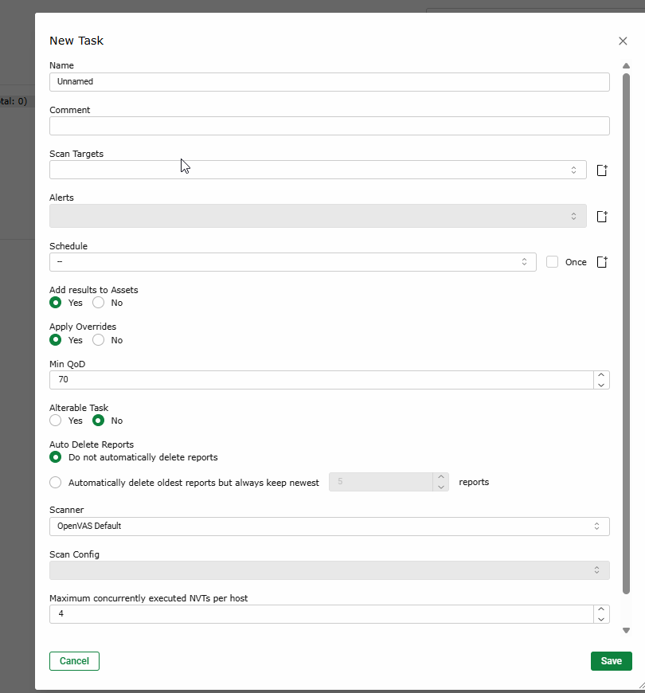
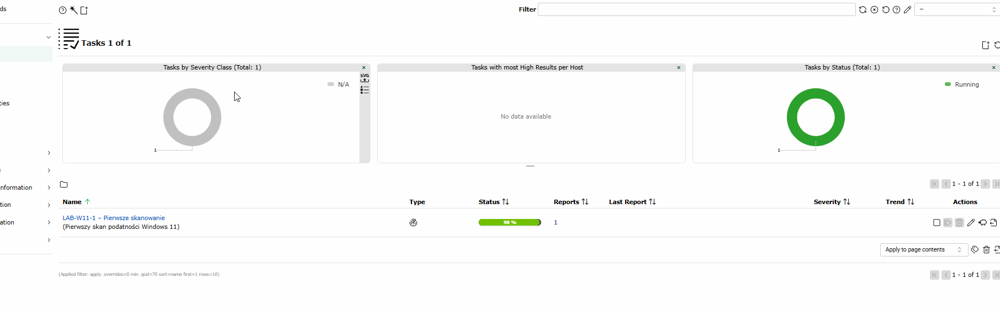
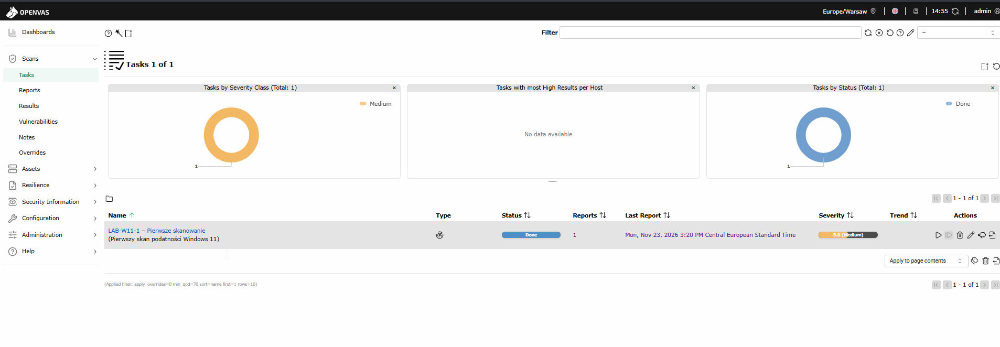
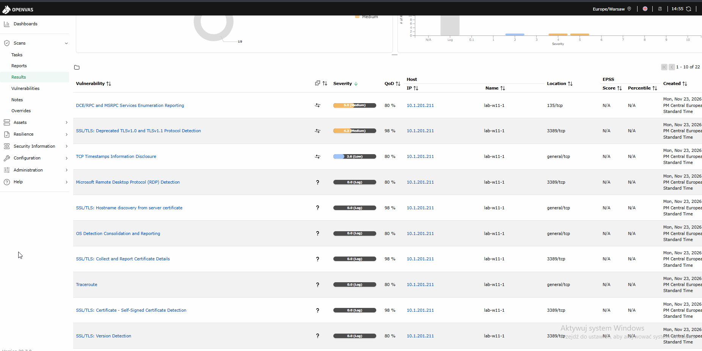

## IV. Kontroler domeny

15. Dodano zadanie `LAB-DC1` dla laboratoryjnego serwera Active Directory. Zrzut pokazuje status `Requested`, czyli przyjęcie zadania do kolejki. Nie dokumentowano zweryfikowanego wyniku analizy podatności tego DC.

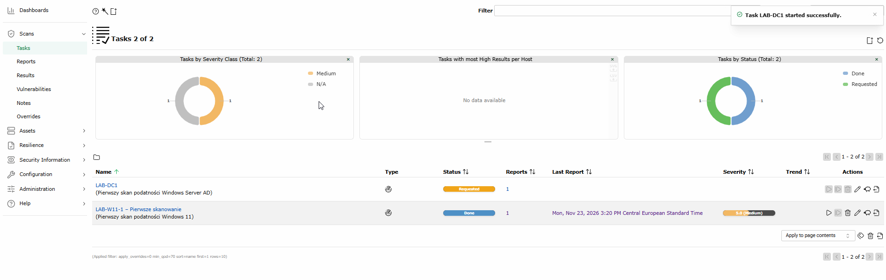

## V. Docelowy DNS i własne PKI — prace wieczorne

16. Zdecydowano o dostępie tylko wewnątrz LAN przez nazwę `openvas.tworzewski.pl`, wskazującą na `10.1.201.240`.
17. Na serwerze OpenVAS przygotowano klucz prywatny RSA 3072 i `openvas.csr` z SAN `DNS:openvas.tworzewski.pl`. Klucz prywatny pozostał na OpenVAS.
18. Przekazano CSR na `LAB-ISSUING-CA` przez SFTP (konto `pkiadmin`, logowanie kluczem SSH). Wystawianie certyfikatu nie wymagało uruchamiania offline Root CA.
19. Na Issuing CA sprawdzono konfigurację `/opt/pki/intermediate/openssl.cnf` oraz istniejący profil certyfikatu Wazuh. W konfiguracji CA widoczne było `copy_extensions = none`, więc rozszerzenia certyfikatu serwera podano jawnie w profilu podpisywania.
20. Przygotowano profil z SAN, `serverAuth`, AIA `http://pki.tworzewski.pl/ca/issuing-ca.cert.pem` i CRL `http://pki.tworzewski.pl/crl/issuing-ca.crl`.
21. CSR podpisano przy użyciu `openssl ca` i klucza `Home IT Lab Issuing CA 01`, z wpisem do rejestru CA. Certyfikat obowiązuje od 23.11.2026 do 23.11.2027.
22. Potwierdzono `openssl verify ... : OK` dla łańcucha, celu serwerowego i nazwy. Adres AIA zwrócił HTTP 200. Test CRL z Windows pozostaje do wykonania.

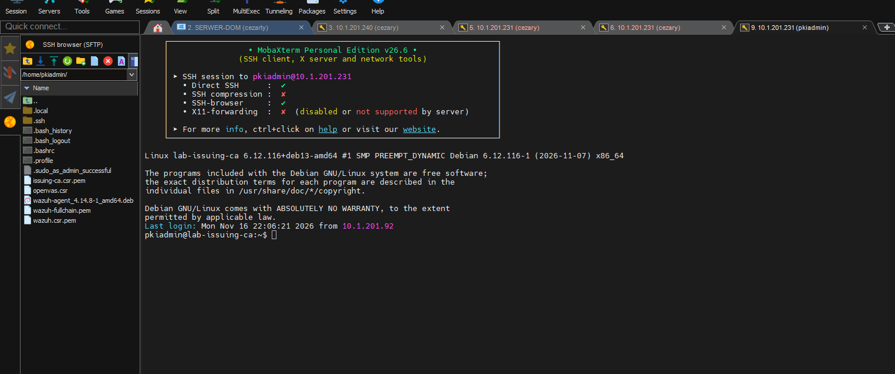
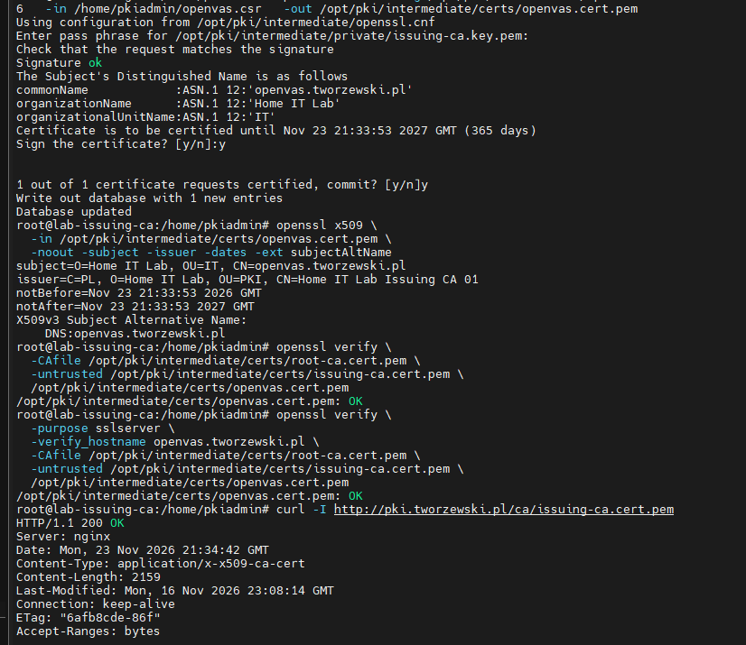

## VI. Podłączenie certyfikatu do Greenbone

23. Przygotowano `openvas-fullchain.pem` jako certyfikat serwera + Issuing CA; prywatny klucz pozostał na OpenVAS.
24. W usłudze `gvm-config` ustawiono `ENABLE_TLS_GENERATION: false` i `NGINX_HOST: openvas.tworzewski.pl`.
25. W Compose usługi `nginx` podłączono `openvas-fullchain.pem` oraz `openvas.key` jako wolumeny tylko do odczytu; HTTPS wystawiono na `10.1.201.240:443`.
26. Po weryfikacji `docker compose config -q` zastosowano zmiany przez `docker compose up -d --force-recreate gvm-config nginx`.
27. `nginx -t` zwrócił poprawną składnię; `openssl s_client` potwierdził rzeczywiście prezentowany certyfikat z właściwym CN i Issuing CA.
28. Otworzono `https://openvas.tworzewski.pl/login` w przeglądarce Windows i wyświetlono certyfikat wystawiony przez własne PKI.

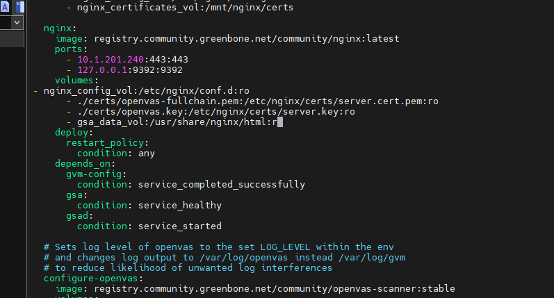
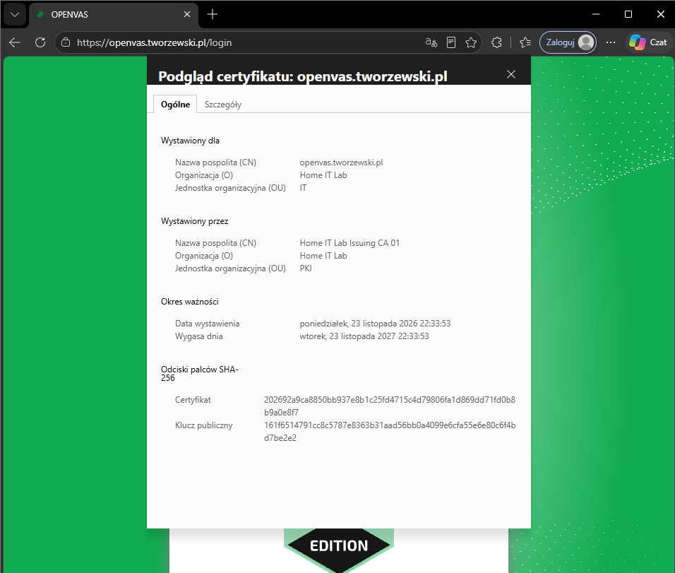

## Rezultat

**Działa:** Greenbone Community Edition na Debianie 13 / Dockerze, pierwsze skanowanie laboratoryjnego Windows 11, wewnętrzna nazwa DNS i HTTPS z certyfikatem Issuing CA.

**Do dalszej pracy:** potwierdzenie testu CRL od strony klienta Windows, ograniczenie dostępu na firewallu, skan uwierzytelniony i analiza zmian po naprawie podatności.
