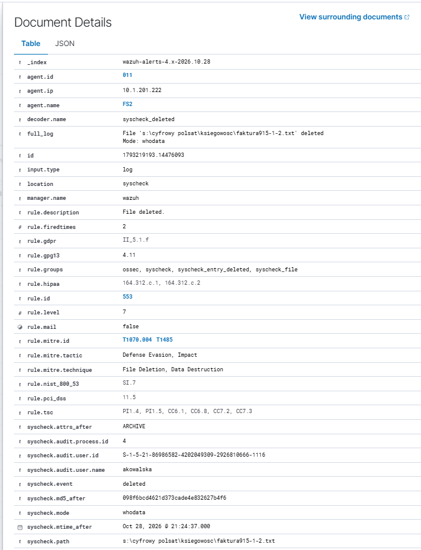
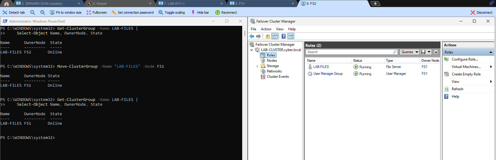
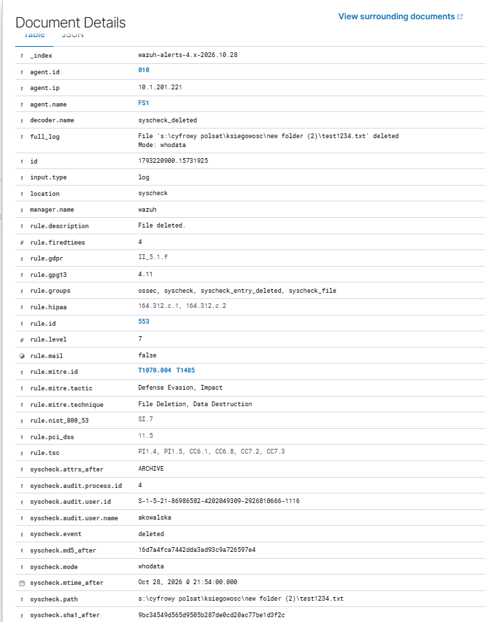
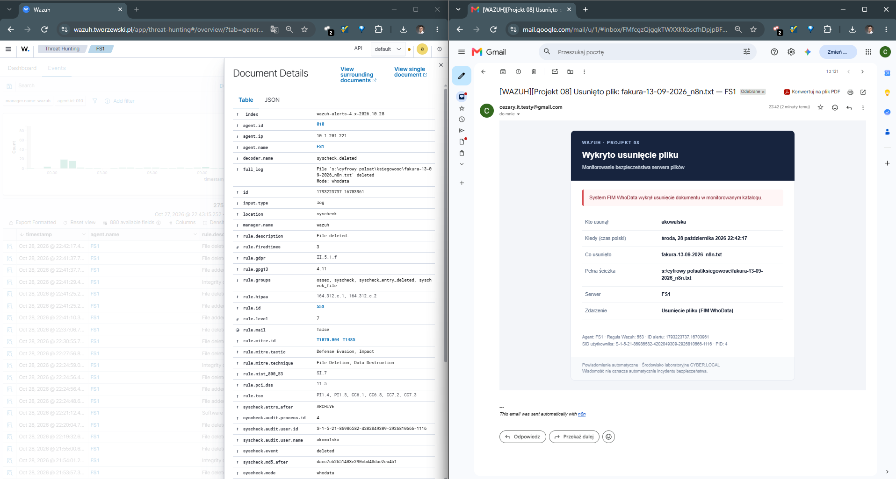
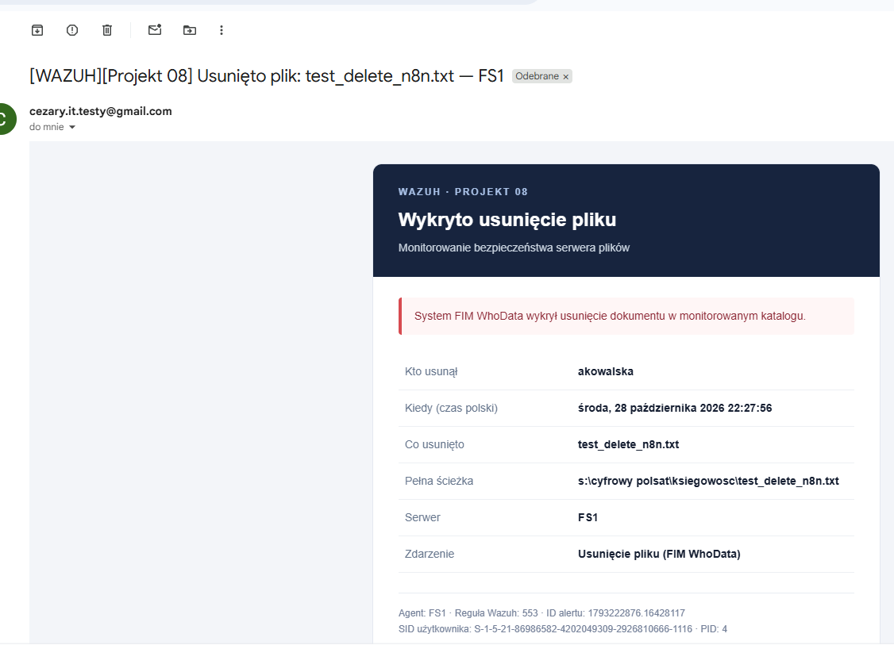

# Projekt 08 — Monitorowanie bezpieczeństwa serwera plików (Wazuh FIM + WhoData)

> **Status:** ✅ Wazuh FIM/WhoData przetestowano na FS1 i FS2; zweryfikowano usunięcie pliku po przełączeniu `LAB-FILES` z FS2 na FS1 oraz automatyczne powiadomienie e-mail Wazuh → n8n.  
> **Środowisko:** Windows Server 2025, Active Directory, Failover Cluster, SMB, NTFS, TrueNAS iSCSI, Wazuh 4.14.8.  
> **Testy:** 16 i 27–28 października 2026 r.

## 1. Cel projektu

Celem projektu jest stworzenie w domowym laboratorium mechanizmu monitorowania operacji na plikach firmowych udostępnianych przez **klastrowy serwer plików**. System powinien wykrywać utworzenie, modyfikację i usunięcie dokumentu, a w przypadku usunięcia — wskazać użytkownika domenowego, który wykonał operację.

**Potwierdzony rezultat:** Wazuh FIM w trybie **WhoData** zarejestrował usunięcie pliku `fvat10.txt` i powiązał je z kontem `CYBER\akowalska`. Później potwierdzono również usunięcie dokumentu na **FS2**, wraz z identyfikacją `akowalska`, oraz wykrycie usunięcia na **FS1 po przełączeniu roli z FS2**.

## 2. Architektura laboratorium

```text
LAB-W11-1 (użytkownik CYBER\akowalska)
        |
        | SMB: \\LAB-FILES\CYFROWY-POLSAT
        v
LAB-FILES (rola klastrowego serwera plików)
        |
        +-- FS1: 10.1.201.221 [agent Wazuh 010]
        +-- FS2: 10.1.201.222 [agent Wazuh 011]
        |
        +-- Dysk współdzielony S: (CLUSTER-DATA, ok. 30 GB)
              |
              +-- TrueNAS iSCSI
              +-- S:\CYFROWY POLSAT\...

Agenty FS1/FS2 ---> Wazuh Manager 10.1.201.201 ---> Wazuh Dashboard
                                     |
                                     +-- reguła 553 / Integrator
                                             | HTTPS POST
                                             v
                                      n8n Webhook → filtr → SMTP → e-mail
```

| Element | Konfiguracja |
|---|---|
| Domena Active Directory | `cyber.local` (NetBIOS: `CYBER`) |
| Jednostka organizacyjna firmy | `CYFROWY POLSAT` — nazwa użyta wyłącznie w laboratorium |
| Klaster | `LAB-CLUSTER` |
| Rola serwera plików | `LAB-FILES` |
| Udział SMB | `\\LAB-FILES\CYFROWY-POLSAT` |
| Ścieżka danych | `S:\CYFROWY POLSAT` |
| Macierz testowa | TrueNAS, udostępnienie bloku przez iSCSI |
| Wazuh Manager | `10.1.201.201` |
| FS1 / agent | `10.1.201.221` / `010` |
| FS2 / agent | `10.1.201.222` / `011` |

**Ważne w klastrze:** dysk `S:` jest dostępny lokalnie na węźle aktualnie obsługującym rolę. Konfigurację WhoData uruchomiono osobno na FS1 i FS2. Weryfikacja po zmianie właściciela roli została przeprowadzona i opisana w rozdziale 7.


## 3. Struktura fikcyjnej firmy w Active Directory

Utworzono dziewięciu testowych użytkowników i grupy zabezpieczeń odpowiadające działom.

| Dział | Konta testowe | Grupa AD |
|---|---|---|
| Księgowość | `akowalska`, `pmalinowski` | `GG_W08_Ksiegowosc_RW` |
| Kadry | `enowicka`, `mlis` | `GG_W08_Kadry_RW` |
| Produkcja | `tzielinski`, `pkrawczyk` | `GG_W08_Produkcja_RW` |
| Zarząd | `awisniewski` | `GG_W08_Zarzad_RW` |
| IT | `kmazur` | `GG_W08_IT_RW` |
| Testy Wazuh | `jtestowy` | `GG_W08_Testy_Wazuh_RW` |


### Struktura na dysku współdzielonym

```text
S:\CYFROWY POLSAT\
├── IT\
├── Kadry\
├── Ksiegowosc\
├── Produkcja\
├── Public\
├── Testy_Wazuh\
└── Zarzad\
```

W katalogach przygotowano fikcyjne dokumenty do testów. Grupy działowe otrzymały prawo **Modify**, natomiast `SYSTEM` i `BUILTIN\Administrators` zachowały **FullControl**. W folderze `Public` dostęp Modify otrzymała grupa `CYBER\Domain Users`.

Na udziale SMB włączono **Access-Based Enumeration (ABE)**. W teście Anna Kowalska widziała foldery `Ksiegowosc` i `Public`, ale nie widziała folderu `Kadry`. ABE odpowiada za ukrywanie zasobów, natomiast rzeczywistą kontrolę dostępu zapewniają uprawnienia NTFS.


## 4. Audyt Windows Security i SACL

Na serwerze plików włączono audyt systemu plików oraz regułę SACL dla folderu Księgowości, obejmującą grupę `CYBER\GG_W08_Ksiegowosc_RW` i operacje `Delete` oraz `DeleteSubdirectoriesAndFiles`.

Sprawdzenie polityki:

```powershell
auditpol /get /subcategory:"File System"
```

W testach otrzymano m.in. następujące zdarzenia:

| Event ID | Znaczenie | Zastrzeżenie |
|---|---|---|
| `4659` | Żądanie otwarcia uchwytu z zamiarem usunięcia | Nie potwierdza zakończonego usunięcia |
| `4663` z `DELETE` / `0x10000` | Użycie prawa DELETE | Może pojawić się także przy zmianie nazwy |
| `4660` | Zarejestrowanie usunięcia obiektu | Może nie zawierać nazwy pliku; wymaga korelacji |

W zdarzeniach dla `akowalska` system rozpoznał m.in. `WAZUH-DELETE-600.txt`, `WAZUH-DELETE-700.txt` i `fva7.txt`.


### Zbieranie zdarzeń przez agenta Wazuh

W pliku `C:\Program Files (x86)\ossec-agent\ossec.conf` zastosowano testowy filtr:

```xml
<localfile>
  <location>Security</location>
  <log_format>eventchannel</log_format>
  <query>Event/System[(EventID=4659 or EventID=4660 or EventID=4663 or EventID=4670)]</query>
</localfile>
```

**Uwaga:** taki filtr ogranicza zbieranie dziennika `Security` do wymienionych identyfikatorów. W pełnym środowisku monitoringu trzeba zapewnić także logi uwierzytelniania i inne zdarzenia bezpieczeństwa.

Potwierdzono łączność agenta `FS1` z managerem oraz odbiór `4659` dla `fva7.txt` w archiwum JSON:

```bash
sudo jq -c '
  select(.agent.id == "010")
  | select((.data.win.eventdata.objectName // "") | contains("fva7.txt"))
  | {timestamp, eventID: .data.win.system.eventID,
     user: .data.win.eventdata.subjectUserName,
     file: .data.win.eventdata.objectName,
     access: .data.win.eventdata.accessMask}
' /var/ossec/logs/archives/archives.json
```

Samo odebranie zdarzenia do `archives.json` nie oznacza automatycznego wygenerowania alertu w Threat Hunting.

## 5. Wazuh FIM — wykrywanie zmian plików

### Etap A: monitoring `realtime`

Do istniejącej sekcji `<syscheck>` agenta FS1 dodano:

```xml
<directories check_all="yes" realtime="yes">S:\CYFROWY POLSAT\Ksiegowosc</directories>
```

Wazuh wykrył dla plików testowych:

- **Dodanie pliku** — `File added to the system.`
- **Modyfikację pliku** — `Integrity checksum changed.`
- **Usunięcie pliku** — `File deleted.` (reguła `553`, poziom `7`)


### Etap B: monitoring `whodata`

W drugim etapie **zastąpiono** poprzedni wpis (nie dodawano go drugi raz):

```xml
<directories check_all="yes" whodata="yes">S:\CYFROWY POLSAT\Ksiegowosc</directories>
```

Następnie uruchomiono ponownie agenta:

```powershell
Restart-Service WazuhSvc
```

W logach FS1 potwierdzono:

```text
File integrity monitoring real-time Whodata engine started.
Monitoring path: 's:\cyfrowy polsat\ksiegowosc', with options '... | whodata'.
```

WhoData pozwala połączyć zdarzenie FIM z użytkownikiem wykonującym operację. W środowisku Windows przy operacjach SMB identyfikator procesu po stronie serwera może odpowiadać procesowi systemowemu, a nie programowi uruchomionemu na komputerze użytkownika.

## 6. Potwierdzony test — usunięcie dokumentu przez Annę Kowalską

Z komputera `LAB-W11-1` użytkownik `CYBER\akowalska` usunął dokument `fvat10.txt` w folderze `Ksiegowosc` udostępnianym przez SMB.

Wazuh zarejestrował:

| Pole | Potwierdzona wartość |
|---|---|
| `agent.name` | `FS1` |
| `syscheck.path` | `s:\cyfrowy polsat\ksiegowosc\fvat10.txt` |
| `syscheck.event` | `deleted` |
| `syscheck.mode` | `whodata` |
| `syscheck.audit.user.name` | `akowalska` |
| `syscheck.audit.process.id` | `4` |
| `rule.id` | `553` |
| Czas lokalny | 28.10.2026, 00:41:04 (CET) |

Przykładowe dane z `alerts.json` (skrócone):

```json
{
  "file": "s:\\cyfrowy polsat\\ksiegowosc\\fvat10.txt",
  "event": "deleted",
  "mode": "whodata",
  "audit": {
    "user": { "name": "akowalska" },
    "process": { "id": "4" }
  }
}
```

**Wniosek:** Wazuh potwierdził faktyczne usunięcie monitorowanego pliku i wskazał konto domenowe wykonujące operację. Nie opieramy tej konkluzji wyłącznie na zdarzeniu Windows `4659`.


### Szybka kontrola usunięć na managerze

```bash
sudo jq -c '
  select(.agent.id == "010")
  | select(.syscheck.event == "deleted")
  | {timestamp, file: .syscheck.path,
     user: .syscheck.audit.user.name,
     mode: .syscheck.mode,
     rule: .rule.id}
' /var/ossec/logs/alerts/alerts.json | tail -20
```

## 7. Monitorowanie po przełączeniu klastra — testy FS2 i FS1

### Test A — WhoData na FS2

Po uruchomieniu roli `LAB-FILES` na **FS2** skonfigurowano na tym węźle Wazuh FIM w trybie WhoData:

```xml
<directories check_all="yes" whodata="yes">S:\CYFROWY POLSAT\Ksiegowosc</directories>
```

Log agenta FS2 potwierdził załadowanie ścieżki z opcją `whodata`. Następnie użytkownik `CYBER\akowalska` usunął plik testowy z udostępnionego katalogu Księgowości.

| Pole | Zarejestrowana wartość |
|---|---|
| Węzeł | `FS2` — agent `011` (`10.1.201.222`) |
| `syscheck.event` | `deleted` |
| `syscheck.mode` | `whodata` |
| `syscheck.audit.user.name` | `akowalska` |
| Plik | `faktura915-1-2.txt` |
| `rule.id` | `553` |
| Czas lokalny | 28.10.2026, 21:24:37 |



### Test B — kontrolowane przełączenie roli FS2 → FS1

Na działającej roli `LAB-FILES` wykonano w PowerShell:

```powershell
Move-ClusterGroup -Name "LAB-FILES" -Node FS1
Get-ClusterGroup -Name LAB-FILES | Select-Object Name, OwnerNode, State
```

Polecenie oraz Failover Cluster Manager potwierdziły stan **`LAB-FILES` — `Online`, właściciel `FS1`**.



Następnie użytkownik `CYBER\akowalska` usunął dokument `test1234.txt` w podfolderze `Ksiegowosc\new folder (2)`. Wazuh wykrył zdarzenie na agencie **FS1 (010)**.

| Pole | Zarejestrowana wartość |
|---|---|
| Węzeł po przełączeniu | `FS1` (`10.1.201.221`) |
| `syscheck.path` | `s:\cyfrowy polsat\ksiegowosc\new folder (2)\test1234.txt` |
| `syscheck.event` | `deleted` |
| `syscheck.mode` | `whodata` |
| `syscheck.audit.user.name` | `akowalska` |
| Reguła | `553` (poziom 7) |
| Czas lokalny | 28.10.2026, 21:54 |



**Wynik:** przetestowano zdarzenia usuwania na obu węzłach oraz działanie detekcji po kontrolowanym przełączeniu `FS2 → FS1`. Wykrycie usunięcia pliku w podfolderze potwierdziło także zakres monitorowania podkatalogów Księgowości.

## 8. Diagnostyka reguł Wazuh

Podczas konfiguracji zaobserwowano konflikt identyfikatora niestandardowej reguły `100800` z istniejącą regułą Sysmon oraz ostrzeżenia dotyczące grupy `sysmon_event_7`. Do potwierdzenia operacji usuwania w tym projekcie wykorzystano **wbudowaną regułę `553`**, która prawidłowo rejestrowała usunięcia dokumentów.

## 9. Automatyczne powiadomienie — Wazuh → n8n → e-mail

**Status: wdrożone i przetestowane 28 października 2026 r.** Po wykryciu usunięcia pliku Wazuh przekazuje pełny alert JSON do n8n, gdzie sprawdzane są warunki zdarzenia i przygotowywany czytelny e-mail HTML w języku polskim.

### 9.1. Przepływ zdarzeń

```text
Pracownik (SMB) usuwa dokument
          ↓
Aktywny węzeł LAB-FILES (FS1 albo FS2)
          ↓
Wazuh Agent — FIM WhoData
          ↓
Wazuh Manager — reguła 553, poziom 7
          ↓
wazuh-integratord — custom-n8n-file-deletion
          ↓  HTTPS POST, alert JSON
n8n Webhook /08-file-deletion-monitoring
          ↓
Filtr: agent FS1/FS2 + deleted + whodata + katalog Ksiegowosc
          ↓
Szablon e-mail HTML → SMTP → skrzynka administratora
```

### 9.2. Konfiguracja Wazuh Manager

W istniejącej sekcji `<ossec_config>` pliku `/var/ossec/etc/ossec.conf` skonfigurowano:

```xml
<integration>
  <name>custom-n8n-file-deletion</name>
  <hook_url>https://n8n.tworzewski.pl/webhook/08-file-deletion-monitoring</hook_url>
  <rule_id>553</rule_id>
  <alert_format>json</alert_format>
</integration>
```

Skrypt wykonywalny: `/var/ossec/integrations/custom-n8n-file-deletion`. Druga kopia z końcówką `.py` powstała pomocniczo; nazwa skryptu uruchamianego przez Integrator wynika z `<name>`. Pliki projektu: [skrypt integracyjny](../scripts/08-file-server-security-monitoring/custom-n8n-file-deletion) i [eksport workflow n8n](../n8n/08-file-server-security-monitoring/08-Wazuh-Usuniecie-Pliku-n8n.json). W repozytorium nie należy umieszczać sekretów SMTP ani tokenów. Adres webhooka jest adresem środowiska laboratoryjnego.

Uprawnienia pliku integracji:

```bash
sudo chown root:wazuh /var/ossec/integrations/custom-n8n-file-deletion
sudo chmod 750 /var/ossec/integrations/custom-n8n-file-deletion
sudo systemctl restart wazuh-manager
```

**Ważny wniosek z diagnostyki:** pierwsze uruchomienie managera nastąpiło **przed utworzeniem skryptu**, dlatego log zawierał błąd `File not found inside 'integrations'`. Po utworzeniu skryptu i ponownym uruchomieniu managera Integrator mógł obsłużyć nową integrację. Test `curl` zwrócił `HTTP/2 200` i `Workflow was started`. Ręczne przesłanie rzeczywistego alertu potwierdziło poprawność webhooka i SMTP, a następnie zweryfikowano **automatyczne powiadomienie po faktycznym usunięciu dokumentu**.

### 9.3. Pola w powiadomieniu

| Informacja | Źródło w alercie Wazuh |
|---|---|
| Kto usunął | `syscheck.audit.user.name` |
| Kiedy | `timestamp` — prezentowany w e-mailu w czasie polskim |
| Co usunięto | nazwa pliku z `syscheck.path` |
| Pełna ścieżka | `syscheck.path` |
| Serwer | `agent.name` |
| Zdarzenie | `syscheck.event = deleted`, `syscheck.mode = whodata` |
| Identyfikator reguły | `rule.id = 553` |

### 9.4. Dowód — automatyczne wysłanie wiadomości

Po restarcie Integratora użytkownik `CYBER\akowalska` usunął testowy dokument `faktura-13-09-2026_n8n.txt` z folderu Księgowości. Wazuh wyświetlił alert **553** na agencie **FS1**, a n8n wysłał e-mail z tym samym plikiem, użytkownikiem i czasem zdarzenia **28.10.2026, 22:42:17 czasu polskiego**. Nie trzeba było uruchamiać skryptu ręcznie.



Poniżej osobny widok szablonu wiadomości z wcześniejszego **ręcznego testu integracji** na prawdziwym alercie (test poprzedzający uruchomienie automatyczne):



### 9.5. Potwierdzony zakres

- Zarejestrowano usunięcia dokumentów w trybie WhoData na obu węzłach: FS1 i FS2.
- Po kontrolowanym przełączeniu roli `LAB-FILES` z FS2 na FS1 zarejestrowano usunięcie pliku również w podfolderze Księgowości.
- Automatyczny alert e-mail z Wazuh przez n8n i SMTP potwierdzono dla usunięcia dokumentu na FS1.
- W workflow zastosowano filtr zdarzeń dla katalogu Księgowości. Wykorzystane pliki i konta są testowe.

## 10. Lista kontrolna — potwierdzone wykonanie

- [x] Przygotowanie struktury organizacyjnej i kont AD
- [x] Utworzenie katalogów firmowych na dysku klastrowym
- [x] Skonfigurowanie grup, uprawnień NTFS oraz ABE
- [x] Rejestrowanie zdarzeń Windows Security dla operacji DELETE
- [x] Podłączenie agentów Wazuh na FS1 i FS2
- [x] Potwierdzenie odbioru zdarzenia `4659` na managerze
- [x] Wykrywanie dodania, modyfikacji i usunięcia pliku przez FIM na FS1
- [x] Wykrywanie usunięcia z identyfikacją konta `akowalska` przez WhoData
- [x] WhoData na FS2: usunięcie pliku z identyfikacją `akowalska`
- [x] Kontrolowane przełączenie `FS2 → FS1` — rola Online na FS1
- [x] Wykrycie usunięcia w podfolderze Księgowości po przełączeniu na FS1
- [x] Automatyczne przekazywanie alertu 553 z FS1 przez Integrator i webhook n8n
- [x] E-mail HTML: użytkownik, data i godzina, dokument, pełna ścieżka i serwer

## 11. Podsumowanie

W laboratorium z klastrem Windows Server i TrueNAS iSCSI wdrożono monitoring plików przy użyciu Wazuh FIM. Potwierdzono wykrywanie usunięcia dokumentu z identyfikacją konta użytkownika w trybie WhoData na **FS1 i FS2**, a także po kontrolowanym przełączeniu roli klastra **FS2 → FS1**. Zintegrowano Wazuh Manager z n8n i przetestowano **automatyczne dostarczenie e-maila HTML** z informacjami o pliku, użytkowniku, serwerze i czasie zdarzenia.

---

> **Uwaga dotycząca publikacji:** zrzuty ekranu pokazują przykładowe nazwy hostów, kont i wewnętrzne adresy IP. Przed publicznym udostępnieniem sprawdź je pod kątem informacji wrażliwych. Nie publikuj haseł, kluczy ani prawdziwych dokumentów użytkowników.
