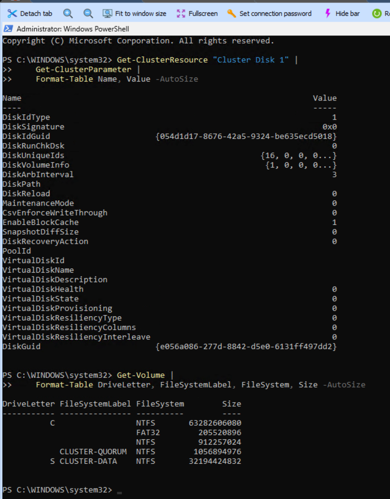
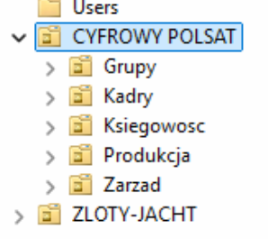
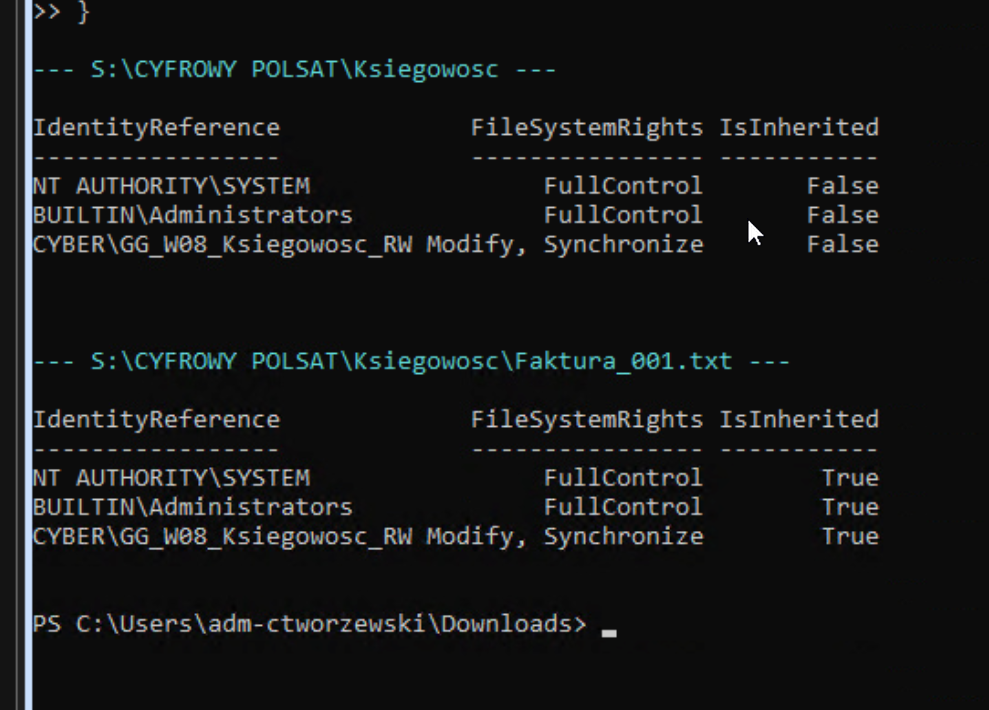
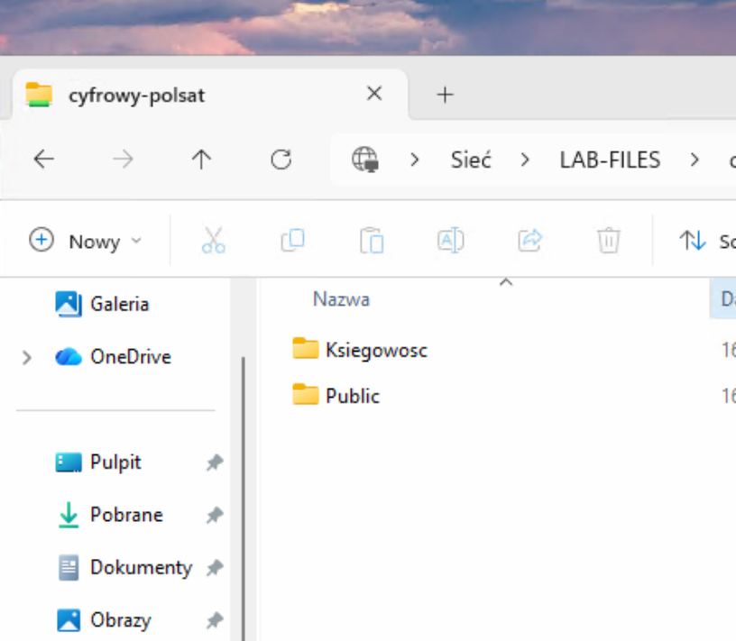
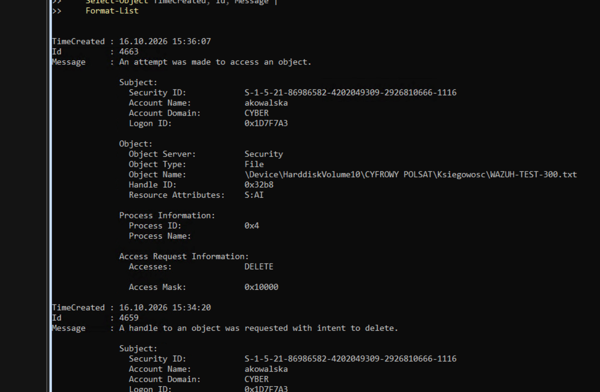
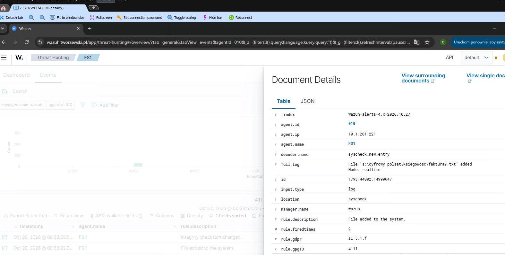
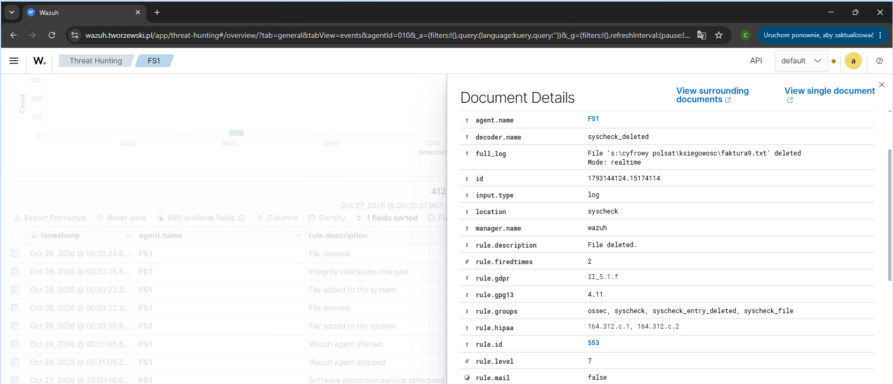
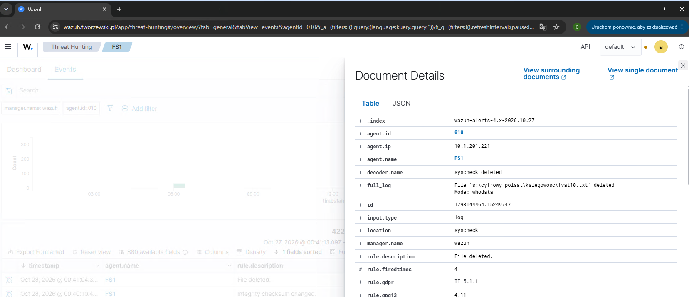
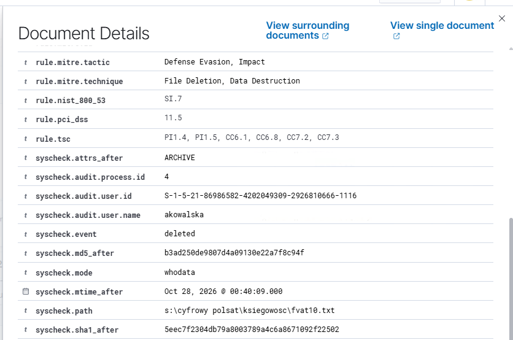

# Projekt 08 — Monitorowanie bezpieczeństwa serwera plików (Wazuh FIM + WhoData)

> **Status:** ✅ Zrealizowano i potwierdzono wykrywanie dodania, modyfikacji oraz usunięcia pliku z identyfikacją użytkownika na FS1.  
> **Do wykonania:** monitoring pozostałych działów, test FS2 po przełączeniu klastra i korelacja masowego usuwania.  
> **Środowisko:** Windows Server 2025, Active Directory, Failover Cluster, SMB, NTFS, TrueNAS iSCSI, Wazuh 4.14.8.  
> **Testy:** 16 i 27–28 października 2026 r.

## 1. Cel projektu

Celem projektu jest stworzenie w domowym laboratorium mechanizmu monitorowania operacji na plikach firmowych udostępnianych przez **klastrowy serwer plików**. System powinien wykrywać utworzenie, modyfikację i usunięcie dokumentu, a w przypadku usunięcia — wskazać użytkownika domenowego, który wykonał operację.

**Potwierdzony rezultat:** Wazuh FIM w trybie **WhoData** zarejestrował usunięcie pliku `fvat10.txt` i powiązał je z kontem `CYBER\akowalska`. Wynik dotyczy monitorowanego katalogu Księgowości na **FS1**. Nie jest jeszcze potwierdzeniem ciągłości monitoringu po przełączeniu na FS2.

## 2. Architektura laboratorium

```text
LAB-W11-1 (użytkownik CYBER\akowalska)
        |
        | SMB: \\LAB-FILES\CYFROWY-POLSAT
        v
LAB-FILES (rola klastrowego serwera plików)
        |
        +-- FS1: 10.1.201.221 [agent Wazuh 010]
        +-- FS2: 10.1.201.222 [agent Wazuh 011]
        |
        +-- Dysk współdzielony S: (CLUSTER-DATA, ok. 30 GB)
              |
              +-- TrueNAS iSCSI
              +-- S:\CYFROWY POLSAT\...

Agenty FS1/FS2 ---> Wazuh Manager 10.1.201.201 ---> Wazuh Dashboard
```

| Element | Konfiguracja |
|---|---|
| Domena Active Directory | `cyber.local` (NetBIOS: `CYBER`) |
| Jednostka organizacyjna firmy | `CYFROWY POLSAT` — nazwa użyta wyłącznie w laboratorium |
| Klaster | `LAB-CLUSTER` |
| Rola serwera plików | `LAB-FILES` |
| Udział SMB | `\\LAB-FILES\CYFROWY-POLSAT` |
| Ścieżka danych | `S:\CYFROWY POLSAT` |
| Macierz testowa | TrueNAS, udostępnienie bloku przez iSCSI |
| Wazuh Manager | `10.1.201.201` |
| FS1 / agent | `10.1.201.221` / `010` |
| FS2 / agent | `10.1.201.222` / `011` |

**Ważne w klastrze:** dysk `S:` jest dostępny lokalnie na węźle aktualnie obsługującym rolę. Konfigurację i działanie FIM trzeba zweryfikować oddzielnie po przełączeniu własności na FS2.



## 3. Struktura fikcyjnej firmy w Active Directory

Utworzono dziewięciu testowych użytkowników i grupy zabezpieczeń odpowiadające działom.

| Dział | Konta testowe | Grupa AD |
|---|---|---|
| Księgowość | `akowalska`, `pmalinowski` | `GG_W08_Ksiegowosc_RW` |
| Kadry | `enowicka`, `mlis` | `GG_W08_Kadry_RW` |
| Produkcja | `tzielinski`, `pkrawczyk` | `GG_W08_Produkcja_RW` |
| Zarząd | `awisniewski` | `GG_W08_Zarzad_RW` |
| IT | `kmazur` | `GG_W08_IT_RW` |
| Testy Wazuh | `jtestowy` | `GG_W08_Testy_Wazuh_RW` |



### Struktura na dysku współdzielonym

```text
S:\CYFROWY POLSAT\
├── IT\
├── Kadry\
├── Ksiegowosc\
├── Produkcja\
├── Public\
├── Testy_Wazuh\
└── Zarzad\
```

W katalogach przygotowano fikcyjne dokumenty do testów. Grupy działowe otrzymały prawo **Modify**, natomiast `SYSTEM` i `BUILTIN\Administrators` zachowały **FullControl**. W folderze `Public` dostęp Modify otrzymała grupa `CYBER\Domain Users`.

Na udziale SMB włączono **Access-Based Enumeration (ABE)**. W teście Anna Kowalska widziała foldery `Ksiegowosc` i `Public`, ale nie widziała folderu `Kadry`. ABE odpowiada za ukrywanie zasobów, natomiast rzeczywistą kontrolę dostępu zapewniają uprawnienia NTFS.





## 4. Audyt Windows Security i SACL

Na serwerze plików włączono audyt systemu plików oraz regułę SACL dla folderu Księgowości, obejmującą grupę `CYBER\GG_W08_Ksiegowosc_RW` i operacje `Delete` oraz `DeleteSubdirectoriesAndFiles`.

Sprawdzenie polityki:

```powershell
auditpol /get /subcategory:"File System"
```

W testach otrzymano m.in. następujące zdarzenia:

| Event ID | Znaczenie | Zastrzeżenie |
|---|---|---|
| `4659` | Żądanie otwarcia uchwytu z zamiarem usunięcia | Nie potwierdza zakończonego usunięcia |
| `4663` z `DELETE` / `0x10000` | Użycie prawa DELETE | Może pojawić się także przy zmianie nazwy |
| `4660` | Zarejestrowanie usunięcia obiektu | Może nie zawierać nazwy pliku; wymaga korelacji |

W zdarzeniach dla `akowalska` system rozpoznał m.in. `WAZUH-DELETE-600.txt`, `WAZUH-DELETE-700.txt` i `fva7.txt`.



### Zbieranie zdarzeń przez agenta Wazuh

W pliku `C:\Program Files (x86)\ossec-agent\ossec.conf` zastosowano testowy filtr:

```xml
<localfile>
  <location>Security</location>
  <log_format>eventchannel</log_format>
  <query>Event/System[(EventID=4659 or EventID=4660 or EventID=4663 or EventID=4670)]</query>
</localfile>
```

**Uwaga:** taki filtr ogranicza zbieranie dziennika `Security` do wymienionych identyfikatorów. W pełnym środowisku monitoringu trzeba zapewnić także logi uwierzytelniania i inne zdarzenia bezpieczeństwa.

Potwierdzono łączność agenta `FS1` z managerem oraz odbiór `4659` dla `fva7.txt` w archiwum JSON:

```bash
sudo jq -c '
  select(.agent.id == "010")
  | select((.data.win.eventdata.objectName // "") | contains("fva7.txt"))
  | {timestamp, eventID: .data.win.system.eventID,
     user: .data.win.eventdata.subjectUserName,
     file: .data.win.eventdata.objectName,
     access: .data.win.eventdata.accessMask}
' /var/ossec/logs/archives/archives.json
```

Samo odebranie zdarzenia do `archives.json` nie oznacza automatycznego wygenerowania alertu w Threat Hunting.

## 5. Wazuh FIM — wykrywanie zmian plików

### Etap A: monitoring `realtime`

Do istniejącej sekcji `<syscheck>` agenta FS1 dodano:

```xml
<directories check_all="yes" realtime="yes">S:\CYFROWY POLSAT\Ksiegowosc</directories>
```

Wazuh wykrył dla plików testowych:

- **Dodanie pliku** — `File added to the system.`
- **Modyfikację pliku** — `Integrity checksum changed.`
- **Usunięcie pliku** — `File deleted.` (reguła `553`, poziom `7`)





### Etap B: monitoring `whodata`

W drugim etapie **zastąpiono** poprzedni wpis (nie dodawano go drugi raz):

```xml
<directories check_all="yes" whodata="yes">S:\CYFROWY POLSAT\Ksiegowosc</directories>
```

Następnie uruchomiono ponownie agenta:

```powershell
Restart-Service WazuhSvc
```

W logach FS1 potwierdzono:

```text
File integrity monitoring real-time Whodata engine started.
Monitoring path: 's:\cyfrowy polsat\ksiegowosc', with options '... | whodata'.
```

WhoData pozwala połączyć zdarzenie FIM z użytkownikiem wykonującym operację. W środowisku Windows przy operacjach SMB identyfikator procesu po stronie serwera może odpowiadać procesowi systemowemu, a nie programowi uruchomionemu na komputerze użytkownika.

## 6. Potwierdzony test — usunięcie dokumentu przez Annę Kowalską

Z komputera `LAB-W11-1` użytkownik `CYBER\akowalska` usunął dokument `fvat10.txt` w folderze `Ksiegowosc` udostępnianym przez SMB.

Wazuh zarejestrował:

| Pole | Potwierdzona wartość |
|---|---|
| `agent.name` | `FS1` |
| `syscheck.path` | `s:\cyfrowy polsat\ksiegowosc\fvat10.txt` |
| `syscheck.event` | `deleted` |
| `syscheck.mode` | `whodata` |
| `syscheck.audit.user.name` | `akowalska` |
| `syscheck.audit.process.id` | `4` |
| `rule.id` | `553` |
| Czas lokalny | 28.10.2026, 00:41:04 (CET) |

Przykładowe dane z `alerts.json` (skrócone):

```json
{
  "file": "s:\\cyfrowy polsat\\ksiegowosc\\fvat10.txt",
  "event": "deleted",
  "mode": "whodata",
  "audit": {
    "user": { "name": "akowalska" },
    "process": { "id": "4" }
  }
}
```

**Wniosek:** Wazuh potwierdził faktyczne usunięcie monitorowanego pliku i wskazał konto domenowe wykonujące operację. Nie opieramy tej konkluzji wyłącznie na zdarzeniu Windows `4659`.





### Szybka kontrola usunięć na managerze

```bash
sudo jq -c '
  select(.agent.id == "010")
  | select(.syscheck.event == "deleted")
  | {timestamp, file: .syscheck.path,
     user: .syscheck.audit.user.name,
     mode: .syscheck.mode,
     rule: .rule.id}
' /var/ossec/logs/alerts/alerts.json | tail -20
```

## 7. Własne reguły i problemy napotkane podczas prac

Podczas tworzenia dodatkowej reguły na zdarzenie `4659` wykryto **konflikt ID `100800`** z regułą Sysmon istniejącą w pliku `100100-MITRE_TECHNIQUES_FROM_SYSMON_EVENT1.xml`. Dla nowej reguły zaproponowano numer `110800`, lecz jej poprawne dopasowanie w `wazuh-logtest` i wdrożenie na żywo **nie zostały jeszcze potwierdzone**.

Do wykonania przed dalszymi testami reguły:

1. Usunąć starszą, zdublowaną regułę `100800` z `local_rules.xml`, **nie zmieniając** istniejącej reguły Sysmon.
2. Potwierdzić unikalność reguły `110800`.
3. Uruchomić `sudo /var/ossec/bin/wazuh-analysisd -t` i `sudo /var/ossec/bin/wazuh-logtest` na przykładowym zdarzeniu.
4. Dopiero po walidacji rozważyć restart managera.

Osobno odnotowano ostrzeżenia o brakującej grupie `sysmon_event_7` dla reguł `900177–900186`. Nie były one przyczyną niepowodzenia testu FIM.

## 8. Lista kontrolna projektu

- [x] Przygotowanie struktury organizacyjnej i kont AD
- [x] Utworzenie katalogów firmowych na dysku klastrowym
- [x] Skonfigurowanie grup, uprawnień NTFS oraz ABE
- [x] Rejestrowanie zdarzeń Windows Security dla operacji DELETE
- [x] Podłączenie agentów Wazuh na FS1 i FS2
- [x] Potwierdzenie odbioru zdarzenia `4659` na managerze
- [x] Wykrywanie dodania, modyfikacji i usunięcia pliku przez FIM na FS1
- [x] Wykrywanie usunięcia z identyfikacją konta `akowalska` przez WhoData
- [ ] Usunięcie konfliktu własnych reguł i walidacja `110800` (jeśli pozostanie potrzebna)
- [ ] Monitoring wszystkich katalogów działowych
- [ ] Test WhoData na FS2 po kontrolowanym przełączeniu roli
- [ ] Detekcja masowego usuwania dokumentów
- [ ] Wyłączenie tymczasowego `logall_json` po zakończeniu diagnostyki i ustalenie retencji

## 9. Dalszy rozwój

**Rozszerzenie zakresu:** objęcie WhoData folderów Kadry, Produkcja, Zarząd, IT, Public i Testy_Wazuh; kontrola wydajności oraz natężenia zdarzeń.

**Weryfikacja failover:** konfiguracja agenta FS2, przeniesienie roli `LAB-FILES` z FS1 na FS2, potwierdzenie dostępności dysku `S:` i ponowny test `added`/`deleted` z identyfikacją użytkownika.

**Mini-DLP:** przygotowanie korelacji zdarzeń `deleted`, np. 10 usunięć w ciągu 60 sekund przez jednego użytkownika. Próg stanowi pomysł na test, nie zweryfikowaną regułę produkcyjną.

**Higiena konfiguracji:** przegląd niestandardowych reguł Wazuh, retencji logów, kopii SACL i uprawnień udostępnionych do publicznego repozytorium.

## 10. Podsumowanie

W laboratorium z klastrem Windows Server i TrueNAS iSCSI udało się wdrożyć monitoring plików przez Wazuh FIM. Najważniejszym rezultatem jest **potwierdzona detekcja usunięcia dokumentu przez użytkownika `akowalska` w trybie WhoData**. Dalsze etapy to rozszerzenie na pozostałe działy i sprawdzenie ciągłości monitorowania po przełączeniu FS1 → FS2.

---

> **Uwaga dotycząca publikacji:** zrzuty ekranu pokazują przykładowe nazwy hostów, kont i wewnętrzne adresy IP. Przed publicznym udostępnieniem sprawdź je pod kątem informacji wrażliwych. Nie publikuj haseł, kluczy ani prawdziwych dokumentów użytkowników.
