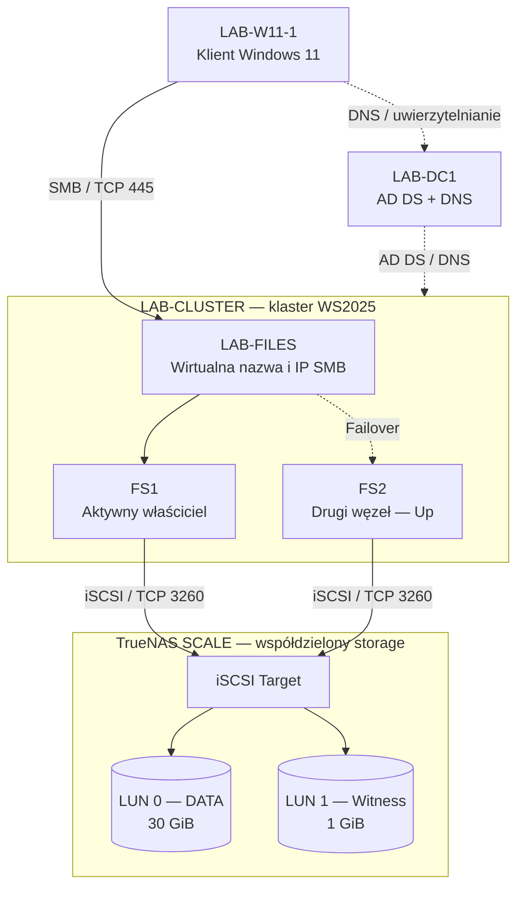

# Windows Server 2025 Failover File Server + TrueNAS iSCSI — Home IT Lab

> **Zbuduj → zrozum → zepsuj → zdiagnozuj → napraw.** Praktyczna dokumentacja dwuwęzłowego klastra serwera plików w domenie Active Directory, z osobnym Disk Witness i testem awarii węzła. Projekt wykonano i udokumentowano **14–15 października 2026 r.** w prywatnym laboratorium.

## Rezultat

**PASS — kontrolowane przeniesienie roli FS1 → FS2, nagła awaria FS2, automatyczne przejęcie `LAB-FILES` przez FS1, dostęp do udziału SMB z Windows 11 oraz powrót FS2 do klastra.** Udział `\\LAB-FILES\DANE` był ponownie dostępny po awarii, a pliki można było otwierać i edytować. Nie wykonano ilościowego pomiaru RTO, RPO ani testów utrzymania już otwartego uchwytu pliku.

| Obszar | Konfiguracja |
|---|---|
| Domena AD | `cyber.local` |
| Klaster | `LAB-CLUSTER` — `10.1.201.223` |
| Węzły klastra | `FS1` — `10.1.201.221`; `FS2` — `10.1.201.222` |
| System | Windows Server 2025 Standard, VM na Hyper-V |
| TrueNAS SCALE | `10.1.201.230`, port iSCSI `3260/TCP` |
| Storage | `POOL-CLUSTER`, zvol 30 GiB i zvol 1 GiB |
| LUN 0 / dane | `ZVOL-FS-CLUSTER` → `Cluster Disk 1`, NTFS, `S:` |
| LUN 1 / witness | `ZVOL-QUORUM` → `Cluster Disk 2`, NTFS, Disk Witness |
| Quorum | Node and Disk Majority, świadek `Cluster Disk 2` |
| Rola SMB | `LAB-FILES` — `10.1.201.224` |
| Udział | `\\LAB-FILES\DANE` → `S:\Shares\DANE` |
| Klient testowy | `LAB-W11-1`, Windows 11 Pro |

## Architektura

Poniższy diagram pokazuje **stan po teście awarii i ponownym uruchomieniu FS2**: rola plikowa działa na FS1, natomiast FS2 jest ponownie aktywnym węzłem klastra i może przejąć rolę podczas kolejnego failover. Diagram rozdziela **usługę SMB**, **węzły klastra**, **Active Directory/DNS** i **wspólny storage**.

### Adresacja i role komponentów

| Komponent | Adres IP | Funkcja |
|---|---|---|
| LAB-DC1 | `10.1.201.200` | AD DS, DNS domeny `cyber.local` — **nie jest węzłem klastra** |
| FS1 | `10.1.201.221` | Węzeł Windows Server 2025; aktualny właściciel roli SMB |
| FS2 | `10.1.201.222` | Drugi węzeł Windows Server 2025; gotowy do przejęcia roli |
| LAB-CLUSTER | `10.1.201.223` | Administracyjny punkt dostępu do klastra (CNO) |
| LAB-FILES | `10.1.201.224` | Wirtualny punkt dostępu do klastrowej usługi SMB |
| TrueNAS SCALE | `10.1.201.230` | iSCSI Target z dwoma LUN-ami |

**Przepływ danych:** klient łączy się z `\\LAB-FILES\DANE` przez SMB (`TCP/445`). Usługę obsługuje aktualny właściciel roli, teraz **FS1**. Po awarii rola oraz własność dysku danych mogą przejść na **FS2**, bez zmiany nazwy udziału.

**Przepływ storage:** FS1 i FS2 posiadają połączenia iSCSI do tego samego TrueNAS (`TCP/3260`) i widzą oba LUN-y. W przypadku dysku danych zwykłego klastra File Server tylko aktualny właściciel zasobu ma prawo go aktywnie używać; koordynacją zajmuje się Failover Clustering. `LUN 1` o pojemności 1 GiB jest świadkiem quorum, **nie** dyskiem na pliki użytkowników.

**AD/DNS:** LAB-DC1 pomaga w rozpoznawaniu nazw, uwierzytelnianiu i integracji obiektów klastra z domeną. Nie przekazuje ruchu SMB między klientem i serwerem plików oraz nie jest trzecim węzłem klastra.

## Pełna dokumentacja projektu

1. [01 — Założenia i architektura](docs/01-architektura.md)
2. [02 — TrueNAS: ZFS, Zvol, iSCSI, LUN](docs/02-truenas-iscsi.md)
3. [03 — Windows Server: iSCSI, role i walidacja](docs/03-windows-walidacja.md)
4. [04 — Tworzenie klastra i konfiguracja quorum](docs/04-klaster-quorum.md)
5. [05 — LAB-FILES: rola File Server, SMB i uprawnienia](docs/05-file-server-smb.md)
6. [06 — Testy failover i przywrócenia działania](docs/06-testy-failover.md)
7. [07 — Diagnostyka, ograniczenia i dalszy rozwój](docs/07-diagnostyka-i-wnioski.md)
8. [Galeria wszystkich 54 zrzutów](docs/08-galeria-zrzutow.md)
9. [Ściąga PowerShell](scripts/README.md)

## Najważniejsze potwierdzenia

| Etap | Dowód |
|---|---|
| Weryfikacja komunikacji iSCSI FS1/FS2 | [Test FS1](screenshots/02-fs1-iscsi-port-test.png), [Test FS2](screenshots/04-fs2-iscsi-port-test-success.png) |
| Pierwsza walidacja — RAW niewspierany | [Raport](screenshots/22-raw-disk-validation-ineligible.png) |
| Walidacja storage po inicjalizacji | [Wyniki PASS](screenshots/25-storage-validation-success.png) |
| Utworzenie klastra | [Kreator](screenshots/28-cluster-creation-summary.png) |
| Osobny świadek quorum | [Dwa dyski](screenshots/42-cluster-witness-switched.png) |
| Rola LAB-FILES | [Running](screenshots/45-file-server-role-success.png) |
| Przełączenie na FS2 | [FS2 owner](screenshots/49-planned-failover-fs2.png) |
| Nagła awaria FS2 | [VM wyłączona](screenshots/51-hyperv-fs2-power-off.png) |
| Automatyczny failover | [FS2 Down, FS1 Online](screenshots/52-unplanned-failover-fs1.png) |
| Klient Windows 11 po awarii | [Zdalny udział](screenshots/53-windows11-share-access-after-failure.png) |
| Powrót węzła | [FS1/FS2 Up](screenshots/54-fs2-return-to-cluster.png) |

## Powtórzenie laboratorium w skrócie

1. Utwórz dwa Zvol na TrueNAS i opublikuj je jako dwa LUN-y przez iSCSI.
2. Połącz FS1 i FS2 z targetem. Upewnij się, że ten sam LUN ma ten sam `UniqueId` na obu serwerach.
3. Zainstaluj `FS-FileServer` oraz `Failover-Clustering` na obu węzłach.
4. Zainicjalizuj nowy, pusty LUN danych **raz, na jednym węźle** jako GPT/NTFS, po identyfikacji dysku.
5. Uruchom pełne `Test-Cluster -Node FS1,FS2`, przeczytaj raport i potwierdź testy storage.
6. Utwórz `LAB-CLUSTER` z wolnym adresem IP, skonfiguruj osobny Disk Witness.
7. Przypisz `Cluster Disk 1` / `S:` do roli File Server for general use `LAB-FILES`.
8. Utwórz udział `DANE`, ustaw prawa SMB i NTFS, wykonaj test z Windows 11.
9. Przenieś rolę na FS2, a następnie w izolowanym labie zasymuluj nagłe wyłączenie FS2 i sprawdź przejęcie przez FS1.
10. Przywróć FS2 i sprawdź węzły, rolę, quorum oraz dane.

## Bezpieczeństwo i granice projektu

- To **laboratorium**, nie gotowy wzorzec produkcyjny. Jeden host Hyper-V, pojedynczy TrueNAS i pojedyncza ścieżka sieciowa pozostają punktami awarii.
- Dwa LUN-y na **jednym** TrueNAS oddzielają dane i witness logicznie, lecz **nie** zapewniają niezależnego świadka infrastrukturalnego.
- Wyłączenie VM przez **Wyłącz** (Hyper-V Turn Off) jest potencjalnie destrukcyjne. Nie stosować na systemach z istotnymi, niezapisanymi danymi.
- Checkpoint pojedynczej VM **nie** jest spójnym backupem wielowęzłowego klastra i zewnętrznego storage iSCSI.
- Na zrzucie Hyper-V zamaskowano wyłącznie notatkę zawierającą dane logowania; pozostałe daty, godziny oraz prywatna adresacja laboratoryjna pozostają widoczne.

## Licencja

Materiały instruktażowe: [MIT](LICENSE). Nazwy i zrzuty interfejsów Microsoft/TrueNAS są użyte wyłącznie w celu dokumentowania prywatnego laboratorium.
