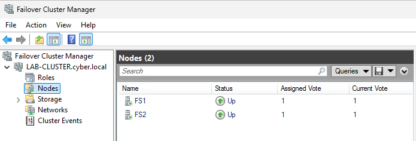

# 01 — Założenia i architektura

[← README](../README.md) | [Następny →](02-truenas-iscsi.md)

## Cel

Zbudować odporny na awarię **jednego węzła Windows Server** klastrowy serwer plików (traditional File Server for general use) z Active Directory, współdzielonym storage przez iSCSI i dostępem SMB pod niezmienną nazwą.

## Elementy i ich role

| Komponent | Funkcja | Dlaczego potrzebny |
|---|---|---|
| LAB-DC1 / AD DS + DNS | Tożsamość, nazwy DNS, obiekty komputerów klastra i roli | Klienci używają nazwy, nie nazwy węzła |
| FS1 / FS2 | Węzły Windows Server 2025 | Przejmują rolę po awarii peer-a |
| LAB-CLUSTER `10.1.201.223` | Administrative cluster access point (CNO) | Zarządzanie klastrem |
| LAB-FILES `10.1.201.224` | Client access point (VCO) | Stała ścieżka `\\LAB-FILES\DANE` |
| TrueNAS `10.1.201.230` | iSCSI Target | Wspólne urządzenia blokowe |
| LUN 0 / 30 GiB | Dane NTFS | Klaster przełącza własność dysku |
| LUN 1 / 1 GiB | Disk Witness | Dodatkowy głos w quorum |

> **Przykład:** użytkownik otwiera `\\LAB-FILES\DANE\raport.txt`. Nie musi wiedzieć, czy zasób obsługuje FS1 czy FS2. Podczas przełączenia możliwa jest krótka przerwa w dostępie.

## Pojęcia

- **Pool (ZFS)**: przestrzeń magazynowa TrueNAS, z której tworzy się zasoby.
- **Zvol**: urządzenie blokowe w ZFS, a nie udział plikowy SMB.
- **Extent**: urządzenie lub plik udostępniany przez konfigurację iSCSI.
- **Target**: endpoint iSCSI, do którego logują się inicjatory Windows.
- **LUN**: logicznie numerowane urządzenie blokowe prezentowane przez Target.
- **Quorum**: mechanizm ustalający, która część klastra ma prawo kontynuować pracę; **Disk Witness** to jeden z możliwych głosów.
- **SCSI-3 Persistent Reservations**: mechanizm koordynacji dostępu do wspólnego dysku; musi przejść walidację dla wykorzystywanego storage.
- **Active/Passive**: jedna instancja roli File Server obsługiwana w danej chwili przez jeden węzeł; drugi gotowy do przejęcia.

## Założenia labu

- Wszystkie adresy są w podsieci `10.1.201.0/24`. IP klastra i roli muszą być wolne, poza kolizjami z DHCP.
- Węzły są członkami `cyber.local`; DNS i AD dostępne; zegary poprawne.
- Jeden NIC na węzeł (ostrzeżenie walidacji o pojedynczej ścieżce komunikacji).
- Oba serwery iSCSI widzą wspólne dyski, lecz tylko klaster koordynuje dostęp do współdzielonego woluminu.

