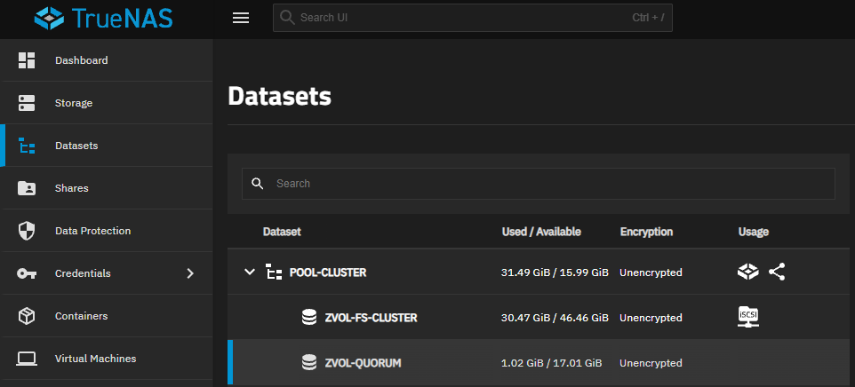
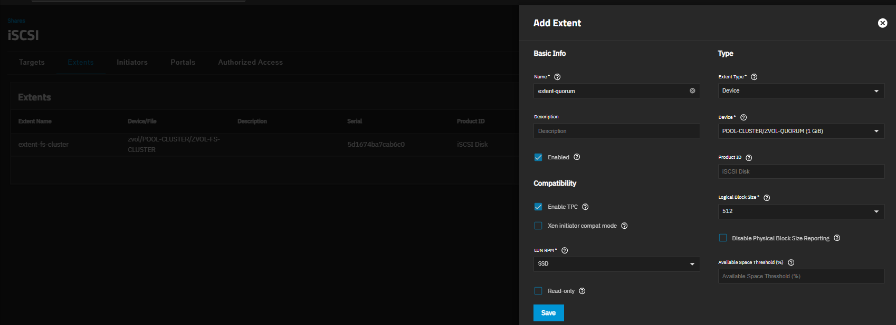
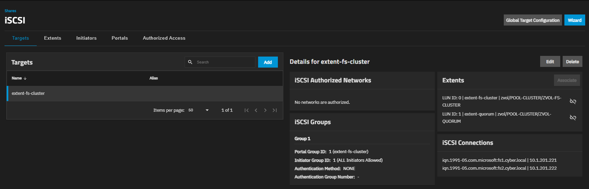
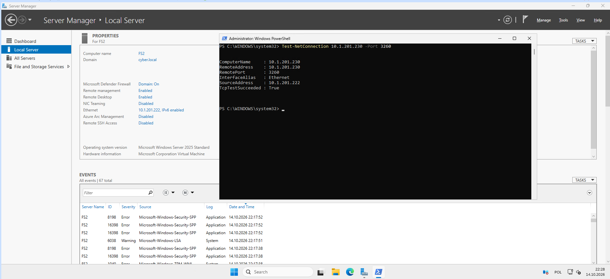

# 02 — TrueNAS SCALE: ZFS, Zvol i iSCSI

[← Poprzedni](01-architektura.md) | [README](../README.md) | [Następny →](03-windows-walidacja.md)

## 1. ZFS i dwa Zvol

Na TrueNAS `10.1.201.230` istniała pula `POOL-CLUSTER`.

| Zvol | Rozmiar logiczny | Zastosowanie |
|---|---:|---|
| `POOL-CLUSTER/ZVOL-FS-CLUSTER` | 30 GiB | Pliki SMB |
| `POOL-CLUSTER/ZVOL-QUORUM` | 1 GiB | Świadek quorum |

W GUI: **Datasets → POOL-CLUSTER → Add Zvol**. Ustaw nazwę i pojemność. `Used/Available` w ZFS nie jest tożsame z logicznym rozmiarem Zvol (rezerwacje, narzut i kompresja mogą zmieniać liczby).



## 2. Extent

W **Shares → iSCSI → Extents** dodano `extent-quorum`:

- **Extent Type:** Device
- **Device:** `POOL-CLUSTER/ZVOL-QUORUM`
- **Logical Block Size:** `512`
- **Enabled:** tak; **Read-only:** nie
- **Enable TPC:** w labie pozostawiono domyślne zaznaczenie

Zvol 30 GiB miał istniejący `extent-fs-cluster`.



## 3. Target i LUN

W **Shares → iSCSI → Targets** istniejący Target `extent-fs-cluster` udostępniał LUN 0. W sekcji **Extents → Associate** powiązano:

| LUN ID | Extent |
|---|---|
| 0 | `extent-fs-cluster` |
| 1 | `extent-quorum` |

Oba LUN-y były dostępne poprzez jeden Target (IQN Windows: `iqn.2005-10.org.freenas.ctl:extent-fs-cluster`). W TrueNAS widać połączenia `fs1.cyber.local` i `fs2.cyber.local`.



> Nie odłączaj LUN 0 podczas pracy klastra. Modyfikacje działającego Targetu wymagają planowania — utrata iSCSI może zatrzymać rolę File Server i/lub quorum.

## 4. Dostęp sieciowy

Z obu węzłów testowano port TCP 3260:

```powershell
Test-NetConnection 10.1.201.230 -Port 3260
```

FS2 początkowo zwracał `DestinationHostUnreachable`, a po poprawieniu łączności uzyskano `TcpTestSucceeded : True`. Ten wynik potwierdza dostęp do usługi TCP; nie zastępuje testu prezentacji LUN, ani testu współpracy z klastrem.



## 5. Wskazówka produkcyjna

W laboratorium Target udostępniano przez prostą konfigurację inicjatorów. W produkcji stosuj odrębną sieć/storage VLAN, ograniczenia inicjatorów i adresów źródłowych, CHAP jeśli wymagany oraz wielościeżkowość (MPIO) przy odpowiednio redundantnym sprzęcie. To nie jest kompletna procedura zabezpieczenia produkcyjnego iSCSI.
