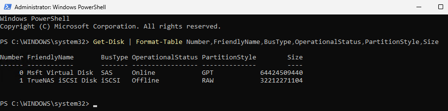
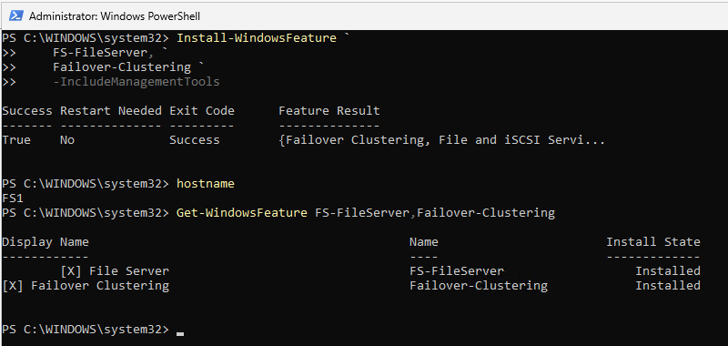
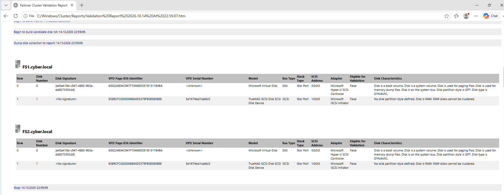
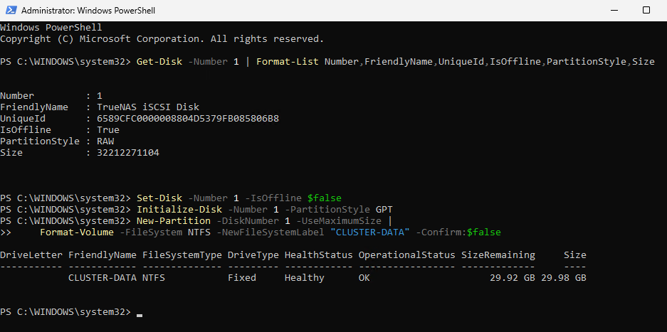
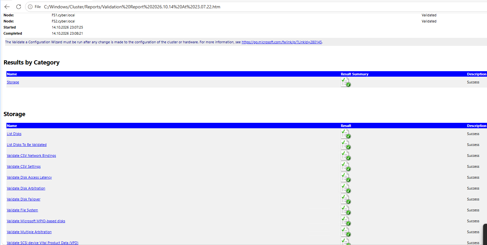

# 03 — Windows Server 2025: iSCSI, role i walidacja

[← Poprzedni](02-truenas-iscsi.md) | [README](../README.md) | [Następny →](04-klaster-quorum.md)

## 1. Inicjator iSCSI

Na obu VM: **Server Manager → Tools → iSCSI Initiator → Discovery → Discover Portal** `10.1.201.230:3260`, następnie **Targets → Connect** i autoodtwarzanie sesji po restarcie (Favorite Targets). W zakładce `Targets` potwierdzono `Connected`.

```powershell
Get-IscsiSession
Get-Disk | Format-Table Number,FriendlyName,BusType,IsOffline,PartitionStyle,Size
```

Początkowo obydwa węzły widziały wspólny `TrueNAS iSCSI Disk` jako `RAW / Offline`, około 30 GiB. Dyski nie mogą być niezależnie formatowane na dwóch węzłach.



## 2. Instalacja ról

Na FS1 przez PowerShell, a na FS2 przez GUI (**Add Roles and Features**):

```powershell
Install-WindowsFeature FS-FileServer,Failover-Clustering -IncludeManagementTools
Get-WindowsFeature FS-FileServer,Failover-Clustering
```

Oba węzły zgłaszały `Installed`.



## 3. Pierwsza walidacja: dlaczego Storage było Not Applicable?

```powershell
Test-Cluster -Node FS1,FS2
```

Pierwszy raport wykazał:

- **Network: Warning** — FS1 i FS2 skomunikowane tylko jedną parą interfejsów, bez redundantnej ścieżki.
- **Storage: Not Applicable** — dysk iSCSI istniał, ale nie nadawał się do testu jako `RAW`.
- Szczegóły: `No disk partition style defined. Disk is RAW. RAW disks cannot be clustered.`



**Lekcja:** ten komunikat wyjaśniał brak testów storage; nie dowodził problemu z TrueNAS ani SCSI-3 PR. Przed wydaniem opinii zawsze przejrzyj **szczegóły raportu**.

## 4. Inicjalizacja dysku danych na jednym węźle

> Poniższe komendy są **destrukcyjne dla istniejącej zawartości wybranego dysku**. Wykonano je na nowym, pustym LUN 30 GiB, po potwierdzeniu identyfikatora i rozmiaru. Numery dysków to wartości z tego konkretnego laboratorium.

Na FS1 (na FS2 dysk pozostaje Offline):

```powershell
Get-Disk -Number 1 | Format-List Number,FriendlyName,UniqueId,IsOffline,PartitionStyle,Size
Set-Disk -Number 1 -IsOffline $false
Initialize-Disk -Number 1 -PartitionStyle GPT
New-Partition -DiskNumber 1 -UseMaximumSize |
    Format-Volume -FileSystem NTFS -NewFileSystemLabel 'CLUSTER-DATA' -Confirm:$false
```

Na FS2 **bez ponownej inicjalizacji**:

```powershell
Update-HostStorageCache
Get-Disk -Number 1
```



## 5. Ponowna walidacja

```powershell
Test-Cluster -Node FS1,FS2 -Include Storage
```

Potem pełna walidacja. Sprawdzono: `List Disks`, `Validate Disk Arbitration`, `Validate Disk Failover`, `Validate File System`, `Validate Disk Access Latency`, inne testy storage; wyniki widoczne jako **Success**. Jeżeli raport pokazuje `Not Applicable`, sprawdź powód i dyski uwzględnione w testach.



### Jak otworzyć ostatni raport

```powershell
Get-ChildItem 'C:\Windows\Cluster\Reports\*.htm' |
    Sort-Object LastWriteTime -Descending |
    Select-Object -First 1 |
    ForEach-Object { Invoke-Item $_.FullName }
```

`Test-Cluster` zwraca nazwę pliku raportu, ale `Invoke-Item '.\nazwa.htm'` nie znajdzie pliku, gdy bieżącą lokalizacją jest `C:\Windows\System32`.

## 6. Wnioski z walidacji sieci

Test komunikacji (UDP 3343) wykazał **0% packet loss**, lecz tylko jedną parę interfejsów FS1 ↔ FS2. Dla prywatnego labu ostrzeżenie świadomie zaakceptowano; na produkcji wymaga zaprojektowania redundantnych ścieżek.
