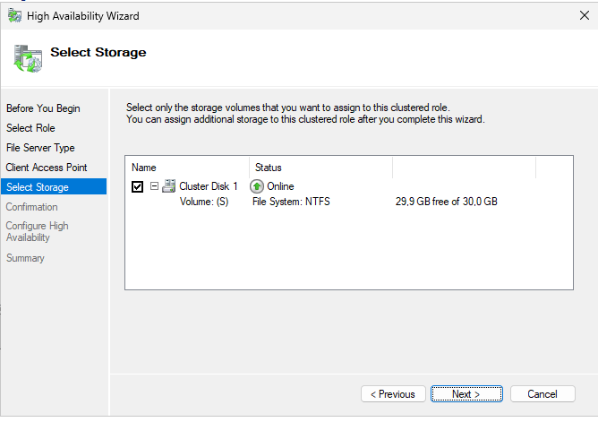
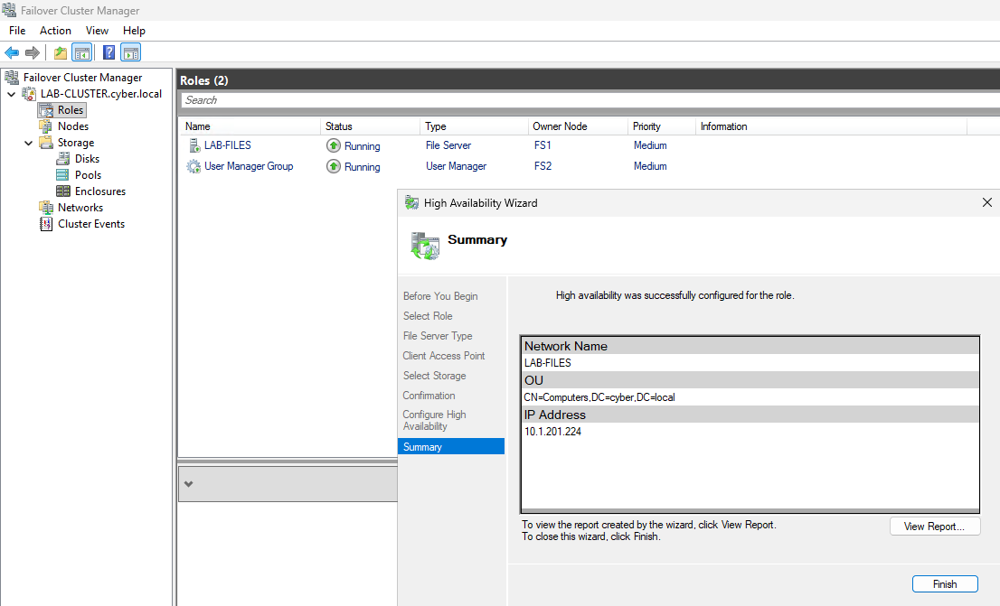
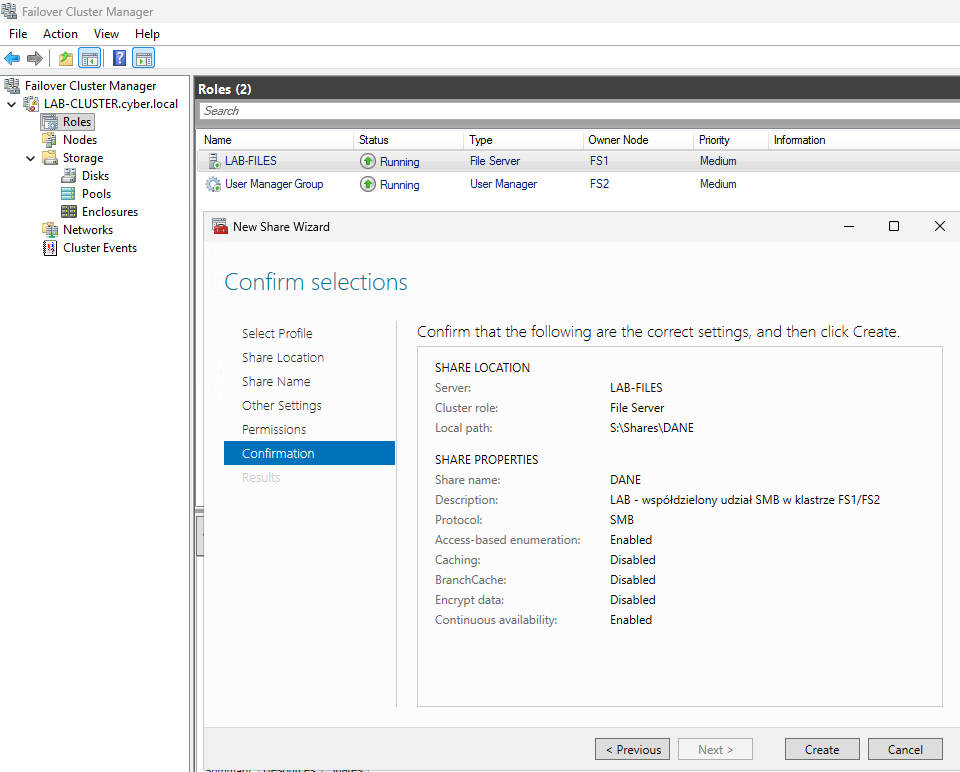
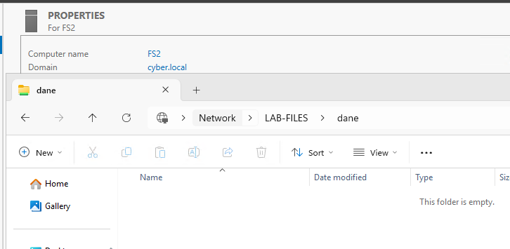

# 05 — LAB-FILES: rola klastrowa i udział SMB

[← Poprzedni](04-klaster-quorum.md) | [README](../README.md) | [Następny →](06-testy-failover.md)

## 1. Przygotowanie woluminu danych

W **Failover Cluster Manager → Roles → Configure Role → File Server → File Server for general use** wybrano `Cluster Disk 1` (30 GiB). Kreator zgłosił `At least one disk needs to have a drive letter` — NTFS istniał, ale bez litery.

Na węźle będącym aktualnie właścicielem `Cluster Disk 1`:

```powershell
Get-ClusterOwnerNode -Resource 'Cluster Disk 1'
Get-Partition -DiskNumber 1
# Po sprawdzeniu, że jest to właściwa partycja NTFS oraz S: jest wolne:
Get-Partition -DiskNumber 1 |
    Where-Object { $_.Type -eq 'Basic' } |
    Set-Partition -NewDriveLetter S
```

> Numery dysków mogą różnić się między maszynami. Nie przypisuj litery przez numer bez potwierdzenia ID i właściciela zasobu klastrowego.



## 2. Rola File Server

Dla `File Server for general use` ustawiono:

- Server Name: `LAB-FILES`
- IP: `10.1.201.224`
- Storage: `Cluster Disk 1` z woluminem NTFS `S:`

Kreator zgłosił sukces, a węzeł FS1 początkowo był właścicielem roli.



## 3. Tworzenie SMB Share

W **Roles → LAB-FILES → Add File Share** wybrano SMB Share (Quick):

| Właściwość | Wartość |
|---|---|
| Share Name | `DANE` |
| Local Path | `S:\Shares\DANE` |
| UNC | `\\LAB-FILES\DANE` |
| Access Based Enumeration | Enabled |
| Caching | Disabled |
| BranchCache | Disabled |
| Encrypt Data | Disabled (testowy VLAN) |
| Continuous Availability | Enabled |



### Prawa dostępu — zalecenie

W tym przebiegu nie zachowano zrzutu zawartości karty **Permissions**, dlatego dokumentacja **nie twierdzi**, że konkretne grupy i ACL zostały wdrożone. Przed produkcyjnym użyciem zweryfikuj uprawnienia udziału oraz NTFS osobno:

```powershell
# Na aktualnym właścicielu LAB-FILES:
Get-SmbShare -Name DANE
Get-SmbShareAccess -Name DANE
Get-Acl 'S:\Shares\DANE' | Format-List
```

Przykładowy model: domenowa grupa `LAB-SMB-DANE-RW` z `Change` na share i `Modify` na NTFS, administratorzy z pełną kontrolą, brak `Everyone: Full Control` w ACL NTFS. Uprawnienia efektywne wynikają z kombinacji SMB i NTFS.

## 4. Weryfikacja z klienta

Na `LAB-W11-1` otwarto `\\LAB-FILES\DANE`, utworzono pliki testowe i po zmianie właściciela roli nadal były dostępne do odczytu/zapisu.



> Funkcja Continuous Availability może wspomagać przełączenia i zachowanie uchwytów SMB, ale samo otwarcie pliku **po** awarii nie potwierdza zachowania operacji I/O w trakcie failover.
