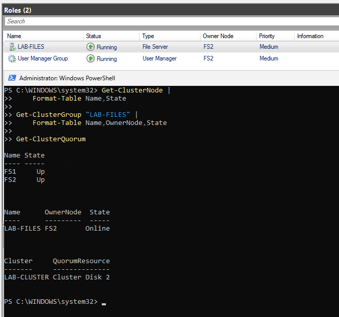
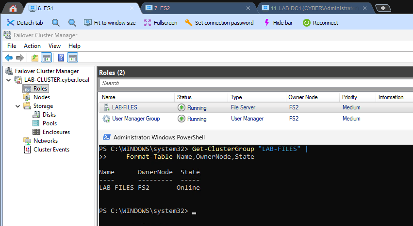
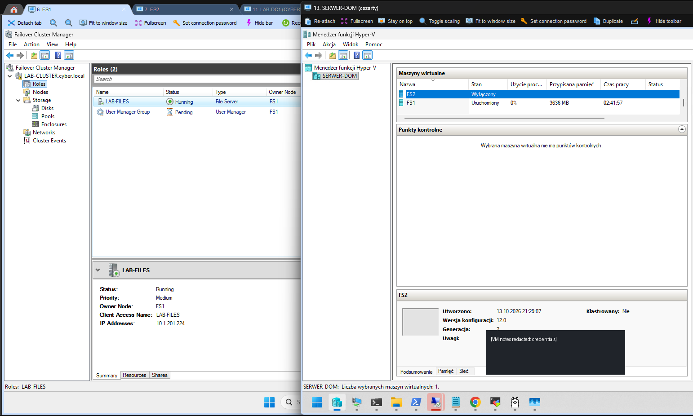
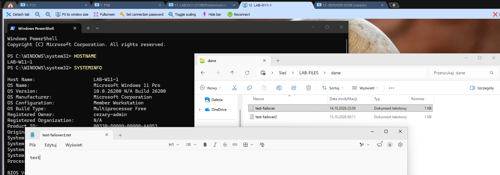
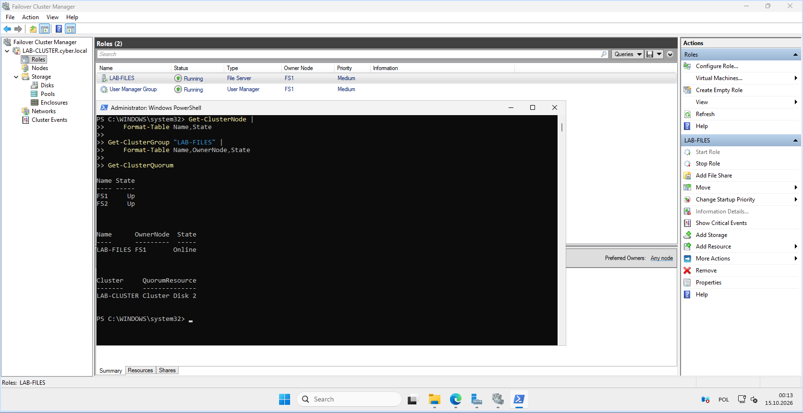

# 06 — Testy HA: kontrolowane przełączenie, awaria i powrót

[← Poprzedni](05-file-server-smb.md) | [README](../README.md) | [Następny →](07-diagnostyka-i-wnioski.md)

## Kryteria PASS

- Węzły `FS1` i `FS2`: `Up` przed testem.
- `LAB-FILES` działa `Online` na FS2 przed testem awarii.
- `Cluster Disk 2` jest Disk Witness.
- Po nagłym wyłączeniu FS2: `FS2 = Down`, `LAB-FILES = FS1 / Online`.
- Klient Windows 11 może ponownie otworzyć udział SMB i zapisać plik.
- Po uruchomieniu FS2: oba węzły `Up`, rola może zostać na FS1.

## 1. Baseline

```powershell
Get-ClusterNode | Format-Table Name,State
Get-ClusterGroup 'LAB-FILES' | Format-Table Name,OwnerNode,State
Get-ClusterQuorum
```

Stan przed wyłączeniem: `FS1 Up`, `FS2 Up`, rola `LAB-FILES` na `FS2`, witness `Cluster Disk 2`.



## 2. Test planowanego przełączenia

**Failover Cluster Manager → Roles → LAB-FILES → Move → Select Node**: FS1 → FS2. Po zmianie właścicielem był `FS2`, a udział sieciowy nadal działał.



## 3. Nieplanowana awaria VM

Na `LAB-W11-1` warto było uruchomić prosty, obserwacyjny test SMB:

```powershell
while ($true) {
    $stamp = Get-Date -Format 'HH:mm:ss'
    $ok = Test-Path '\\LAB-FILES\DANE'
    Write-Host "$stamp | SMB available: $ok"
    Start-Sleep -Seconds 1
}
```

> Ten polling nie jest precyzyjnym pomiarem RTO i nie sprawdza utrzymania otwartych uchwytów plikowych. W pokazanych dowodach nie zarejestrowano przebiegu pętli ani czasu niedostępności.

Następnie w Hyper-V Manager na hoście `SERVER-DOM` dla maszyny **FS2** wybrano **Wyłącz (Turn Off)**, a nie **Zamknij (Shut Down)**. To nagłe odcięcie zasilania wirtualnej maszyny. Test dotyczył wyłącznie prywatnego środowiska i plików demonstracyjnych.



## 4. Co zrobił klaster

Na FS1:

```powershell
Get-ClusterNode | Format-Table Name,State
Get-ClusterGroup 'LAB-FILES' | Format-Table Name,OwnerNode,State
```

Wynik widoczny na dowodzie:

```text
FS1 Up
FS2 Down
LAB-FILES FS1 Online
```


Na Windows 11 udział `\\LAB-FILES\DANE` działał ponownie; użytkownik otwierał pliki i testował edycję.



## 5. Powrót FS2

Maszynę FS2 uruchomiono w Hyper-V. Na FS1 ponowiono sprawdzenie węzłów i roli:

```text
FS1 Up
FS2 Up
LAB-FILES FS1 Online
QuorumResource Cluster Disk 2
```

Powrót FS2 **nie spowodował automatycznego cofnięcia usługi na ten węzeł** — jest to prawidłowe zachowanie, o ile nie skonfigurowano polityki automatycznego failback.



## Macierz testów

| Przypadek | Wynik | Dowód / ograniczenie |
|---|---|---|
| Planned failover FS1 → FS2 | PASS | GUI i `Get-ClusterGroup` |
| Unplanned failure FS2 | PASS | Hyper-V VM Off; node Down |
| Auto failover to FS1 | PASS | `LAB-FILES FS1 Online` |
| SMB accessible after failover | PASS | Windows 11, pliki testowe |
| FS2 rejoins | PASS | `FS1 Up`, `FS2 Up` |
| RTO / RPO liczbowo | NOT MEASURED | Brak precyzyjnej telemetrii |
| Otwarty uchwyt przy zerwaniu | NOT TESTED | Osobny test ciągłego zapisu wymagany |
| Awaria TrueNAS | NOT TESTED | Single point of failure |
| Awaria całego hosta Hyper-V | NOT TESTED | Jeden host ma oba węzły |
